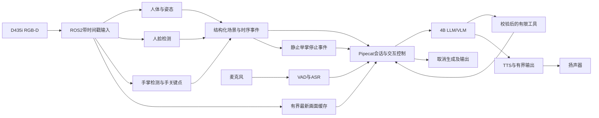

# 项目二：面向陪伴机器人的 Jetson 端侧多模型部署与资源调度

> 版本：v2.0，2026-10-14；依据用户最新目标及公开岗位JD重设计。
> 目标岗位：端侧模型部署、嵌入式AI推理、机器人推理系统与性能优化。
> 平台：Orin NX 16GB；主模型暂定Qwen3.5-4B Q4_K_M；首版使用llama.cpp。
> 当前执行状态：实施Goal保持暂停。本次完成计划重设计与既有证据整理，不自动启动新开发或性能实验。
> 核心约束：复用成熟开源框架；保留references/及已有数据；长期记忆后置；无身份验证、SO-101或实体执行器。

## 0 当前交付阶段调整（2026-10-14）

### 0.1 最终目标

在单台Orin NX 16GB上，基于成熟推理后端和机器人/音视频框架，交付一套**数据流正确、资源有界、运行可观测、异常可恢复、性能可测量与改进的端侧多模型部署服务**。

用陪伴机器人作为持续混合负载：人体、人脸和手部感知持续运行，语音经ASR进入4B主模型，再经TTS实际播放；挥手触发问候，静止举掌触发当前轮次取消。最终给出模型部署与精度证据、多模型调度对照、系统瓶颈分析、可靠性验证及可复现交付，支撑端侧部署岗位面试。

这一目标有两个交付节点：

| 节点 | 定义 | 完成范围 |
|---|---|---|
| A：软件基础版本 | 当前优先目标，先打通并夯实系统 | 正确的真实模型调用链、取消与状态一致性、有限资源、故障恢复、可运行入口；性能只诊断，不以旧百分比门槛卡住 |
| B：端侧部署作品集版本 | 面向目标岗位的项目最终交付 | 在A基础上完成部署/精度案例、完整性能基线、资源策略优化、真机演示、长时验证和复现材料 |
| 后续产品扩展 | 当前A/B之外的独立阶段 | 长期记忆质量与容量、身份无关的更多个性化功能；已有实现保留，恢复时另建验收 |

A完成不能声明B完成。长期记忆仍属于完整产品愿景，但不再阻塞本轮端侧部署项目A/B交付。旧J0–J7/JT-01～13保留在[历史计划](docs/archive/02-plan-v1.3-20261014.md)，不改写历史失败或把延期算作通过。

### 0.2 用户已确认的行为

- 人体、人脸、手掌/手指由小模型提供结构化感知；人脸只检测与定位。
- 主模型先固定为Qwen3.5-4B，不继续进行无边界模型筛选。
- 左右挥手触发一次问候；静止举掌并保持片刻触发停止。运动中的张掌不能同时被当作停止。
- 停止取消当前整轮生成和播报，并阻止尚未开始的工具；已完成笔记/提醒保留。已进入不可撤销持久事务的操作必须报告实际结果。
- 当前会话、笔记、提醒保留；长期记忆专项延期。
- 性能优化在软件基础之后开展；最终作品集必须有可信的性能证据。
- ReSpeaker Lite双麦及扬声器尚未连接。实物录播、AEC和声学打断必须单列，文件音频不能替代。

## 1 目标岗位JD与能力映射

检索日期为2026-10-14。用户未指定单一公司/级别，本计划取相关岗位的能力交集，不声称已经匹配某个实际HC的学历、年限或招聘状态。职位页面存在不代表仍有名额；正式投递前重新核对。

| 来源 | 岗位与层级 | 用于本项目的能力信号 |
|---|---|---|
| [蔚来官方招聘，A97595](https://nio.jobs.feishu.cn/campus/position/7687434450226317604/detail) | AI模型部署与性能优化；2027校招，页面列硕士要求 | 部署兼容/精度、计算与访存剖析、量化、多模型稳定性及案例文档 |
| [京东探索研究院](https://research.joyai.com/career/embodied-model-inference-deployment-engineer) | 具身模型推理部署；社招/校招/实习 | 机器人多模态推理链、资源优化、Linux/ROS工程、监控与失败分析 |
| [双深科技官方招聘](https://www.attrsense.com/careers/model-deploy) | AI模型部署；社招 | 硬件适配、模型转换和精度、C++/Python/CMake、并行与工程工具 |
| [西图官方招聘](https://myxitu.ai/zh/careers/) | AI模型部署与优化；页面列5年以上经验 | 端侧模型服务、优化、自动化benchmark，以及较深的C++/Linux能力 |

蔚来和京东岗位正文通过官方域名的搜索索引读取，动态页面解析未返回正文；双深和西图正文可直接读取。来源、可见性与需求映射见[JD清单](benchmarks/manifests/target-jd-20261014.json)。不采用聚合站无法核验的要求，也不把高级岗位全部职责硬塞入本项目。

| 能力ID | 核心能力 | 项目必须形成的证据 | 优先级 |
|---|---|---|---|
| C1 | 模型落地与精度一致性 | checkpoint→ONNX/GGUF→实际后端，预后处理/布局/shape/精度说明，逐项回归 | 必做 |
| C2 | C++/Python/Linux工程 | 一个实质性的原生部署或数据路径组件/补丁，构建、生命周期、调试与回归证据 | 必做 |
| C3 | 多模型数据流与运行时 | 有界接口、依赖、轮次/时间戳/epoch、取消、背压与丢弃策略 | 必做 |
| C4 | 板载资源与并发 | 统一内存账本、线程与队列预算、准入/频率策略、共存干扰矩阵 | 必做 |
| C5 | Debug与Profiling | 排队/预处理/拷贝/推理/输出拆分，CPU/GPU trace和可复现根因 | 必做 |
| C6 | 性能实验与权衡 | 单模型/串行/直接并发/优化组对照，延迟、时效、吞吐、质量、资源共同报告 | 必做 |
| C7 | 可运行交付与故障恢复 | 清单、自检、日志、离线、重部署、故障和长时记录 | 必做 |
| C8 | 算子/编译器深度 | 有实际热点时做一个受限C++/CUDA或图优化案例；无热点则保留负面结论 | 进阶 |
| C9 | 跨平台迁移 | 与RK项目共享契约、分别验证；两端真实证据齐全后才能写入简历 | 可选 |

本项目主要匹配部署与推理系统方向。源码编译、配置TensorRT、使用CUDA后端本身，不构成“自研推理引擎/编译器/高性能算子”的证据。

## 2 已有资产、缺口与本轮复用

下表是局部证据，不是完整验收结果。新增人脸/手部模型和切换4B后，需要重建当前配置的整机基线。

| 已有资产 | 可复用内容 | 当前缺口 |
|---|---|---|
| [4B默认服务切换](benchmarks/results/qwen35-main-activation.json) | 锁定权重、原生模板、真实端口与服务归属 | 当前4B配置的完整数据流、资源与故障验证 |
| [8轮集成复测](benchmarks/results/phase-one-qwen35-main-serial.json) | 文字/文件语音、工具、蓝色图像、提醒输出 | 真实人脸/手部输入和实物声音 |
| [工具批量调用修复](benchmarks/results/qwen35-serial-tool-comparison.json) | 原始失败、幂等结果、串行工具策略及42项相关回归 | 更广的迟到回调、取消和异常组合 |
| [COCO5000回归](benchmarks/results/vision-quality-coco-preserved.json) | 检测/姿态部署一致性，关键点发布层根因修复 | 新的人脸/手关键点参考对照、实际场景 |
| [GPU执行追踪](benchmarks/results/jt02-pose-preserved-audit.json) | 原3B配置下实际GPU工作与请求竞争的审计方法 | 不能直接继承为当前4B及新增模型的通过结果 |
| ROS录制/回放与数据epoch | 原生rosbag2/MCAP、暂停/跳转/断流处理 | 真实场次录制、音频/事件统一时间轴与公开入口 |
| systemd后端管理 | 启停、自检、端口归属、日志和有限恢复 | 完整助手进程的监督、全路径重部署/离线 |
| Mem0/Qdrant/BGE | 保留源码、数据和历史证据 | 退出主实验依赖需显式功能开关及数据保留验证，不能直接停库造成空查询 |

当前环境记录为Ubuntu24.04、aarch64、L4T39.2.1、CUDA13.2、TensorRT10.16.x、ROS2 Jazzy；准确包版本、功耗档、时钟与散热按实际实验manifest读取。D435i后续已在USB3链路完成采样，旧USB2记录仅为历史。不得因网上最新版文档而直接升级本机已锁定依赖。

外部源码/模型/环境继续统一放在[AI_Stack目录](deploy/dependencies-layout.md)。仓库保存业务接入、局部补丁、锁文件、复现工具和脱敏报告。

## 3 开源组件选择与固定版本

| 层次 | 当前方案 | 实施边界 |
|---|---|---|
| 交互与生命周期 | Pipecat1.12原生Pipeline/Worker、帧流及工具回调 | 扩展processor/adapter，沿用框架控制和清理；不另写主控框架 |
| 传感器/持续视觉 | ROS2 Jazzy、realsense-ros、yolo_ros | 沿用消息、节点、时间戳和QoS；清晰区分实时/回放 |
| 主模型 | llama.cpp CUDA，Qwen3.5-4B Q4_K_M，匹配F16投影 | 单实例、单活跃请求、非thinking；现为2K上下文/128输出，变更必须版本化 |
| 人体/姿态 | YOLOv8n、YOLOv8n-pose，ORT TensorRT EP | 沿用当前已验证精度，输出人体/姿态；身体17点不能冒充手指识别 |
| 人脸候选 | OpenCV Zoo YuNet | 成熟候选，尚未本机验证；只检测和定位，不建人脸身份库 |
| 手掌/手指候选 | OpenCV Zoo MediaPipe Palm + HandPose | 原有ONNX及预后处理作参考；21点支撑张掌与运动状态 |
| 语音 | Silero VAD、OVS接口、Qwen3-ASR0.6B、Matcha/Vocos | ASR实际为llama.cpp CUDA音频后端；TTS实际为本机TensorRT engine |
| 交互规则/工具 | Pipecat插件、APScheduler/SQLite | 手势时序、取消、静音、笔记、提醒；状态由真实执行回执驱动 |
| 服务管理/测量 | systemd、现有CLI、Nsight Systems、NVTX、perf、系统采样 | 不引入新的大规模服务平台，仅补足必要控制和观测 |
| 后置能力 | Mem0/Qdrant；Edge-LLM对照 | 长期记忆另阶段；Edge-LLM仅在软件/性能基线冻结后做单独实验 |

新视觉模型的源码/许可证依据：[YuNet](https://raw.githubusercontent.com/opencv/opencv_zoo/main/models/face_detection_yunet/README.md)、[Palm](https://raw.githubusercontent.com/opencv/opencv_zoo/main/models/palm_detection_mediapipe/README.md)、[HandPose](https://raw.githubusercontent.com/opencv/opencv_zoo/main/models/handpose_estimation_mediapipe/README.md)。YuNet目录为MIT，后两者为Apache2；使用时仍需固定commit、实际权重、license文件和SHA256。YuNet新旧ONNX的动态shape支持有差异，须与实际OpenCV/ORT版本匹配。HandPose上游明确提示INT8可能出现明显精度问题，初次接入保持参考精度。

先通过上游参考路径验证新视觉输出，再复用现有ORT/CUDA/TensorRT后端适配。每个节点报告实际provider和回退；不为使“全GPU”表面成立而隐藏CPU回退。候选不兼容时最多做有明确原因的替换，记录旧失败。

### 3.1 C++深度落实

以现有C++视觉评估/ROS回放及yolo_ros集成为起点，选取一个实际部署路径完成原生适配或优化，例如新视觉模型的预后处理与结果发布、输入缓冲复用、后端资源生命周期。

要求提交可归属的代码/补丁、CMake构建、RAII/线程与缓冲所有权说明、异常路径及数值回归，并用gdb/ASan或相应原生调试工具验证适用路径。GPU内存与异步执行另用对应工具验证。不为了简历把Python业务编排整体重写成C++；若组件只用于评测，简历应明确为评测工具。

## 4 目标系统结构与数据流

- 持续视觉产生结构化结果，不把每帧都送给VLM；图像请求取与提问关联的有效画面。
- 语音和感知可以独立到达。无人脸时不凭空引入身份门控；多人时保留匿名track与来源，不自动推断主人。
- 身体、脸、手是不同结果类别，可在同一人身上同时存在。不能以“检测到人”替代脸和手模型已工作。
- 视线、年龄、情绪、身份识别不属于当前范围。
- 停止事件走确定性的控制路径，不等待LLM解释手势含义。
- 波动/遮挡/追踪重建必须重新积累手势证据。挥动与静止举掌互斥；保持时长、冷却与运动阈值在开发片段确定并锁定。
- 当前先支持一个活跃会话；多人同时做动作时，任何有效停止事件可取消当前轮次，问候按事件去重与会话占用策略处理。该匿名多人规则属于可配置的初始工程默认，真实场景验证后说明局限。

### 4.1 数据契约

沿用现有框架帧和ROS消息，在adapter边界统一必要元数据；不新增独立RPC/消息框架。

| 数据类别 | 必须携带/约束 |
|---|---|
| 公共元数据 | schema_version、source、frame/request/turn ID、source_epoch、原始时间、单调时间、deadline、输入模式 |
| 图像/深度 | 编码、宽高、stride、坐标系、对齐关系、缓冲owner与lease；每次变换有可追踪定义 |
| 感知结果 | 对应输入frame ID、模型/工件版本、推理起止、类别、置信度、坐标及关键点定义 |
| 手势事件 | event ID、匿名track、开始/确认时刻、有效期、wave/stop类别、证据窗口 |
| 语音轮次 | utterance/turn ID、VAD时刻、最终转写、取消代次；迟到ASR不能进入新轮次 |
| 模型/工具输出 | 请求归属、实际用量、工具幂等键、执行/持久回执、取消后的可接受结果 |
| 播放输出 | 入队、首PCM、实际播放开始/排空、停止、输出通道；WAV与实体播放严格分开 |

重要行为：旧epoch或过期数据拒绝；同一frame不能跨轮次误用；队列满时行为明确；逻辑取消后等待真实资源释放；已开始的持久操作不宣称虚假回滚；传输和provider超时不等于进程已退出。

## 5 资源预算与调度设计

### 5.1 先建立真实资源账本

按模型记录：工件大小、加载常驻、KV/工作区、预后处理缓冲、峰值、线程池、实际provider、输入shape、首次/稳态耗时。按整机记录MemAvailable、进程PSS/RSS、CPU/EMC/GPU频率与负载、温度、功耗模式、磁盘及队列。

Orin的CPU/GPU共享板载系统内存。权重文件大小、进程RSS、设备分配和系统可用内存不能简单相加；共享映射避免重复累计。保存监控开销和采样周期。

### 5.2 初始策略与实现位置

| 负载 | 初始策略 | 真正生效的位置 |
|---|---|---|
| 停止/故障控制 | 最高控制优先级，不被推理或图像转换阻塞 | Pipecat控制帧、线程/任务隔离、结果接纳检查 |
| 麦克风采集/VAD/播放 | 连续服务、有界缓冲 | 实际音频transport及输出队列 |
| ASR/LLM/TTS | 按依赖提交；LLM单slot；超时及取消可追踪 | 服务adapter与后端接口 |
| 人体/脸/手感知 | 每路有界，优先最新待处理帧，持续服务 | ROS订阅QoS、原生节点待处理队列与推理提交点 |
| 问候/到期提醒 | 去重、有效期、会话占用和静音策略 | 事件消费者与持久通知回执 |
| 后台维护/评估 | 不与正式测量争抢；有明确运行边界 | 现有生命周期管理和实验排他机制 |

软件准入/频率限制不等于GPU硬抢占或固定SM配额。Python进程内semaphore不能约束其他ROS/模型进程，跨进程策略必须在实际提交点落实并用trace证明。先测频率、并发上限和提交策略，再考虑更复杂机制。

现有2K上下文、128输出、VLM/ASR提示缓存256/64MiB作为起始配置，不当作永久最优参数。视觉缓存128MiB为历史实现上限，新的人脸/手链路要一并核算。具体频率、线程、队列容量及内存余量在M2固定为资源配置文件，不用只写“合理分配”。

长期记忆延期后，增加显式关闭功能的配置；保留数据并移除对应工具和不必要的索引加载。是否停止Qdrant必须在应用启动依赖解耦后验证。旧含记忆服务/检索的结果保留实际配置，不能混入新性能基线。

## 6 分阶段实施与交付

任务状态以[进度记录](benchmarks/manifests/progress.json)和[新路线任务清单](benchmarks/manifests/deployment-roadmap-v2.json)为准。下表文件为实施后应产生的交付物，除已链接现有文件外，不声称已存在。

| 阶段 | 具体工作 | 可审查交付物 | 离开条件 |
|---|---|---|---|
| M0 固定服务边界 | 整理4B默认入口；锁定软件/模型；更新CLI与服务清单；提供长期记忆关闭配置；建立问题台账 | 模型/环境清单、服务拓扑、配置说明、部署自检、已知问题 | 实际运行身份与配置一致；缺失/不兼容有明确失败；数据保留 |
| M1 完整交互与可靠性 | 接入脸/手参考模型；贯通wave/stop；统一感知/语音轮次；验证工具/取消/重启；接入实体音频 | 数据契约、真实场景演示、失败与修复回归、资源生命周期报告 | 软件基础A的SF-01～06逐项有证据；缺失实体音频时只交付A-software并标注差异 |
| M2 基线与瓶颈 | 固定场次和输入；单模型及共存测量；拆分时延；记录实际资源/功耗；定位热点；冻结SLO与质量容差 | 工作负载manifest、资源预算、B0/B1/B2、时间线、瓶颈报告、SLO | 输入、环境、口径、容差已固定；每个主瓶颈有观测依据 |
| M3 有依据的优化 | ≥3个单因素实验，覆盖调度/资源和数据/执行；完成量化或精度配置对照；选有收益方案合并复测 | B3、至少一个C++实质组件/补丁、优化报告、精度对照、失败实验 | 至少1项多模型资源策略产生可重复收益，满足已冻结质量/服务约束；至少2个完整工程案例 |
| M4 稳定交付 | 当前配置持续负载、故障注入、离线、重部署/回滚；实物体验复验 | 8h曲线、故障记录、部署说明、演示和验收表 | 通过本计划DP验收；未验证项和已知局限可追踪 |
| M5 求职成果 | 整理个人贡献、源码归属、两页技术说明、简历条目、面试复现材料 | 3条有依据简历描述、数据图、架构图、2～3个根因案例 | 每条描述能追溯代码/配置/输入/报告，能复现和解释 |

### 6.1 M0–M1优先任务

1. 固定已选择4B及原生工具策略，保留3B回退清单，复查公开interact/voice入口。
2. 以配置关闭长期记忆业务而保留笔记/提醒；确认关闭后不会继续返回“记忆保存成功”等误导回执。
3. 锁定人脸、手掌、手关键点的参考模型与代码，验证其预后处理、坐标变换及基础输出。
4. 通过现有ROS/ORT/OpenCV适配接入持续感知；结果有frame/epoch/model身份，退出时释放引用。
5. 完成wave与静止open-palm的互斥时序状态；停止调用现有整轮取消链，问候走受控TTS输出。
6. 固定一套公开演示入口：启动→健康→查看匿名场景→文字/语音指令→问候/停止→退出；不只依靠内部测试脚本。
7. 对各阶段超时、断流、后端退出、迟到回调和重复请求做定向验证，先复现再修复。
8. 实体音频到位后测录播/AEC/双讲；在此之前独立推进全部软件工作。

顺序依赖为M0→M1→M2→M3→M4→M5；模型单体回归、观测接入和文档可提前，不能在正式对照运行中改变代码、输入或配置。内存不足时采用构建/运行互斥，不在推理驻留时强行并行编译。

若只有音频外设缺失，A-software完成后可以先做M2/M3的资源、真实模型和回放实验；物理首播/停播SLO保持待测，不能据文件输出填值。M4的实物交互及最终DP-03/05仍须等待硬件并重新验证。

### 6.2 问题处理方法

问题台账至少包含：触发条件、最小复现、版本与输入、错误范围、原始日志/trace、根因、修改、回归及残余局限。区分模型能力不足、部署数值偏差、数据错配、资源竞争、软件生命周期错误和硬件缺失。功能已通、指标已测、实验达标、整机通过分别记录。

## 7 代表性场景与回放

| 场景 | 固定输入/事件 | 主要观测 |
|---|---|---|
| W0 空闲与启动 | 冷/热启动、无用户输入 | 加载、就绪、常驻、线程、退出 |
| W1 持续感知 | 同一RGB-D场次，人体/脸/手均启用 | 各路有效频率、最新结果年龄、无结果比例、丢弃 |
| W2 普通语音 | W1背景＋固定短指令到达时间 | VAD/ASR/排队/首token/首PCM/可听回复 |
| W3 图文语音 | W1背景＋需要当前画面的指令 | 图像选帧、编码、prefill、视觉干扰与回答 |
| W4 交互控制 | 生成/播报/工具前后分别注入wave、静止掌、语音打断 | 事件语义、停止、迟到结果、数据持久性 |
| W5 工具与提醒 | 创建/查询/取消/到期，包含占用和重启 | 幂等、真实回执、重复输出与排队 |
| W6 过载与故障 | 突发请求、慢消费者、相机/后端故障 | 拒绝/降级、队列界限、恢复、下一轮正确性 |
| W7 持续共存 | 按固定比例重复W1–W6，最终8h | 内存趋势、队列、温度/降频、错误与恢复 |

录制沿用rosbag2/MCAP，音频和事件带统一相对时间轴。各组相同初始笔记/提醒状态、输入到达时间及预热条件；不能等上一轮回答完才临时改变下一轮到达时间。真人现场演示和录制回放分别报告。相邻帧、同一录制场次不得跨开发和最终验证集合。

手势基础阶段使用带正/负标签的短片验证状态转换，包括挥动张掌、静止掌、握拳、遮挡、离场、多人、追踪重建。不能用合成关键点证明真实识别质量；后续冻结独立场次及误触发统计。

## 8 基线、实验与性能目标

### 8.1 四组配置

| 组别 | 含义 | 用途 |
|---|---|---|
| B0 | 每个实际模型/流水段单独测量 | 理解计算、预后处理、常驻和首次执行成本 |
| B1 | 完整链路，受限串行提交且缓冲有界 | 观察串行参考；采集/控制/播放仍能服务 |
| B2 | 完整链路，直接允许既有后端并发 | 作为工程优化的主要对照基线 |
| B3 | 与B2相同业务、模型和输入，加入经验证的资源/数据策略 | 验证实际收益与副作用 |

主要优化收益对比B3与B2；B1保留用于解释争用，不人为制造失效串行基线。模型更换、图片分辨率、量化精度和输出预算改变，单独列为产品配置实验，不能冒充纯调度加速。

### 8.2 单因素候选

| 候选 | 可改变的一项 | 应保持/同时报告 |
|---|---|---|
| E1 视觉待处理策略 | 有界FIFO与latest-frame | 同采集、模型、参考标签；统计丢弃、年龄和有效频率 |
| E2 准入/频率 | 推理在途上限或某路周期预算 | 固定到达序列；证明实际提交变化，关注前后台公平 |
| E3 数据路径 | 一个可定位的拷贝、布局转换或缓冲分配 | 输入像素/输出回归，所有权、取消和内存峰值 |
| E4 执行配置 | 线程池、绑核、受支持的stream/Graph其中一项 | 单因素，计量等待与运行；不得声称未知硬隔离 |
| E5 内存策略 | KV/主机缓存或工作区上限 | 同上下文和业务；命中、重算、尾延迟、峰值 |
| E6 精度对照 | 一个视觉模型的FP32/FP16或受支持PTQ | 校准/验证分离，完整精度、速度及部署兼容性 |

E6是独立部署权衡实验，精度确定后所有B组保持一致。主模型先保留用户选定4B；Edge-LLM另行对照时同样控制量化和模板差异，不作为M0/M1前置。DLA、MPS、零拷贝和硬件抢占仅在本机栈确实支持且有实际测量时纳入。

### 8.3 测量与判定

- 每个主要配置至少5轮完整场景；交互事件每配置累计至少100次。基础阶段的小样本只作功能检查。
- 报告P50/P95、样本数、错误/超时/拒绝/丢弃，P99样本不足时不作为稳定结论。
- 记录模型版本、精度、输入、输出长度、上下文、缓存状态、功耗/时钟、温度、后台服务、预热和测量开销。
- 分别报告排队、预处理、数据传递、实际推理、后处理与播放等待；不能把API提交时间当作GPU执行时间。
- 重型Nsight短trace用于根因，低开销监控用于正式延迟和长时结果。CUDA Graph整体区间及请求重叠，不等于SM同时执行。
- 同时检查质量与有效吞吐，不能靠少回答、更多拒绝、降低视觉服务或改变输入取得表面加速。
- 至少3个有依据的单因素实验；争取合并后仍有可重复收益。无收益/退化实验保留，不能拼接最佳单轮或相加单项提升。
- 至少1项多模型资源策略对主要指标产生超过测量噪声、跨轮次方向一致的改善；另保留至少1个深入部署/正确性修复案例。若未获得收益，不将配置调整写成性能优化成果。

性能工作沿用NVIDIA“测量→定位→优化→复测”的方法，见[TensorRT性能实践](https://docs.nvidia.com/deeplearning/tensorrt/latest/performance/best-practices.html)。当前环境使用本机锁定版本，不自动套用最新文档里的平台能力。

### 8.4 可达到的性能契约

本阶段不重新强加旧3秒/5秒/500ms或20%提升门槛。M2结束前，依据真实交互需求与B0/B2结果，在版本化SLO清单中固定：

| 必填项 | 定义 |
|---|---|
| T_voice、T_image | 话音结束到首个相关可听回复的P95上限，区分普通/图文 |
| T_stop | 静止掌事件确认到逻辑停止，以及实际停播延迟；识别保持时间另计 |
| F_body/F_face/F_hand、A各路 | 各感知有效频率下限、周期采样最新结果年龄上限 |
| M_guard与队列上限 | 内存保留余量、各服务工作区/缓存及队列容量 |
| Q_tolerance | 转换/量化允许的精度变化、实际交互质量与拒答条件 |
| R_recovery | 故障检测、停止接纳、恢复上限和一致性检查 |

填写时必须提供负载、硬件/功耗、样本及选择依据，并在优化前提交锁定。SLO尚未填写或未达到时，最终性能验收不能PASS。之后修改须新版本、说明原因并重跑参考，不能根据结果倒填门槛。这样既保留“保证一定性能”的最终目标，也避免现在承诺未经证明的数字。

## 9 最终验收与证据

### 9.1 软件基础A

SF-01～06分别对应：真实链路、取消状态、笔记提醒持久化、资源生命周期、故障恢复、可运行交付。每项标注实测配置与缺失条件。至少完成多轮真实后端调用和一次持续混合运行，覆盖输入中断、取消、后端退出及后续请求；这些用于暴露问题，不用短时运行替代最终8h。

| 编号 | 基础版本离开条件 | 验证方式 |
|---|---|---|
| SF-01 | 公开入口使用真实模型完成当前会话、相机问答、人体/脸/手事件、语音与有限工具 | 按固定步骤运行多轮；每步记录来源和实际回执；实体音频缺失时仅A-software |
| SF-02 | 停止使当前轮次失效；未开始工具被阻止，已持久操作状态真实；下一轮可继续 | 在准备/推理/工具/播报阶段分别取消，覆盖迟到ASR和旧画面；保留全部尝试及失败 |
| SF-03 | 笔记与提醒跨进程/重启保持一致，无重复持久写入、无已取消提醒复活 | 独立数据目录中的创建/查询/取消/重启及同请求重放 |
| SF-04 | 自己拥有的任务、连接、图像lease及文件能收回；队列有界，预热后占用可解释 | 至少20次启动/请求/取消/退出循环，加持续混合运行；分别检查OS与应用计数 |
| SF-05 | 后端/传感器异常有明确状态，恢复后正常处理下一轮，不靠测试脚本补救冒充自恢复 | 对每个已接入后端至少一次实际退出或连接失败，以及超时/断流；记录检测/恢复与残留 |
| SF-06 | 按说明从新测试数据目录启动、查看状态/日志、停止和再次启动 | 通过公开命令复现，检查模型/依赖身份和目录迁移；全量重部署另在DP-01验收 |

缺少音频硬件时只能标为A-software；摄像头真实检测结果、合成感知、文件音频和物理输出不得合并统计通过。修复的关键状态缺陷必须有原始复现与回归。

### 9.2 端侧部署最终版本B

| 编号 | 验收要求 | 必须提供的证明 |
|---|---|---|
| DP-01 部署可复现 | 当前全部模型实际加载、版本一致，重启/重部署/离线可用 | 构建与部署说明、manifest、provider/engine清单、全链路自检 |
| DP-02 数据流正确 | 人体/脸/手、语音、主模型、输出的时序/归属正确；过期/迟到不污染当前轮次 | 真实场景及回放、逐阶段事件、错误与取消回归 |
| DP-03 交互真实 | 挥手问候、静止举掌整轮停止、语音指令到实体播放可重复 | 真机演示、外部/回环播放证据、正反例与多人/遮挡记录 |
| DP-04 资源受控 | 所有服务有资源/队列预算，过载有明确拒绝/降级，释放可验证 | 资源账本、压力时间线、恢复/残留检查 |
| DP-05 性能有契约 | M2预先固定的SLO字段完整；B0–B3已测且最终配置符合契约 | 锁定SLO、原始逐事件数据、统计与环境记录 |
| DP-06 优化有证据 | ≥3单因素实验；≥1可重复多模型资源收益；合并复测保留质量/服务约束 | trace根因、对照、效应与失败实验 |
| DP-07 部署精度可解释 | 已用模型的转换/预后处理一致性；至少1项精度配置对照 | 参考输出、误差/质量、校准与验证分离、最终精度选择 |
| DP-08 软件可靠 | 代表性8h无未恢复崩溃/OOM/持续积压；适用故障每类10次 | 内存/队列/温度曲线、故障清单、持久状态及恢复证据 |
| DP-09 工程贡献清晰 | ≥1实质C++组件/补丁；≥2可解释工程案例；源码归属明确 | 代码、构建、测试/调试、因果分析、上游固定版本 |
| DP-10 求职材料真实 | 简历、演示、技术说明与仓库证据一致 | 3条可追溯简历条目、两页技术说明、复现入口 |

上述DP是新版最终目标。旧JT数字保存在历史计划用于对照，不把它们与新版DP混成同一通过率。SF完成率、DP完成率分别按状态报告；不以文档数量、工具数量或测试条数估算整体开发百分比。

## 10 故障矩阵与恢复边界

至少覆盖：LLM/ASR/TTS/感知节点退出，连接失败/超时，相机断流与重连，慢消费和队列满，输出设备不可用，取消与工具持久化交错，重启后的笔记/提醒恢复，以及当前数据目录/版本不匹配。

每次记录故障注入点、归属PID、检测和恢复时刻、取消状态、是否重试、持久结果、下一请求及进程/连接/缓冲残留。副作用请求的重试须幂等；无法证明已完成时返回明确状态。不要通过探针人工补启动后宣称应用自动恢复。

OOM优先用受控准入/分配失败测试，保留真实已有OOM证据；不为测试强杀整机。涉及写入的故障使用隔离测试目录。变更模型/后端需停止接纳、排空或取消、检查工件、受控重启、自检、失败回退；不承诺零中断热切换。

## 11 交付文件与已有路径

| 交付物 | 位置/状态 |
|---|---|
| 当前实施计划 | 本文件；旧版在docs/archive/ |
| JD来源与能力映射 | benchmarks/manifests/target-jd-20261014.json |
| 新路线任务/最终Goal定义 | benchmarks/manifests/deployment-roadmap-v2.json |
| 当前软件问题台账 | benchmarks/manifests/foundation-issues.json |
| 模型/依赖/运行配置 | models/manifest.json、deploy/upstreams.lock.json、configs/runtime.yaml |
| 服务与公开入口 | deploy/services.py、tools/project.py；已有interact/voice/up/down/status/logs |
| 新感知适配 | 复用deploy/vision/、app/perception.py和adapter；实施时登记新增文件 |
| 原生代码证据 | deploy/vision/eval/、deploy/vision/bag/及patches/；按实际贡献范围解释 |
| 待实现的整机场景/资源/SLO | benchmarks/scenarios/、configs/experiments/、benchmarks/manifests/下按M2创建 |
| 性能/故障/交付报告 | benchmarks/results/内元数据；大文件在AI_Stack/runtime-data/ |
| 简历与技术材料 | M5创建单一证据索引，引用实际报告；不提前填结果 |

现有bench命令只覆盖部分专项，完整场景/验收入口尚未全部实现。M0清楚区分已支持、计划中和不可用命令；不把计划中的CLI写成已经可以执行。

## 12 简历与面试呈现

项目名称采用“面向陪伴机器人的Jetson端侧多模型部署与资源调度”。完成后按三条组织：

1. 部署：真实平台/模型/后端、转换和精度、自己的C++/Python接入工作。
2. 系统：跨模态数据流、并发与内存预算、取消/背压/故障恢复。
3. 优化：固定条件下的瓶颈、策略和可复现指标变化，并附质量与资源约束。

指标在实验完成后填写，不能把候选、计划或合成测试写成真机成果。个人贡献逐项对应上游已有功能、自己增加的适配/修复及实际验证。用户本人需要能够独立讲清并复现至少两个根因案例，以及说明为何某些优化无效。

跨平台RK对照可在两端真实证据齐全后补充，不作为本机主线前置。身份、记忆扩展、大型WebUI、训练VLA、集群推理、通用调度框架与无证据CUDA改写不进入当前关键路径。

## 13 与旧计划的迁移及下一步

| 旧主线 | 新安排 |
|---|---|
| J0依赖与J1框架 | 复用，转入M0/M1；补实际服务/数据契约 |
| J2长期记忆及JT-10/11 | 延期，保留代码、数据、原始实验 |
| 语音/视觉/工具/主动反馈 | 聚焦用户确认链路；新增人脸/手部小模型 |
| J4/J5泛化质量与大量模型筛选 | 固定4B；转入M2/M3的部署一致性、混合负载及资源策略 |
| JT-03/04/05/06数字门槛 | A阶段不设硬门槛；B阶段以优化前冻结的SLO与DP验收 |
| J6/J7故障、部署、成果 | 保留并强化为M4/M5 |
| Edge-LLM | 后续独立后端实验，不能抢占当前框架贯通工作 |

恢复实施后，按M0清单核对当前4B公开入口与长期记忆关闭边界，再完成M1的人脸/手部适配及停止控制。当前只完成计划修订，原运行服务与暂停状态保持；不重新创建或自动恢复执行Goal。

### 可用于后续执行的Goal文本

> 在Orin NX 16GB上，以陪伴机器人为真实负载，基于Pipecat、ROS2、llama.cpp、TensorRT/ORT及成熟感知/语音模型，交付端侧多模型部署服务。主模型暂用Qwen3.5-4B；实现人体、人脸和手部感知、语音指令理解与扬声器回应，挥手问候、静止举掌整轮取消，保持工具幂等和状态一致。先完成SF-01～06软件基础与已知缺陷修复，再建立资源预算、B0–B3和预先冻结SLO，完成有依据的优化、精度对照、8h与故障恢复、离线及重部署，并以DP-01～10证据形成端侧部署岗位作品集。长期记忆另阶段，身份验证不包含，Edge-LLM仅作后续对照；所有成果区分真实/回放/合成范围，不把阶段交付等同最终完成。
