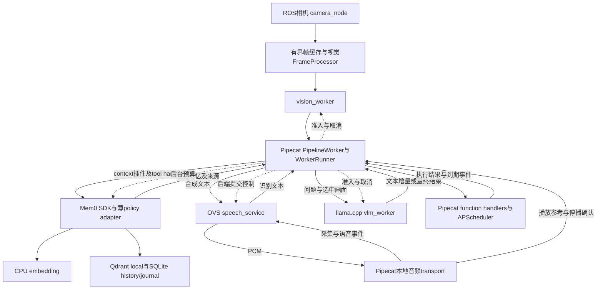

# 项目二 本地多模态个人助手实施计划

> 版本：v1.1，2026-10-12，可实施计划书；按用户要求改用成熟开源框架作为整体基底。
> 产品目标：在单台 Jetson Orin NX 16GB 上实现具有长期记忆的本地多模态个人助手，交互体验参考贾维斯。
> 工程主线：Pipecat 业务编排、Mem0 长期记忆、APScheduler 持久提醒、多模型推理与数据路径优化、可复现性能实验。
> 状态：已开始依赖核验和框架接入；J0 尚未完成，真实模型、音频与整机验收仍待推进。SDK/框架测试不等于模型质量或 JT 验收通过，性能数值均为待验收目标。
> 范围确认：项目二不使用 SO-101、LeRobot、机械臂或其他实体执行器。

本项目让助手持续观察、听懂中文、看图回答、记住用户明确要求保存的信息，并在用户打断时及时停播。长期记忆和有限工具能力形成个人助手体验；调度、测量与执行优化证明这些能力可以在单板资源约束下稳定共存。

定位及 RK 项目分工见[项目总计划](00-project-overview.md)。本文件统一维护项目二的架构、任务、配置与验收标准。首版固定 llama.cpp；Edge-LLM 仅进入后续 J5 性能对比，不作为开工或功能闭环的前置条件。

阅读顺序：先看第 3 节的确定方案、第 13 节阶段任务与第 19 节执行手册；记忆实现见第 8 节，验收门槛见第 14 节，后续实施 Goal 见第 20 节。

## 1 产品目标与首版范围

### 1.1 首版必须具备的能力

| 能力 | 用户可见行为 | 工程重点 |
|---|---|---|
| 中文语音交流 | 连续提问，得到相关、可听的中文回答 | ASR、上下文、生成、TTS、播放的全链路延迟 |
| 持续视觉 | 感知有人靠近、举手、挥手，保持人物状态 | 周期任务、结果年龄、突发负载中的最低服务频率 |
| 单图问答 | 回答“我手里拿的是什么”等受限问题 | 提问与画面关联、图像编码及 prefill 干扰 |
| 用户打断 | 用户说话时旧播报停止，新轮次接管 | AEC、旧 turn 失效、后端取消与资源释放 |
| 长期记忆 | 记住称呼、偏好、项目背景，跨会话和重启使用 | 持久化、准确检索、更新、遗忘、来源证据 |
| 有限工具 | 查询时间/设备状态、保存笔记、建立和取消本地提醒 | 结构化工具调用、幂等、超时、真实执行结果 |
| 有限主动反馈 | 挥手问候、到期提醒，在合适时机播报 | 去重、冷却、静音、会话优先、可取消 |
| 可解释的优化 | 性能报告说明何处竞争、修改带来何种收益 | B0–B3、单因素实验、质量与资源约束 |

记忆与工具属于首版的一部分。首版在线推理和存储全部在本机；模型首次下载、开发资料检索及离线转换单独记录，模型缓存完整后进行断网运行验证。

### 1.2 优先级与实施深度

- P0：可测量的视觉与 VLM 部署、中文语音闭环、统一请求管理、有界资源、可持久化且可修改的记忆。
- P1：真实打断、受限工具、提醒、手势反馈、完整调度与数据路径实验、故障和 8h 验收；这些仍是最终首版必达能力。
- P2：唤醒词、自动整理候选记忆、用户主动导入的资料检索、丰富主动交流、更多工具和其他设备适配。P2 在首版验收后逐项扩展。

暂不包含移动底盘、SLAM、抓放、通用 VLA、视觉或声纹身份识别、开放式 shell 执行、多机器人、云端在线补算、通用模型训练和推理编译器研发。多人可出现在画面中，首版采用一个手动选择的主人档案和一个活跃会话；不根据检测到的人脸自动认领记忆。

### 1.3 三个完整用户用例

1. 用户说“记住，我喜欢简短的中文回答”。助手提交偏好写入，确认成功；重启后问一个问题，按该偏好回答；用户说“以后详细一点”，更新同一偏好并保留变更来源。
2. 用户举起杯子问“这是什么”。助手选取与提问关联的画面回答，期间持续视觉仍能输出有效人物状态；播报时用户打断，旧回复和旧音频不能接入新 turn。
3. 用户说“五分钟后提醒我休息”。工具服务持久化提醒，助手根据真实结果确认；到期时若正在对话则等待允许的播报时机，用户可以查询、取消或关闭主动播报。

## 2 当前环境与开工核验

### 2.1 本机已读取的信息

以下为 2026-10-12 本机读取结果，不是完整 J0 验收。

| 项目 | 当前记录 | J0 还需补充 |
|---|---|---|
| 设备树型号 | NVIDIA Jetson Orin NX Engineering Reference Developer Kit | 模块 SKU、载板、存储、供电及散热 |
| 系统架构 | aarch64 | 编译器、Python ABI、容器运行时版本 |
| 物理内存 | 系统显示约 15GiB，符合标称 16GB 的容量级别 | 功耗模式、可用内存基线、各后端共存峰值 |
| Ubuntu | 24.04.4 LTS | 软件包清单与系统镜像来源 |
| L4T | 39.2.1；nvidia-l4t-core 39.2.1-20260806224157 | JetPack 套件标识和升级记录 |
| CUDA | 本机存在 CUDA 13.2 路径 | nvcc、驱动及最小 CUDA 程序验证 |
| TensorRT | libnvinfer10 10.16.2.10-1+cuda13.2 | parser、开发包、Python binding 和 engine 验证 |
| cuDNN | CUDA 13 包 9.20.0.46-1 | 实际后端加载的动态库 |
| 工具 | docker、nsys、trtexec 命令路径可见 | 容器 GPU 访问、profiling 权限和实际运行 |
| ROS 2 | 本次未发现 /opt/ros 安装目录 | 优先验证 Jazzy，固定实际可运行版本 |
| 外设 | 后续已枚举 D435i 8086:0b3a、/dev/video0～5，当前 USB 速度 480Mbit/s；声卡仅确认 HDA/APE 板载节点 | RGB-D 实际帧率/同步、USB3 链路；真实麦克风/扬声器录播及 AEC 能力 |

ROS 2 Jazzy 官方安装资料列出 Ubuntu Noble 24.04 的 amd64/arm64 包，本方案选用 Jazzy，J0 验证实际安装与驱动兼容性。[ROS 2 Jazzy 安装资料](https://github.com/ros2/ros2_documentation/blob/jazzy/source/Installation/Ubuntu-Install-Debs.rst)

JetPack 套件名称需通过本机包清单或 BSP 来源确认，不能只根据 CUDA 路径判定。此前读取到的 L4T 39.2.0 已被本次 39.2.1 记录替代；后续每轮实验均使用自己的环境 manifest。

### 2.2 J0 必须登记的清单

- 硬件：模块/载板、相机序列号和固件、声卡型号、扬声器、USB 端口、存储余量、供电与散热。
- 软件：OS/L4T/JetPack、CUDA/cuDNN/TensorRT、ROS、ONNX Runtime、C++ 编译器、Python、Docker/容器 GPU runtime、Nsight。
- 模型：checkpoint/revision、许可证、权重哈希、输入输出、tokenizer/processor、预处理、精度和转换参数。
- 产物：engine 哈希、构建设备、动态 shape/profile、workspace、执行实例数、KV cache 上限、实际加载后端。
- 实验：功耗档位、时钟策略、温度、输入集版本、调度配置、启动方式和采样工具。

## 3 开源组件选择与固定版本

### 3.0 首版最终方案与变更规则

首版采用 **Pipecat 1.12.0 + Mem0 2.2.1 + APScheduler 3.11.3 + llama.cpp + OpenVoiceStream + yolo_ros/TensorRT**。ROS 2 采用 Jazzy，相机通过 realsense-ros 接入；业务编排主要使用 Python，C++ 用于现成推理后端、ROS 视觉和有证据的执行优化。在线模型、记忆和工具均在 Orin NX 本机运行。

- 文本和图文首轮基线共用一个 `Qwen2.5-VL-3B-Instruct` 实例，由 llama.cpp CUDA 后端运行；语言权重从 GGUF Q4_K_M 起步，使用匹配的视觉 projector。3B 是首轮部署与容量基线，未来根据质量/容量证据更换模型并重建基线；不是永久锁死的产品模型。
- 语音固定为 OVS 的 `Qwen3-ASR 0.6B + Matcha TTS` 子集；VAD 使用 CPU 上的 Silero ONNX。麦克风/播放由 Pipecat 本地音频 transport 管理，软件 AEC 采用 SpeexDSP；若实物提供通过测试的硬件 AEC，则旁路软件 AEC，避免双重处理。
- 视觉固定 YOLOv8n 检测和 YOLOv8n-pose 姿态，通过 yolo_ros 的 ONNX Runtime TensorRT EP 执行；检测先接入，姿态在 J3 加入，按调度额度运行。跟踪和手势规则使用 CPU。
- 主控直接复用 Pipecat 的 `Pipeline`、`PipelineWorker`、`WorkerRunner`、`LLMContextAggregatorPair`、FrameProcessor 和 function handlers，承担会话生命周期、帧流、上下文与工具结果回传。必要的视觉/语音/记忆与资源控制作为插件或 service adapter 接入；不再另建 C++ 会话运行时和调度框架。Pipecat 1.12 已弃用旧 PipelineTask/PipelineRunner 命名，本项目采用 maintained Worker API。[固定版源码](https://github.com/pipecat-ai/pipecat/tree/1559a684b1ee9771b36454b72418d7364b518e7f/src/pipecat)
- 长期记忆复用 Mem0 SDK，采用 Qdrant local 持久向量存储、CPU BGE-small-zh-v1.5 和 Mem0 的 SQLite history。明确事实使用 `infer=False`；薄 policy adapter 处理主体校验、来源、幂等、更正版本、遗忘与崩溃恢复。SDK 不提供跨 Qdrant/SQLite 原子事务，也不会自动满足全部产品记忆要求，边界见第 8 节。
- 提醒直接复用 APScheduler 3.11.3 与 SQLAlchemy SQLite job store，使用稳定 job ID、持久通知记录及薄工具适配；任务调度与音频播报时机分开。
- Letta、Triton 保留为机制参考。Edge-LLM 对话/VLM 后端仅进入后续 J5.7 性能对比；OVS ASR 的内部 Edge-LLM fork 是既有语音依赖，与该后续对话引擎对比区分。

组件和模型身份按此实施；J0 锁定能在本机运行的 commit、镜像、模型 revision、哈希和精度，J1 固定共存资源预算。兼容性失败、容量不达标或质量不达标才触发选型变更，并记录证据及受影响基线。后续优化阶段切换引擎时，GGUF 与 AWQ 的量化差异需要单独控制或说明，不能将不同量化的结果直接归因于引擎。

首版按上述路线推进，无需先做引擎选型竞赛。llama.cpp 的部署问题先定位并修复；必须变更组件时记录具体兼容性或容量证据。Edge-LLM 的性能对比按 J5.7 独立执行，不阻塞 J0–J4。

本机实施更新：OVS旧ASR包仅含TRT10.3序列化engine，因此同一Qwen3-ASR-0.6B改由llama.cpp CUDA音频后端执行，经OVS后端注册接口接入；整句REST识别配合Pipecat真实Silero分句，暂不声明partial streaming。Matcha/Vocos使用原始ONNX在本机TRT10.16重建，文件合成/转写与Pipecat语音问答已验证。该兼容性修订单独锁定模型、精度和profile，不计作E1–E6性能收益；物理ReSpeaker录播/AEC及完整质量集仍未验收。详见[本机语音复现步骤](deploy/speech/README.md)。

### 3.1 首版依赖与接入边界

| 项目 | 地位 | 复用内容 | 本项目增加的内容 |
|---|---|---|---|
| [Pipecat](https://github.com/pipecat-ai/pipecat) | 整体主控框架 | Pipeline/Worker、原生帧流、context aggregators、工具 handlers、服务扩展 | 本地设备/OVS/视觉接入、记忆上下文插件、有界资源与测量 |
| [Mem0](https://github.com/mem0ai/mem0) | 长期记忆基底 | Memory SDK、Qdrant provider、CPU embedding provider、SQLite history | 明确事实策略、主体校验、operation journal、版本/遗忘验证及必要局部补丁 |
| [APScheduler](https://github.com/agronholm/apscheduler) | 持久提醒基底 | scheduler、date trigger、job ID、持久 job store、misfire/max_instances | 工具 schema、通知幂等、取消/重启恢复、播报时机适配 |
| [Qdrant client](https://github.com/qdrant/qdrant-client) / [SQLAlchemy](https://github.com/sqlalchemy/sqlalchemy) | 本地持久化依赖 | Qdrant local、SQLite ORM/事务与 APScheduler job store | 固定版本、配额、迁移、跨存储失败恢复测试 |
| [TensorRT](https://github.com/NVIDIA/TensorRT) | 执行基础 | trtexec、样例、ONNX parser、插件接口 | 按需要增加 C++ runner、执行所有权和计时 |
| [llama.cpp](https://github.com/ggml-org/llama.cpp) | 首版唯一文本/VLM 后端 | CUDA、GGUF、视觉 projector、llama-server | 请求适配、实际执行事件、额度、取消语义 |
| [yolo_ros](https://github.com/mgonzs13/yolo_ros) | 视觉功能基线 | 检测、姿态、跟踪、深度辅助结果 | 图像准入、实际执行回调、时效和手势事件 |
| [realsense-ros](https://github.com/realsenseai/realsense-ros) | 相机接入 | RGB-D 和相机参数 | 帧缓存、时间映射、状态与重连 |
| [OpenVoiceStream](https://github.com/Seeed-Solution/openvoicestream) | 语音后端 | 中文 ASR/TTS、流式服务及现有能力 | 统一会话接入、提交控制和执行事件 |
| [Silero VAD](https://github.com/snakers4/silero-vad) | CPU 语音活动检测 | ONNX 模型及参考处理 | 音频窗口、端点、会话与打断事件 |
| [SpeexDSP](https://github.com/xiph/speexdsp) | 软件 AEC | 回声消除及播放参考接口 | 设备延迟对齐、双讲与误打断验证 |
| [FlagEmbedding](https://github.com/FlagOpen/FlagEmbedding) | embedding 参考和转换 | 中文检索模型及参考预处理 | CPU 执行适配、ONNX 回归和检索质量测试 |
| [NVTX](https://github.com/NVIDIA/NVTX) | 测量 | 业务与执行阶段标记 | 统一事件格式、运行关联和报告 |
| [rosbag2](https://github.com/ros2/rosbag2) | 录制回放 | ROS 输入录制和回放 | 音频/会话时间轴、负载复现及质量标签 |

SQLite 用于 Mem0 history、必要的操作 journal、会话/笔记和 APScheduler job store；记忆正文/metadata/向量由 Mem0 + Qdrant local 管理，不复制出第二套自建事实/向量引擎。不同数据库之间没有自动原子提交，须显式恢复和核验。SQLite WAL、durability 与 busy timeout 按实际配置验证。[SQLite WAL](https://www.sqlite.org/wal.html)

### 3.2 关键兼容性条件

1. TensorRT 主分支已面向 11.x，而本机为 10.16。样例、headers 和库需要匹配 10.16；不为跟随 main 自动替换系统推理栈。[TensorRT 仓库](https://github.com/NVIDIA/TensorRT)
2. llama.cpp 官方多模态列表包含 Qwen2.5-VL-3B，模型需要语言 GGUF 和匹配的 mmproj；J0 验证 aarch64/CUDA 构建、GPU offload、图像预处理、中文输出和完整内存峰值。HTTP 断开不视作 GPU 释放，需补充服务内执行确认。[官方多模态说明](https://github.com/ggml-org/llama.cpp/blob/master/docs/multimodal.md)
3. 当前 yolo_ros 为 C++/ONNX Runtime 管线。GPU 预编译包以 x64 为主，aarch64 需源码构建；TensorRT EP 为显式选择，存在回退。验收必须证明实际执行后端，不能把 CPU 功能测试算作 GPU 基线。[yolo_ros 构建与后端说明](https://github.com/mgonzs13/yolo_ros/blob/main/README.md)
4. 当前 yolo_ros 无旧版运行时 enable 服务，持续推理。先在同步图像输入处准入，再在推理提交入口加入开始/完成回调；旧版教程中的服务名不作为可用 API。[yolo_ros 运行接口](https://github.com/mgonzs13/yolo_ros/blob/main/README.md)
5. OVS 固定版存在独立 `deploy/docker-compose.edgellm-v091-voice.yml`，只含 speech。profile `jetson-edgellm-v091-matcha` 对应目标为 JP6.2/L4T36.4.3/CUDA12.6/TRT10.3/ORT1.23.2；本机目标验证器已实际返回版本不匹配，旧 Python3.10 TensorRT mount 也不存在。因此需要移植构建层并重建本机 ASR/Matcha engine，不能直接拉旧发布物宣称兼容；默认 installer 已转 v0.11 CustomVoice candidate，必须明确固定 Matcha 子集。[本机核验和准备步骤](deploy/speech/README.md)
6. Pipecat 1.12.0 的 Python 与可选 transport/service 依赖在本机独立 venv 核验；先采用原生 Worker API 和本地 OpenAI-compatible LLM service，OVS 实现 STT/TTS adapter。框架的 interruption/cancel frame 只保证框架语义，后端真实完成/释放仍需接入验证。
7. Mem0 2.2.1 显式配置本地 llama `openai_base_url`、BGE CPU、Qdrant local path、history DB；在 import 前关闭 `MEM0_TELEMETRY`。按当前 `search(query, filters={"user_id": ...}, top_k=...)` 接口调用，ID 操作另行验证归属。SDK delete 会保留历史，跨存储写入无原子性，必须按第 8 节补足并测试。[固定版 SDK](https://github.com/mem0ai/mem0/tree/b7ad69afda6b6ed030347c66d48a13e4de9dec08/mem0)
8. APScheduler 使用 3.11.3 API 和 SQLAlchemyJobStore；不套用 4.x 文档。持久 job store 与业务通知记录之间的崩溃窗口需 reconciliation，不能把 job 创建成功或 callback 被调度等同于实际播报完成。

### 3.3 非首版依赖与故障替代路径

| 项目 | 使用条件 |
|---|---|
| [Letta](https://github.com/letta-ai/letta) | 参考持久状态与记忆管理。当前 README 指向 [letta-code](https://github.com/letta-ai/letta-code)；采用前核查当前代码及资源预算。首版不叠加第二套完整 agent runtime。 |
| [Triton](https://github.com/triton-inference-server/server) | 仅参考跨模型资源额度和优先级。首版通过 Pipecat 插件与后端适配控制准入；后续有多客户端服务需求时再评估。 |
| [DeepStream 并行示例](https://github.com/NVIDIA-AI-IOT/deepstream_reference_apps/tree/master/deepstream_parallel_inference_app) | 作为多视觉分支对照，需匹配 SDK。首版先保持一套视觉基线。 |
| [sherpa-onnx](https://github.com/k2-fsa/sherpa-onnx) | OVS 路径不适配或需要更明确中文 streaming ASR 时评估。 |
| [TensorRT Edge-LLM](https://github.com/NVIDIA/TensorRT-Edge-LLM) | J5 发现 VLM 推理为主要瓶颈后才开展对照，验证当前 Orin 支持矩阵、模型质量、共存峰值和实际端到端收益；收益成立后版本化切换。 |
| [ros2_benchmark](https://github.com/NVIDIA-ISAAC-ROS/ros2_benchmark) | 补充 ROS 图测量；先验证所选 ROS 版本，覆盖不到的语音/记忆阶段使用自有记录。 |
| [Isaac ROS DNN](https://github.com/NVIDIA-ISAAC-ROS/isaac_ros_dnn_inference) | 图像路径成为瓶颈后评估，核验其 ROS 发行版和缓冲机制。 |

Mem0 首版实际接入，不能沿用上游默认云模型配置；显式本地配置是运行门槛。Letta 为参考，其当前代码位置见[上游说明](https://github.com/letta-ai/letta/blob/main/README.md)。所有上游质量或速度声明均不作为本机结果。

### 3.4 候选源码快照

以下 commit 是本次 GitHub 核查的候选快照，不是板端可运行版本或 release 推荐。J0 可选择更合适的 tag/commit，并保存变更理由。

| 项目 | 候选 commit |
|---|---|
| Pipecat | `1.12.0` / `1559a684b1ee9771b36454b72418d7364b518e7f` |
| Mem0 | `2.2.1` / `b7ad69afda6b6ed030347c66d48a13e4de9dec08` |
| APScheduler | `3.11.3`，发行包和哈希写入依赖锁 |
| SQLAlchemy / qdrant-client | 与以上 SDK 配套的实际安装版本及 wheel 哈希在 J0 依赖锁固定 |
| llama.cpp | `08ffba21e5c2f1728b6b405c05ff3913f65706d4`，构建/推理验证状态以日志为准 |
| Silero VAD / SpeexDSP | J0 固定模型哈希与库版本 |
| Edge-LLM（非首版，仅参考） | `0f52705723abfa8c6702654bfdcc082a728ed353` |
| yolo_ros | `7924a8be76c81f4051370e254677516ca696a272` |
| OVS | `18a459761647a641926f04d7d36c17035c11f8b7` |
| realsense-ros | `7a87097c499e3b0b69518d54a8e7a9ac1924e87c` |
| FlagEmbedding | `fd1a2bdf69488ffebe0327999d4400d8c8058a0b` |

上游以固定 commit 的子模块、固定版本系统包或固定 digest 镜像接入。只下载实际启用的组件。记录 LICENSE、模型许可证、依赖和个人补丁；yolo_ros 的代码许可不能替代 YOLO 权重许可。保留既有 references 内容。

## 4 场景与测试输入

| 场景 | 行为 | 测量重点 |
|---|---|---|
| S0 待机 | 低频观察，持续监听 | 常驻内存、CPU 唤醒、功耗及唤醒恢复 |
| S1 人物感知 | 1–3 人靠近、举手、挥手 | 检测/姿态/跟踪、距离方位、结果年龄 |
| S2 普通对话 | 用户说话，助手保持观察并回答 | 首个相关可听回复、CER、视觉频率 |
| S3 看图问答 | 用户询问当前物体 | 选帧时间偏差、回答质量、prefill 干扰 |
| S4 打断 | 播报中用户发言 | 实际停播、误打断、旧 turn 及释放时间 |
| S5 手势反馈 | 举手或挥手触发简短语音 | 去重、冷却、过期拒绝、事件到播报 |
| S6 长时与故障 | 持续交互、设备断连、后端超时 | OOM、队列、温度、内存趋势和恢复 |
| S7 记忆召回 | 新会话询问既有偏好或项目背景 | 来源、重启持久化、检索和生成正确率 |
| S8 记忆维护 | 记住、更正、遗忘、查询已记内容 | 持久确认、版本、索引一致性和误写 |
| S9 历史事件 | 问“上次我们讨论了什么” | 时间过滤、事件归属、无证据拒答 |
| S10 工具 | 时间/状态/笔记/提醒 | schema、参数、幂等、真实执行结果 |
| S11 主动提醒 | 提醒到期、会话占用、静音 | 去重、重启恢复、延迟与取消 |

S0–S6 延续原计划的感知与交互场景，S5 已改为语音反馈。S7–S11 是新增个人助手能力。真机输入与授权回放均使用上述编号标记；回放与真机报告分开。

## 5 模型与资源预算

### 5.1 首轮模型矩阵

| 功能 | 选定模型 | 首轮执行路径 | 固定项 |
|---|---|---|---|
| 人物/物品检测 | YOLOv8n | ONNX Runtime TensorRT EP，当前FP32初始基线，FP16保留比较 | 输入、类别、阈值、NMS、后处理 |
| 人体姿态 | YOLOv8n-pose | ONNX Runtime TensorRT EP，当前FP32初始基线，FP16保留比较 | 关键点、姿态规则、服务频率 |
| VAD | Silero VAD ONNX | ONNX Runtime CPU | 采样率、窗口、端点和阈值 |
| 中文 ASR | Qwen3-ASR 0.6B | OVS Orin 语音子集；实际 engine 由 J0 核验 | checkpoint、流式粒度、CER、端点 |
| 文本/图文回复 | Qwen2.5-VL-3B-Instruct | llama.cpp CUDA，语言 GGUF Q4_K_M + 匹配 mmproj | processor、上下文、图片和输出上限 |
| 中文 TTS | Matcha TTS | OVS Matcha 路径，锁定完整声学模型与声码器产物 | 音色、采样率、分段规则和播放预算 |
| 中文 embedding | BAAI/bge-small-zh-v1.5 | CPU 优先，参考实现后验证 ONNX | tokenizer、pooling、归一化和查询指令 |

llama.cpp 官方多模态说明列出 Qwen2.5-VL-3B GGUF，OVS Orin 指南列出 Qwen3-ASR 0.6B 与 Matcha。实际精度、实时性、共存峰值仍需本机测试；OVS 所带的额外文本 LLM 不启动。[图文模型](https://github.com/ggml-org/llama.cpp/blob/master/docs/multimodal.md)、[OVS Orin 语音组合](https://github.com/Seeed-Solution/openvoicestream/blob/main/docs/deploy/jetson-orin-nx-v091.md)

BGE small 中文模型为约 24M 参数、512 维，确定为 CPU 检索模型；ONNX 转换后的 pooling、查询指令和归一化需对照原始实现。[模型说明](https://huggingface.co/BAAI/bge-small-zh-v1.5)

功能数量不是完成标准。姿态兼任人物检测时可减少模型；CPU embedding/VAD 不计为 GPU 并发。至少有视觉和 VLM 两个业务必需 GPU 负载存在重叠请求，并通过 trace 说明实际执行或争用。

2026-10-12的J0检查记录了一次精度调整：FP16在公开图像上把两个候选置信度舍入为相等值，导致NMS换框，未通过预设0.98框IoU对齐门槛；FP32在允许或关闭TF32时均通过同一门槛，FP32姿态对齐也通过。因此在J4冻结前先以FP32继续ROS整合，模型、输入与原验收门槛保持一致，FP16留作后续有质量约束的性能候选。此时只有TensorRT SDK单图证据，不能当作ROS整机或冻结质量集验收。

### 5.2 首轮配置与调整规则

下面是启动实验的建议值，J0/J1 实测后再冻结；修改模型、输入或上下文属于容量/质量取舍，需要登记。

| 项目 | 首轮建议 |
|---|---|
| 相机 | 验证支持的 640×480 RGB-D 模式；采集 30Hz，视觉有效结果常态目标 10Hz |
| 输入保留 | 视觉待处理采用有界缓存；历史选帧窗口从 2s 起试，精确核算实际格式字节数 |
| VLM | 单会话、单图，先 2K 上下文；回答生成上限从 128 tokens 起试 |
| 记忆上下文 | 检索最多 5 条，记忆注入上限从 512 tokens 起试 |
| 会话窗口 | 最近若干轮 + 有来源的摘要；按实际 tokenizer 截断，优先保留当前问题 |
| CPU embedding | 一个执行实例，初始 1–2 线程；前台查询优先于后台索引 |
| TTS | 最多一个合成请求在途；按标点并设最短文本阈值分段，播放缓存试验 100–200ms |
| GPU 并发 | 从视觉一个实例、VLM一个实例起，扫描受限串行与允许并发的配置 |
| 本地向量规模 | 首版在 1k/10k/50k 条记录下测容量和延迟；50k 是压力档，不要求真实采集这么多 |

总预算包含 OS/桌面、CPU进程PSS、GPU engine/workspace、VLM KV cache、帧/音频缓冲、embedding、索引和文件缓存。统一物理内存不把 CPU/GPU 显示值简单相加。目标保留至少 2GiB MemAvailable 余量作为首轮容量门槛，记录谷值；不满足时在冻结前调整配置，不能靠 swap 掩盖稳定容量。

帧缓存必须有字节上限和引用计数。原始 640×480 RGB8 加 depth16 每帧约 1.46MiB，60 帧约 88MiB；stride、额外副本和编码路径另算。缓存预算示例只适用于这些格式。

## 6 进程架构与资源所有权



### 6.1 组件职责

| 组件 | 实现方式 | 所有权及输出 |
|---|---|---|
| camera_node | 上游 ROS 驱动 | 唯一相机所有者；设备时间、主机采集时间、RGB/深度 |
| perception adapter / frame cache | Pipecat FrameProcessor + ROS 消息适配；必要后端 C++ 补丁 | 同步 RGB-D，有界缓存与选帧；只处理获准帧 |
| vision_worker | yolo_ros 集成补丁或按需 TRT runner | 拥有自己的 context/stream/buffer；检测/姿态/跟踪/手势 |
| audio transport | Pipecat 本地 transport 与 AEC 薄适配 | 唯一声卡所有者；采集、播放、AEC参考、停播 |
| speech_service | 固定 OVS 服务 | ASR/TTS 推理；不另行争抢本机声卡 |
| vlm_worker | llama-server + 本项目控制与事件适配 | GGUF/projector/KV cache所有者；真实执行与释放事件 |
| assistant pipeline | Pipecat Pipeline / PipelineWorker / WorkerRunner | 原生帧流、会话生命周期、context aggregators、interruption/cancellation 与错误事件 |
| memory policy adapter | Mem0 2.2.1 SDK + 必要局部补丁/持久 journal | SDK 管理正文/向量；适配验证主体/版本/来源、幂等、遗忘与恢复 |
| tool/reminder adapter | Pipecat function handlers + APScheduler 3.11.3 / SQLAlchemy | 固定工具、真实结果回传、持久 job/通知、幂等和播报时机 |
| resource/trace processors | 小型 Pipecat FrameProcessor / observer 与后端 hooks | 在原生 pipeline 中施加有界准入、度量 deadline/资源释放；不另造调度框架 |
| recorder/evaluator | Python脚本和ROS工具 | 录制、回放、评测与报告，不参与实时决策 |

业务插件在 Pipecat Python 进程内调用原生 SDK，模型服务沿用现成 HTTP/WS 或 ROS 接口。具体进程数按后端决定，不为一模型一进程增加额外常驻。此前自建 C++/SQLite 原型不纳入产品架构或成果；产品代码以现成框架的接入、必要补丁和验证为边界。

### 6.2 通信与数据路径

- ROS 2：相机、视觉结果、人物/手势和状态。首轮传标准消息，QoS及缓存深度记录在配置中。
- HTTP/WebSocket：固定版本的 OVS ASR/TTS 接口；llama-server 使用本地 `/v1/chat/completions` 处理文本/图文请求。工具计划使用受约束 JSON 输出并由本项目校验，不假定 Qwen 模型具备可靠的原生工具调用能力。真实执行/释放事件另由 worker 适配提供。[OVS接口](https://github.com/Seeed-Solution/openvoicestream)、[llama-server接口](https://github.com/ggml-org/llama.cpp/blob/master/tools/server/README.md)
- 业务控制：使用 Pipecat 原生 frame、Worker lifecycle、event handler、context aggregator 与 function result callback；元信息附在 frame/插件上下文，不新增一套进程间控制协议。
- 大载荷：使用 transport 的音频 frame、带时间戳的图像 frame 或受管理文件引用，并设字节上限。跨进程服务按其现成输入格式发送，引用必须有实际访问方式、生命周期及释放确认。
- 共享内存/减少ROS拷贝：仅在 trace 证明数据路径成本后增加，记录到底减少了哪次转换或拷贝。

### 6.3 启动与关闭

启动顺序：配置/manifest核验 → Mem0/journal 与 APScheduler job store 初始化/恢复 → 相机/音频 transport → 模型加载和预热 → adapter 能力核验 → 创建 PipelineWorker 并交给 WorkerRunner → 允许交互。只有必需组件就绪后才显示完整就绪；失败时报告具体降级能力。

关闭顺序沿用 Pipecat 的结束/取消 frame 与 WorkerRunner cleanup：停止输入 → 停播并使旧 turn 输出失效 → 停止后续后端提交 → 等待真实执行释放或有界终止异常后端 → 关闭 Mem0/Qdrant/history、flush journal、关闭 APScheduler/job store 和日志。systemd 或固定 compose 管理服务；重启限流，避免崩溃后无限快速重拉。

## 7 Pipecat 帧流与执行状态约束

### 7.1 统一任务元信息

以下为 J1 固定的 trace/frame metadata，不是另建的通信协议。会话控制复用 Pipecat 原生 Worker、帧和 turn 机制；字段通过 FrameProcessor、observer 及服务适配传递。

```json
{
  "metadata_schema_version": 1,
  "request_id": "unique-request",
  "turn_id": "conversation-turn",
  "session_id": "conversation-session",
  "user_id": "owner-profile",
  "task_type": "vision|asr|vlm|tts|embed|memory_write|tool",
  "capture_time_ns": 0,
  "arrival_time_ns": 0,
  "deadline_ns": 0,
  "cancellation_generation": 0,
  "worker_epoch": 0,
  "model_revision": "locked-revision",
  "payload_ref": "local-payload-reference"
}
```

相机任务可没有turn，但有frame_id。控制事件、模型结果、音频块和工具结果必须带所属turn或后台任务ID。跨重启的记忆/提醒使用独立持久ID，不能复用已失效进程的单调时钟deadline。

每个后端 adapter 登记以下能力：实际CPU/GPU后端、最大在途数量、输入上限、取消粒度、流式输出能力、执行计时能力、可否在步骤边界让出、实际完成确认方式。只有被验证的能力才能进入配置。

### 7.2 任务状态与资源状态分开

逻辑统计状态：`QUEUED → ADMITTED → RUNNING → COMPLETED/FAILED`，旁路包括 `REJECTED/EXPIRED/CANCELLED`。这些是 Pipecat frame/后端事件的观测映射，不实现第二套任务运行时；后端另报告 `ACCEPTED/EXECUTION_STARTED/EXECUTION_FINISHED/RESOURCE_RELEASED`。

用户取消使逻辑结果立即无效，但后端资源额度只在真实释放后归还。外层HTTP超时不等于GPU停止；worker进程已退出或对应执行完成事件可靠到达后，才能回收额度。每次释放幂等并校验worker_epoch，迟到的旧实例消息不能释放新实例的额度。

事件日志包含 `event_id、run_id、request_id、turn_id、worker_epoch、stage、monotonic_ns、status、reason`；durable事件另有UTC时间。最终每个请求只能进入一个统计终态，资源清理事件另外计数。

### 7.3 会话与播报状态

会话展示状态：`IDLE/LISTENING/THINKING/SPEAKING/INTERRUPTING/DEGRADED`，从 Pipecat 原生 turn、response、TTS、transport 和错误事件映射，不单独编写会话管理器。SPEAKING期间采集与VAD保持运行；同一turn的VLM、TTS和播放可以在各后端允许时重叠。

首版通过本地按键或明确的监听开关开启会话，关闭时不把环境讲话直接作为主人请求；已开启的会话内使用VAD与端点处理实现连续交流。唤醒词列为P2候选，未经验证前不宣称免操作的远场唤醒能力。静音、关闭监听和停止播报分别提供状态。

播放：`EMPTY/BUFFERING/PLAYING/STOPPING/STOPPED`。停播ACK需区分软件队列清空、声卡停止请求和实际声学停止；实际声学停止由回环或外部录音测试校验。

Pipecat 原生 turn/interruption 触发打断后，transport 停播并清空旧音频，各 service adapter 停止旧 turn 后续提交并通知后端取消；插件更新消费代次，旧 token/PCM/工具回调再次校验。后端不支持即时停止时保持其真实在途状态；原生 interruption frame 或 coroutine cancellation 不能当作 GPU 已释放证据。

### 7.4 请求接口

后端通过 Pipecat 的 LLM/STT/TTS service 或 FrameProcessor adapter 接入，沿用对应框架 lifecycle 与现成 HTTP/WS/ROS 调用。Mem0 policy adapter 提供 `search、remember、correct、forget、list、export`，工具通过 Pipecat function handlers 接收结构化参数并调用 result callback。接口粒度是插件边界，不另实现通用 RPC 框架。

所有接口都有载荷大小上限、超时、错误码、可重试标识和幂等键。重试生成新attempt_id，但保持业务request_id；已经执行的记忆写入、笔记和提醒不能因重试重复产生副作用。

## 8 记忆系统的实现

### 8.1 五类状态与用途

| 类型 | 内容 | 保存及过期规则 |
|---|---|---|
| 会话工作记忆 | 当前问题、最近对话、工具返回、选中画面 | 有界上下文；会话状态持久化与实时缓存分开 |
| 用户事实与偏好 | 称呼、语言、回复风格、项目背景 | 明确要求或确认后保存，版本化更正/遗忘 |
| 历史事件 | 某次讨论摘要、已完成任务、明确保存的观察 | 有时间和来源；只陈述证据覆盖的时间范围 |
| 任务状态 | 笔记、提醒、到期/取消/完成 | 确定性工具事务保存，不依赖向量相似度判定状态 |
| 资料知识 | 用户主动导入的文档片段 | 单独namespace与文件版本；首版仅预留接口，P2实施 |

记忆检索与VLM KV cache分开管理。KV cache是本次推理状态，不能作为长期持久记忆。对话日志、摘要、用户事实、任务状态也不能混为一个向量集合。

### 8.2 存储和索引

首版直接使用 `mem0ai==2.2.1` 的 `Memory` SDK。正文、metadata 与 embedding 由 Mem0 的 Qdrant local provider 管理，`on_disk=True` 并固定 collection/path；SDK history 使用独立 SQLite。BGE-small-zh-v1.5 通过其 HuggingFace provider 在 CPU 执行，模型从已校验的本地路径加载；ONNX 路径先对照参考实现再启用。

配置固定 `version="v1.1"`、本地 llama 的 `openai_base_url` 和 manifest 中的模型 alias，Pipecat 与 Mem0 从同一部署配置派生 endpoint。关闭 `MEM0_TELEMETRY` 必须发生在导入 Mem0 之前，启动自检验证生效；不使用默认云 LLM/embedding，不因本地 OpenAI-compatible provider 名称而引入云调用。

薄 policy adapter 是唯一 SDK 写入入口，利用单进程串行校验与进程锁、SQLAlchemy 的小型 operation journal 和必要上游局部补丁承接产品约束。CPU embedding/SDK 调用移至有界执行线程，音频 event loop 不等待数据库锁；这些适配不复制出自建记忆引擎。

首版数据实体：

| SDK 数据或必要本地记录 | 核心字段及归属 |
|---|---|
| profiles | user_id、人工选择的名称、语言及配置 |
| sessions / turns | session_id、turn_id、原始用户文本、已实际输出内容、取消状态、时间 |
| Mem0 memory / Qdrant payload | memory_id、user_id、正文；metadata 保存 type/key/namespace、source_id/证据片段、有效期、版本和来源；向量由 SDK embedder 管理 |
| Mem0 SQLite history | SDK 变更历史；普通更正保留按策略处理，遗忘必须额外 purge 相关正文 |
| operation journal / deletion barriers | 操作ID、指纹、PENDING/COMPLETED/失败状态、目标ID、owner generation、最小删除/取消屏障；不保存第二份事实库 |
| APScheduler jobs / notification records | 稳定 job ID、UTC到期时间、timezone、用户、通知ID、到期/取消/播放状态与幂等键 |
| notes / session evidence | SQLAlchemy 持久笔记、已完成会话事件和来源保留策略；不以向量相似度判断工具完成 |

用户主动遗忘时移除相应正文、向量和包含该内容的派生摘要，仅保留不含被遗忘内容的最小删除标识。普通更正的历史是否保留正文由档案策略决定；遗忘优先于历史审计和摘要复用。已经存在的备份另有保留与恢复规则，恢复时应用删除标识，不能把旧内容重新纳入检索。

稳定事实的必要来源证据独立于整段会话文本保存，避免7天会话清理后事实失去来源；遗忘时连同相关证据和会话中的对应片段移除。候选提取按来源版本及删除屏障过滤，不能从旧历史重新提取已遗忘事实。

Mem0/Qdrant 事实与 SQLite history/journal **不构成一个原子事务**。操作先写持久 PENDING journal，调用 SDK 并核验正文/metadata/向量及必需 history 结果，再完成 journal；只在所需持久结果可确认后回复“已记住”。失败或崩溃保持未确认状态，通过稳定操作ID、SDK metadata 与删除屏障 reconciliation，不能把写入排队或单个存储成功当作整体成功。

SDK `update/get/delete(memory_id)` 不自动按当前 owner 校验；adapter 先查归属并再次核验。SDK 没有原生 CAS，版本比较与变更在唯一 adapter 写入者内串行完成，所有写入禁止绕过边界。若不能证实崩溃窗口的版本/幂等/恢复要求，保留为失败项并实施必要局部补丁，不能下调 JT-10。

SDK delete 会写入并保留历史；产品遗忘还要清除 SDK history 中的原文、派生摘要、来源片段、可能包含正文的 operation result/会话记录，并验证 SQLite/WAL/备份恢复不会重新纳入检索。按固定 SDK 版本采用受测试的局部 purge 补丁，留下不含正文的最小删除屏障。索引恢复使用 owner-filtered 的有效 Mem0 导出/备份与模型锁重建，恢复时先应用当前删除 journal；不另外维护自建事实/向量表。

### 8.3 记忆写入与更新

- “记住……”：校验主体、类型、来源和内容后，调用 Mem0 `add(..., user_id=..., metadata=..., infer=False)` 保存明确事实，避免再次让 LLM 猜测或改写用户事实；SDK 与 journal 持久结果核验后回复成功。含糊信息先澄清。
- 普通对话：只进入受保留策略约束的会话记录。后台可提取候选事实，但初版未经用户确认不提升为稳定用户事实。
- 偏好更正：按 owner/type/key 查 SDK metadata，adapter 验证 expected_version 后串行调用 SDK update；新旧生效时间和来源明确。该 CAS 是薄适配策略，不能宣称 SDK 自带原子 CAS。
- 历史摘要：基于被保存的用户内容和实际完成输出；未播出的答案、模型推测和取消后的迟到输出不作为完成事实。
- 观察事件：保存“在某时刻看到某物”的有时效记录，不能转成“该物一直在那里”；连续帧不逐帧写入记忆。
- 遗忘：先建立持久 deletion barrier 并更新 owner generation，调用 SDK 删除、purge history/来源/派生内容，并从 Pipecat 当前 LLMContext 移除相关召回数据、失效缓存和后台作业，再核验持久结果；正在运行的旧提取不能再次写回被删内容。

每轮摘要不强制触发VLM调用。首版实现明确写入、SDK metadata/语义召回、用户要求的摘要及有界维护；普通对话自动候选提取属于P2。SDK add/update 所需 embedding 与向量写入是保存路径的一部分，不假定 SDK 提供跨存储异步 outbox。摘要复用当前 VLM 时通过 Pipecat 后台插件预算执行，遵守后端实际取消能力。

### 8.4 检索和上下文装配

1. 识别请求需要用户偏好、历史事件、任务状态还是当前观察。
2. 必须先按user_id、namespace、有效状态和时间范围过滤。
3. 明确 key 通过 SDK metadata 查找，任务 ID 通过笔记/提醒工具查找；语义召回使用 SDK `search(query, filters={"user_id": owner, "namespace": ...}, top_k=...)` 与 CPU BGE。Mem0 2.2.1 的 filters API 按固定版本调用，不沿用旧教程中的 search user_id 参数形式。
4. 合并候选，按相关性、来源可靠性、时间和重复情况排序；首版不另加reranker模型。
5. 选出最多5条并附source_id、时间、版本；注入实际token预算内。
6. Pipecat memory/context FrameProcessor 向 `LLMContext` 注入系统指令、当前问题、近期上下文、有效记忆、画面与工具结果，复用 context aggregators，记录实际 tokens 和截断原因。

检索超时可以回退精确字段/关键词；回答需标记本轮未取得可靠历史，不能虚构记忆。无相关记录的提问应回答不知道或请求补充。

记忆、文档和工具返回作为数据注入，不具备更改系统规则或自行授权工具的效力。没有事实证据时，不能因为相似度高就断言属于当前用户。

### 8.5 保留与身份默认值

首版使用手动选择的owner档案；guest会话不读取owner记忆。持久用户事实保留至更正/遗忘；会话文本默认保留7天；历史摘要仅保存用户指定或确认的内容；原始图像/录音默认只在明确录制测试时落盘。运行日志设置轮转与磁盘配额。

上述内容作为首版默认策略。当前文本入口已实现手动档案隔离、已输出会话记录、启动/新轮次时执行7天清理、查询时过滤过期记录，以及记忆来源关联与遗忘屏障；完整音频记录策略、主动播报开关、日志配额和跨存储故障恢复仍待验收。记忆文件、用户资料、原始录音和测试数据不进入Git；测试使用独立临时库和合成/授权数据。

### 8.6 必须验证的记忆行为

| 行为 | 验证样例 |
|---|---|
| 持久化 | 保存偏好后重启整个服务，再用新会话读取 |
| 语义召回 | “回答尽量简短”与“你知道我喜欢什么回复风格吗” |
| 纠正 | 从“简短”改为“详细”，最新有效事实优先 |
| 遗忘 | 删除后精确查找、语义查找和摘要均不返回 |
| 主体隔离 | owner记忆不出现在guest/另一测试档案 |
| 来源追踪 | 每条回答用到的记忆可以追到输入turn |
| 拒绝虚构 | 没有保存过的经历不能声称记得 |
| 冲突处理 | 相同key不同内容，显式版本与来源而非随机覆盖 |
| 取消一致性 | 取消后的提取结果不会污染新turn或重建旧事实 |
| 索引恢复 | 删除向量索引后从有效记录重建，结果一致 |

## 9 工具调用与主动提醒

### 9.1 首版工具集合

| 工具 | 副作用 | 完成标准 |
|---|---|---|
| get_time | 无 | 明确本地时区与时间 |
| get_device_status | 无 | 返回实际健康/资源状态和采样时间 |
| create_note / list_notes | 本地持久写入/读取 | 唯一ID、真实写入结果、可查询 |
| create_reminder / cancel_reminder / list_reminders | 本地任务写入/状态修改 | 解析时间、持久ID、幂等、重启恢复 |
| remember / correct / forget / list_memories | 用户记忆变更 | 调用 Mem0 policy adapter，遵守主体、持久确认和版本语义 |

工具通过 Pipecat 原生 ToolsSchema/FunctionSchema 与 function handlers 注册，参数执行 schema、范围、主体和状态校验，真实结果经 result callback 回到 context。模型原生工具调用按实测启用；不可靠时由受约束 JSON FrameProcessor 解析同一白名单并调用相同 handler，最多一次修复再澄清。不能因 SDK 有工具接口就假定 Qwen3B 能可靠调用，也不能在执行前播报成功。

首版工具通过固定函数执行，不接入通用shell、任意路径操作或外部账号。注册工具时声明是只读还是本地写入；后续扩展的外部副作用单独定义交互和权限。被检索出的旧内容不能触发新的工具执行。

### 9.2 提醒和手势的行为

提醒使用 APScheduler 3.11.3 date trigger 与 SQLAlchemyJobStore，持久化稳定 job ID、UTC到期时间、timezone 和原始表达，明确 `max_instances`、misfire grace、coalescing 与重启政策。相对表达转换为持久 UTC 到期值，同时记录创建时单调时钟以测量倒计时/时钟调整；库本身按墙钟调度，时间跳变和重启行为必须实测。

薄提醒 adapter 保存业务状态/幂等键及 notification ID；创建/删除 job 与业务记录之间的提交窗口通过持久记录和 reconciliation 修复，不能假定跨连接事务原子。callback 只生成一次逻辑通知 frame，Pipecat 决定可播放时机；播放尝试可重试但保留同一通知ID。取消、重复请求、创建中崩溃、callback 与取消竞争、重启后的 misfire 都必须验证。

用户可开启静音/勿扰和取消提醒。正在用户对话时到期提醒等待可用播报槽；超出已配置有效期则记录延后/过期状态。正常调度与会话占用时分别统计播报延迟。

当前已实现通知消费与持久交付协议：每次领取具有独立attempt_id；输出尚未开始时可有限重试，已开始但崩溃/中断且未确认时记为uncertain并禁止自动重播。文本显示、音频播放和测试夹具采用独立通道状态。默认到期有效期1小时、失败最多3次、重试间隔5秒；静音按档案持久保存。Pipecat音频通道使用原生TTS起止帧、有序输出标记和设备排空确认，已完成带明确fixture标记的队列测试；实机音频接入、墙钟跳变和JT-12声学时延仍待完成。

手势从关键点规则形成事件，采用连续帧确认、目标ID、事件ID和冷却窗口；首轮建议2s冷却。无身份识别时使用普通问候，不根据未确认的人物调用主人档案。旧/过期事件在消费前再次校验。

## 10 多模型调度与后台预算

### 10.1 调度粒度

CPU采集、播放及VAD始终独立运行。调度控制可观察的推理任务或后端步骤，不把麦克风持续流长时间占为一个全局GPU许可。

| 任务 | 准入单位 | 过期/取消策略 |
|---|---|---|
| 视觉 | 同步帧及所需推理任务 | 最新待处理帧、过期丢弃、保底服务 |
| ASR | 后端可观察的块/段/请求 | 停止旧turn提交；连续监听不阻塞 |
| VLM | 首版为完整请求；有验证接口后才拆prefill/decode | 限制图片/上下文；迟到输出无效；真实结束后释放 |
| TTS | 文本片段及声码器任务 | 旧片段不提交，旧PCM不播放 |
| embedding检索 | 一次有界查询 | 前台优先、超时回退、缓存 |
| 提取/摘要/索引 | 一个小型后台作业 | 低优先级、有界积压、可恢复检查点 |

外层请求许可只能限制提交和在途数，不能自动抢占后端内部GPU工作。VLM请求粗粒度且长时间占用时，先限时/限token/限上下文并测容量；阶段切分只在后端接口允许且结果正确时实施。

### 10.2 Pipecat 资源与后台插件的职责

- 为各任务类维护有界队列、在途额度、deadline和终态计数。
- 优先处理打断/停播控制，不让其排在GPU作业后面。
- 为用户当前turn提供前台额度；视觉采用保底频率和最新帧策略。
- embedding设置CPU线程额度；索引和记忆提取进入后台队列。
- 给后台任务配置最小允许服务窗口和最大积压；长期无空闲时合并可重做作业并保持显式记忆事务，不能静默丢失已确认写入。
- 依据真实完成归还许可，worker异常时先核验资源停止，再更新epoch并恢复。
- overload时拒绝/降级并记录理由。模型/分辨率等质量策略变化单独作为产品实验。

上述策略在 Pipecat FrameProcessor、async semaphore/有界 executor 与现成后端 adapter 中实现；复用框架帧流和 lifecycle，不另造全局任务调度器或会话运行时。先扫描并发额度并记录可解释规则。GPU/CPU额度是实验配置的逻辑资源单位，不等于硬件抢占能力；SDK 没有满足的限制需要必要适配或局部补丁，不减少产品场景和验收门槛。

## 11 测量 录制与质量数据

### 11.1 每轮实验的观测

| 层次 | 记录内容 |
|---|---|
| 请求 | 接收、入队、获准、拒绝、执行开始/完成、消费、取消、过期和释放 |
| GPU执行 | 预处理、传输、kernel、同步、分配；可接入stream时使用CUDA event |
| 语音 | 话音起止、VAD/端点、ASR最终文本、首token、首PCM、播放/停播 |
| 视觉 | 采集、选帧、推理完成、应用消费、最新结果年龄、无结果时间 |
| 记忆 | 查询embedding、过滤/检索、上下文装配、写事务、提取、索引及命中来源 |
| 工具 | schema解析、校验、实际执行、持久确认、提醒触发与播放 |
| 系统 | MemAvailable、进程PSS、KV/workspace、CPU/GPU/EMC、温度、频率、功耗、磁盘和队列 |

CPU业务阶段使用NVTX和结构化日志；GPU事件只测对应stream，异步API返回时间单列。Nsight重型trace用于短场景，8h使用低开销采样；先测工具开销，不能混用两种延迟分布。[NVTX](https://github.com/NVIDIA/NVTX)

### 11.2 录制与回放

每个recording包含输入文件、统一相对时间轴、设备原始时间、业务标签、模型与输入manifest、哈希、授权范围。ROS输入用rosbag2，音频/turn/工具事件使用同一时间轴的sidecar；播放输出另外记录。

回放启动时将录制相对时间映射到新的单调时钟，保留原始标签，不能把旧deadline直接当新deadline。视觉/音频按固定到达时间开放输入，使队列真实积压；ASR→检索→VLM→TTS依赖按实际完成触发。真人闭环单独报告。

调度对照使用相同初始记忆数据库、索引版本和提醒集合。测试中允许相同的记忆写入和后台作业，但每轮从快照恢复，避免上一轮记忆改变下一轮prompt或负载。

### 11.3 冻结数据集

- 视觉：独立录制场次、人物和物品；分别评估检测、姿态、跟踪事件和结果年龄。
- ASR：中文短问句与打断语音，包含安静、背景声及机器人回声；按文字标注CER。
- 对话：至少100个短问答/意图、100个单图问题，冻结参考答案和可接受表述。
- 记忆：至少200个用例，包含保存/召回、更正/遗忘、时间限定、主体隔离、无事实、取消、重启和索引恢复；包含同义表达与硬负例。
- 工具：至少100个用例，覆盖正常参数、含糊时间、重复提交、取消、超时、服务重启和执行失败。
- 声学：至少100次打断及100段仅助手自播样本，以外部录音或回环标注实际停播。

性能用输入和质量保留集分开。开发时调整阈值使用开发集，最终正确率使用未参与调整的测试集；相邻帧与同一会话不得跨训练式调参/最终评测分组泄漏。

## 12 基线与优化实验

### 12.1 四组主要配置

| 组别 | 配置 | 固定条件与输出 |
|---|---|---|
| B0 | 每个模型/记忆操作独占 | 同模型、精度和输入，记录单任务耗时、质量、常驻及峰值 |
| B1 | 完整助手，FIFO及受限GPU串行 | 采集/播放/VAD不阻塞，完整任务依赖、相同有界上限和初始记忆 |
| B2 | 相同业务，允许直接多worker/stream | 记录真实在途和kernel重叠；保留公共过期及取消正确性 |
| B3 | 同业务，调度及数据路径优化 | 所有改动明确列出，质量和最低服务频率保持冻结要求 |

B1与B2同样具有基本有界缓存、失效turn拒绝、配置和计数。B3优化的是服务策略及执行路径，不能通过让基线不清理旧任务或无限制缓存制造收益。

B1的串行单位按实际后端接口明确登记。VLM只有整请求接口时会持有许可至实际完成，不称为prefill/decode级调度；持续监听使用独立CPU路径或可观测ASR提交粒度。不同CPU/GPU后端配置不能混入同组调度收益。

每场景至少5轮；交互类每配置至少100个事件；推理P99尽量累计至少1000请求，不足则说明分位稳定性。保持输入到达时间、记忆初始快照、数据集、模型、precision、上下文、图片、输出预算、功耗模式、时钟和最低视觉频率一致。

### 12.2 预先登记的实验候选

| 实验 | 单一改变 | 指标 | 质量或公平性约束 |
|---|---|---|---|
| E1 视觉队列 | FIFO与最新帧待处理策略 | 结果年龄、无结果占比、有效Hz、丢弃 | 同采集和推理输入配置，报告全部丢弃 |
| E2 在途额度 | GPU并发上限或业务额度 | 视觉年龄、对话P95、按期吞吐、峰值 | 同任务到达和依赖 |
| E3 视觉缓冲 | 固定大小分配与复用 | 分配/传输/执行/端到端耗时 | 同精度和输出，验证生命周期 |
| E4 记忆缓存 | 查询/embedding缓存开关 | 记忆检索及对话P95、CPU占用 | 同memory版本；更正/删除必须失效 |
| E5 后台维护 | 后台索引/明确请求的摘要即时执行与有界空闲窗口 | 前台延迟、视觉频率、后台积压 | 同一批后台作业与完成要求，记录全部完成/延后 |
| E6 执行方式 | 单stream与适量多stream，或Graph | GPU时间、CPU提交、有效吞吐 | 固定shape/精度，支持条件分别登记 |

至少完成3项单因素实验，其中调度、数据/执行路径、记忆负载各至少1项；至少两项形成有统计支持的有效改善。选择E1/E2、E3/E6、E4/E5的具体组合由J4瓶颈报告决定。

VLM量化、图像尺寸、上下文长度、TTS切分大小会改变质量或工作量，作为单独容量/产品策略实验。若某项是必要部署条件，先确定参考精度和质量，再冻结所有B组使用同一配置。

### 12.3 报告与成功判定

同时报告按事件类型的P50/P95/P99、到达/接受/拒绝/丢弃/取消/超时/按期完成、质量、内存/功耗/温度/降频，以及按期且质量合格的有效吞吐。

每项报告5轮完整分布、配对轮次差异和效应大小；有条件时对重复轮次使用bootstrap置信区间，不能把高度相关的相邻帧视为独立用户试验。成功项合并复测，不把单项收益相加。

主要优化指标在J4、修改前冻结为S2或S3的“话音结束到首个相关可听回复P95”，选择具有稳定可复现负载的一项；另一个交互场景与视觉保底作为约束。不以占位音频、少回答问题或大量拒绝获得表面改善。

## 13 分阶段实施任务

阶段编号：J0平台，J1运行时骨架，J2记忆和语音闭环，J3完整交互，J4冻结基线，J5优化，J6稳定性，J7成果与跨平台。编号用于执行追踪，不沿用旧版同编号任务的不同含义。

### J0 平台与依赖核验

前置：按第 3.0 节确定的首版范围与选型推进，准备已有外设。

| 任务 | 工作 | 交付及完成条件 |
|---|---|---|
| J0.1 | 采集完整环境/BOM/功耗与存储清单 | manifest能够说明准确设备、库版本和可用资源 |
| J0.2 | 确认ROS版本、相机与声卡路径 | RGB/深度时间戳可用；真实录音和播放成功 |
| J0.3 | 跑一个视觉GPU模型 | 参考输出与GPU后端证据，trtexec或相应后端基线 |
| J0.4 | 构建llama.cpp CUDA并验证Qwen2.5-VL-3B文本/单图 | 真实结果、peak memory、GGUF/mmproj哈希及GPU offload证据 |
| J0.5 | 验证OVS Qwen3-ASR 0.6B/Matcha及Silero VAD | 真录音识别、中文PCM播放、能力接口；重复LLM未启动 |
| J0.6 | 核验 Pipecat/Mem0/APScheduler 依赖、Qdrant local/SQLite 与 CPU BGE | 原生 Worker 链路、SDK明确写读/删除/重启、持久 job 可用；真实 BGE 参考回归，无在线云模型依赖 |
| J0.7 | 固定commit/镜像/model和license | 兼容矩阵；失败路径及备选决定都有记录 |

离开条件：最小后端分别可用，视觉+VLM共存容量已测；采集链路可用。后端失败先解决或明确切换，不能带着假定兼容性进入整机性能承诺。

### J1 运行时骨架与双GPU负载

前置：J0视觉/VLM可用，接口和产物已固定。

| 任务 | 工作 | 交付及完成条件 |
|---|---|---|
| J1.1 | 接 Pipecat PipelineWorker/WorkerRunner、context aggregators 与配置/metadata | 原生帧经过处理器、服务、结果及结束事件；日志可重建，不另建会话运行时 |
| J1.2 | 接视觉 FrameProcessor、有界帧缓存和同步输入准入 | 有界字节数、frame ID、选帧规则、断连状态 |
| J1.3 | 接vision执行开始/完成/释放 | 启停和过期能影响实际提交，额度无重复释放 |
| J1.4 | 接VLM wrapper和取消能力声明 | 请求与worker状态可关联，粗粒度限制明确 |
| J1.5 | 建日志、NVTX和资源采样 | 能看排队、CPU/GPU执行、memory与温度 |
| J1.6 | 建最小开放时间轴回放 | 同一视频和图文触发能重复串行/并发试验 |
| J1.7 | 接 Mem0 SDK、本地存储与薄 policy/journal 边界 | 手动记住/读取/纠正/遗忘、主体校验；持久结果重启后存在，跨存储失败明确可见 |

离开条件：视觉+VLM有真实业务依赖的最小看图链路可测，基础记忆持久化可用。得到首次竞争trace；未加入语音时的结果只称双负载工程基线。

### J2 语音与持久记忆闭环

前置：J1请求/日志可用，J0音频后端通过。

| 任务 | 工作 | 交付及完成条件 |
|---|---|---|
| J2.1 | 接 Pipecat 本地音频 transport 单一设备所有者 | 录音/播放有界缓存，采样时间、声卡状态和输出时间可测 |
| J2.2 | 接ASR→会话→VLM→TTS，先半双工 | 能完成真实中文普通/单图问答，阶段耗时齐全 |
| J2.3 | 接 memory/context FrameProcessor 与原生 context aggregator 的 token 预算 | 实际tokens可查；当前问题不因记忆超量被截断 |
| J2.4 | 接 Mem0 metadata/语义检索、来源和时间过滤 | 真实 CPU BGE 同义表达召回，无相关记录时不虚构 |
| J2.5 | 完成 Mem0 policy、operation journal、history purge 及必要 SDK 补丁 | 明确 infer=False、主体验证、适配层CAS、删除屏障、崩溃 reconciliation；不宣称跨存储原子性 |
| J2.6 | 持久化会话与已实际输出的事件 | 重启后能使用可靠历史，取消输出不当作完成事实 |
| J2.7 | 采集首批独立质量样本 | CER、问答、记忆与视觉质量报告，发现失败样例 |

离开条件：S2/S3/S7/S8/S9基本可演示；重启后记忆可用，更正/删除与检索一致。半双工阶段不标称S4完成。

### J3 打断 工具与完整场景

前置：J2完整半双工和记忆闭环。

| 任务 | 工作 | 交付及完成条件 |
|---|---|---|
| J3.1 | 验证硬件或软件AEC、播放参考对齐 | 仅自播与用户双讲可区分，误触发样本保留 |
| J3.2 | 接 Pipecat 原生 interruption/turn、停播与后端取消确认 | 实际停播可测，旧token/PCM/回调被拒绝；原生取消不等于资源释放 |
| J3.3 | 增加姿态/跟踪及规则手势 | S1/S5有人物连续性、去重、冷却和过期测试 |
| J3.4 | 接 Pipecat function handlers、受限 schema、幂等及真实结果 | 时间/状态/笔记/提醒通过原生结果回调按实际执行反馈 |
| J3.5 | 接 APScheduler 持久 job store、通知记录、静音/会话占用策略 | 重启、misfire、取消、提交竞态和时钟变化不重复通知，状态可查询 |
| J3.6 | 建有界后台索引与明确请求的摘要任务 | source版本、memory代次及取消保护；资源开销可见；自动候选提取留P2 |
| J3.7 | 设备/后端基本恢复和降级状态 | 相机/声卡断连和worker失败后状态可解释 |

离开条件：S0–S11可以按测试步骤执行，真实AEC/打断已验证；仍未做性能优化时也具备基本取消和资源正确性。

### J4 数据 冻结与瓶颈报告

前置：J3场景链路可重复，主要正确性问题已解决。

| 任务 | 工作 | 交付及完成条件 |
|---|---|---|
| J4.1 | 冻结模型/输入/context/记忆快照/质量门槛 | lock文件和测试集哈希，容量不足的修订已记录 |
| J4.2 | 建B0各单模型/数据库/embedding基线 | 独占性能、质量、peak/resident memory |
| J4.3 | 建B1/B2完整业务配置 | 相同输入/依赖/基础失效处理，结果可复现 |
| J4.4 | 5轮场景回放与真人试验 | 统计分布、异常和全部请求计数 |
| J4.5 | 短场景Nsight及低开销对照 | 明确排队、prefill、CPU/IPC、音频与记忆成本 |
| J4.6 | 选主要业务指标和3项优化实验 | 预登记假设、唯一变量、质量约束与成功判定 |

离开条件：具备容量边界、质量基线、准确瓶颈解释；所有目标参数先于优化结果冻结。

### J5 调度与执行优化

前置：J4已选实验与约束。

| 任务 | 工作 | 交付及完成条件 |
|---|---|---|
| J5.1 | 实现有界准入、保底频率、过期和额度策略 | E1/E2完整对照，视觉和当前turn服务率可测 |
| J5.2 | 优化trace定位的分配/转换/执行路径 | E3/E6至少一项，输出正确性与缓冲寿命测试 |
| J5.3 | 优化记忆查询缓存或后台维护窗口 | E4/E5至少一项，更正/遗忘失效正确，积压受控 |
| J5.4 | 完成5轮单因素复测及精度回归 | 至少3项，失败或无收益实验保留 |
| J5.5 | 合并有效改动形成B3 | 合并收益实测，不相加单项数字 |
| J5.6 | 固定最终配置并做真机体验复验 | S0–S11质量、时效、打断和资源约束同时报告 |
| J5.7 | 后续扩展：Edge-LLM与llama.cpp性能对比 | J4基线已冻结后实施；同模型来源/输入/质量门槛，独立报告量化差异、部署成本及端到端结果，不计为E1–E6单因素收益 |

离开条件：至少两项有有效改善的证据；主要P95改进达到目标或明确不达标原因。未达标不自动换指标、减少场景或修改分母。

### J6 长时 故障与重新部署

前置：J5最终配置、数据与版本固定。

| 任务 | 工作 | 交付及完成条件 |
|---|---|---|
| J6.1 | 设计代表性交互/后台任务的8h时间轴 | 包含视觉、对话、看图、记忆、提醒及待机 |
| J6.2 | 完成8h热运行及低开销记录 | 队列/内存趋势、降频、失败、恢复与输出质量样本 |
| J6.3 | 执行每类故障至少10次 | 按第15节核验停止、重试、恢复与数据完整性 |
| J6.4 | 从空运行缓存重建并重启部署 | 固定产物可取回/重建、启动自检和模型身份验证 |
| J6.5 | 确认记录和数据库配额/备份/索引重建 | 恢复不复活已遗忘内容，磁盘满不虚报成功 |
| J6.6 | 从离线模型缓存断网复验 | 正常交互、记忆和工具不依赖云端计算 |

离开条件：第14节逐项记录PASS/FAIL/证据；未达标项目列在最终报告。

### J7 成果与跨平台说明

前置：J6验收记录齐全。

- 整理公开演示：普通对话、单图问答、打断、重启记忆、纠正/遗忘、提醒，以及竞争和优化trace。
- 提交源码/补丁、部署、manifest、测试输入说明、回放、原始指标、报告和失败案例。
- 列出复用与个人实现边界；性能数字附实验条件，记忆效果附用例集。
- 对照RK项目的公共请求/取消/时间戳/测试格式。RK实测由项目一提供；本机报告其Jetson侧结果，不能将未取得的RK数据写成已完成跨平台收益。

### 13.1 关键路径与排期

关键路径：J0 → J1 → J2 → J3 → J4 → J5 → J6。J0的视觉、语音、VLM与记忆核验可在依赖清楚时交错进行；不假定有额外开发人员或外部GPU。

每个任务记录实际工时、阻塞原因和下一步。按单名实施者执行，依赖允许时可交错处理构建等待与文档/测试准备。完成J0/J1后依据模型构建时间、兼容性和初轮竞争数据估算剩余工时与日期；不以未经验证的固定周数承诺交付。共享D435i/声卡时登记分时安排。J5.7是后续引擎对比扩展，不影响首版功能交付。

## 14 最终验收标准

JT-01至JT-09延续原计划核心目标并移除实体执行器；JT-10至JT-13是本次记忆和个人助手新增目标，全部为待实测目标。J4冻结后如需更改，以新版本记录原因和旧版结果。

| 编号 | 目标 | 首轮验收条件 |
|---|---|---|
| JT-01 | 真机助手完整 | S0–S11，真实RGB-D/麦克风/扬声器；正常在线能力无云端或RK补算 |
| JT-02 | 多模型真实竞争 | 约4–7个功能模型可按需要合并；视觉/VLM至少两个必需GPU负载重叠请求，trace说明实际执行/争用；登记所有engine |
| JT-03 | 视觉时效 | S1/S2有效结果≥10Hz，采集到消费年龄P95≤200ms；S3≥5Hz、P95≤400ms；各模型频率分别报告 |
| JT-04 | 对话响应 | 话音结束到首个相关可听回复：普通短问答P95≤3s，单图问答≤5s；包含记忆检索和播放等待 |
| JT-05 | 打断与旧任务 | 实际发言到停播P95≤500ms；≥100次打断成功率≥95%；≥100段仅自播误打断率≤5%；旧turn无新播报或新工具副作用 |
| JT-06 | 优化证据 | B0–B3、至少3项单因素实验和2项有效改善；预选主要S2或S3 P95相对B1目标降低≥20%，质量、视觉保底和有效吞吐同时合格 |
| JT-07 | 输出质量 | 对照冻结参考：检测/姿态下降≤1个百分点、ASR CER上升≤1个百分点、问答/意图正确率下降≤2个百分点；短问答/意图≥90%，单图问题≥80%；TTS异常单列 |
| JT-08 | 长时与恢复 | 代表性8h无未恢复崩溃/OOM/持续队列增长；预热后内存趋势可解释；每类故障≥10次，恢复状态与持久数据一致 |
| JT-09 | 可复现 | 源码/engine/model/环境manifest、启动自检、输入回放、原始trace/报告、重新部署和断网演示齐全 |
| JT-10 | 记忆功能 | ≥200个记忆用例，跨会话/重启召回、更正、时间和来源正确率目标≥95%；测试中的主体泄漏、删除后召回、迟到重写均为0 |
| JT-11 | 记忆时延与容量 | 10k条冻结记录、固定查询长度和embedding下，查询embedding+过滤+检索P95目标≤200ms；明确事实事务P95≤500ms；1k/50k压力档分别报告 |
| JT-12 | 工具与提醒 | ≥100个工具用例，意图+参数+执行结果正确率≥95%；重复写入/已取消提醒再触发为0；≥20个无会话占用到期提醒的开始播报延迟P95目标≤2s；占用和静音延迟单列 |
| JT-13 | 手势与主动反馈 | 至少50个正例/50个负例，冻结场景事件识别目标≥90%；冷却/过期/静音规则正确；同一逻辑事件无重复播报 |

JT-10的零错误指冻结测试中的观察结果，不是无限场景保证。记忆写入≤500ms从已校验事实交给 policy adapter 到全部必需持久结果可确认，包含该路径实际需要的 SDK embedding/写入、history 与 journal；不能只计一个 SQLite commit 而遗漏跨存储确认。自然语言解析、澄清和听觉确认另计，不以该数字声称完整语音写入≤500ms。目标不变，跨存储非原子边界仍如实记录。

JT-03必须周期采样“当前最新结果年龄”、无结果时间占比和各模型有效频率；不能只测已完成帧。JT-04的占位句不算有意义回复。JT-11检索超时回退样例计入正确率和时延，不能只统计成功的向量查询。

计算memory检索Recall@5及无事实误召回，并与最终回答正确率分开。TTS RTF、工具解析成功和数据库写入成功分别报告，不能代替用户实际体验。

## 15 测试与故障注入

### 15.1 必要自动化测试

- 调度：deadline已过、满队列、同一许可重复释放、worker旧epoch、视觉长期饥饿、关闭时遗留任务。
- 取消：VLM/ASR/TTS各阶段打断、旧PCM迟到、停播与新播报竞争、后台提取完成后的版本校验。
- 记忆：真实 Mem0/Qdrant/history 调用的部分提交失败、adapter CAS冲突、ID主体绕过、delete后历史正文、旧缓存/摘要/后台作业、user隔离、journal重启恢复与索引重建。fixture embedding只验证SDK生命周期，真实BGE召回与JT-11规模时延另测。
- 工具：schema错误、含糊参数、执行超时、结果迟到、重试幂等、提醒取消与到期竞争。
- 端到端：录制回放、选帧时间、模型版本一致性、B组初始数据库快照还原。

单元测试使用假的后端完成事件验证状态和资源不变量；模型正确性、GPU时序、AEC和实际播放使用真实后端/设备测试。测试避免仅复述代码分支，关注竞态、故障和业务结果。

### 15.2 故障矩阵

| 故障 | 注入方式 | 预期行为与证据 |
|---|---|---|
| 相机断连 | 真机拔插/驱动暂停，分别记录 | 视觉无结果可见，旧帧失效，语音可降级继续，重连后时间映射重新核验 |
| 声卡断连 | 真机拔插/设备丢失 | 停止旧播放，语音功能标记不可用，重连不播放陈旧缓冲 |
| 模型worker崩溃 | 终止测试worker | 任务失败计数、旧epoch拒绝、资源可靠释放后恢复 |
| GPU请求超时 | 注入有界延迟或受控负载 | 输出失效，不提前虚假归还许可；阻塞时间可见 |
| 数据库写失败 | 使用测试库模拟只读/磁盘满 | 不播报保存成功，已提交数据保持可读，前台采集不锁死 |
| 索引中断 | 中止测试索引任务 | 已持久事实可精确读取，索引幂等补齐，不丢确认写入 |
| 过载 | 固定开环输入增加到达率 | 有界队列、显式拒绝/丢弃、保底与容量报告 |
| 热降频 | 代表性长时负载观察，必要时受控提高负载 | 温度/频率/时延关联；降级策略及恢复可解释 |
| 进程重启 | 阶段性重启服务 | 数据/提醒持久，旧turn不自动继续播报，无重复工具副作用 |
| 时间变化 | 测试时钟接口注入跳变 | 单调deadline不受墙钟影响，持久提醒按记录规则恢复 |

每类可适用设备/后端故障至少10次。温度测试在正常硬件条件下进行，不通过关闭保护或超规格供电制造故障。

## 16 仓库结构与交付物

以下结构对齐已开始接入的 `app/`；尚不存在的目录/功能随对应任务创建，不预建第二套运行时或记忆框架。

```text
00-project-overview.md
02-jetson-multimodel-inference.md
references/                     # 保留现有内容；新源码缓存单独管理
pyproject.toml                  # Pipecat/Mem0/APScheduler及Python依赖，配合完整锁
tools/
  project.py                    # doctor、prepare、smoke、up/down、bench等入口
app/
  pipecat_bot.py                # 原生Pipeline/Worker/Runner/context组装
  memory.py                     # Mem0配置、薄policy与必要journal/purge适配
  reminders.py                  # APScheduler/SQLAlchemy提醒与通知适配
  adapters/                     # llama、OVS、视觉/ROS、本地音频service/transport
  processors/                   # 必要context/资源/事件FrameProcessor插件
  tools/                        # Pipecat function handlers、笔记/状态工具
  telemetry/                    # 原生observer、后端执行事件和资源采样
interfaces/                     # frame metadata/tool schema、必要ROS接口定义
configs/
  models/                       # 模型输入、实例、上下文和精度
  scenarios/                    # S0–S11负载与质量要求
  experiments/                  # B0–B3及单因素参数
models/                         # 仅manifest，权重/engine放运行缓存
benchmarks/
  record/ replay/ analysis/      # 输入记录、回放和报告脚本
  manifests/                    # 数据集与运行清单
  results/                      # 可提交的汇总；大原始结果单独归档
tests/                          # 必要单元与集成测试
deploy/                         # 固定镜像/服务/自检
patches/                        # 上游必要集成补丁
```

业务入口使用 Python3.12 独立 venv 与固定 SDK/传递依赖锁；Pipecat 管理唯一会话与原生帧流。llama.cpp/OVS 后端沿用上游 CMake/Ninja 或隔离容器，ROS 驱动与视觉包通过 colcon 构建；必要 C++ 修改保留为后端/ROS 补丁，不新增产品级 C++ 主运行时。CPU BGE 与 GPU 视觉 ORT 依赖隔离，避免不同 EP/ABI 覆盖。上游源码、权重、环境与构建产物按用户要求统一放在 `/home/nvidia/AI_Stack/`，旧缓存与venv路径保留兼容链接，不改既有 references。

运行数据采用明确的本机数据根目录，数据库/模型缓存/原始录制/日志分别设置权限与配额，具体路径在部署配置中固定。`.gitignore`扩展时屏蔽用户记忆、原始语音图像、权重/engine、构建产物和凭据；不改变既有references内容。

最终交付包括：启动和健康检查、环境/上游/模型锁、源码与补丁归属、数据库迁移和备份恢复、S0–S11演示、质量集说明、B0–B3配置、3项以上单因素原始结果、Nsight短trace、8h曲线、故障记录、完整验收表和失败案例。

## 17 风险与替代路径

| 风险 | 触发证据 | 处理 |
|---|---|---|
| OVS engine与本机不匹配 | 已证实目标门禁拒绝 L4T39.2.1/CUDA13.2/TRT10.16，旧 Python mount 缺失 | 移植固定构建层并重建语音 engine/运行环境；保留模型路线，若仍失败才按证据评估替代并更新manifest |
| yolo_ros GPU构建难以适配 | aarch64库或EP失败 | 保留消息/后处理契约，按需建立匹配系统TRT的小型runner；避免整套重写跟踪 |
| VLM及其他模型超容量 | MemAvailable不足、OOM、KV增长 | 缩短输入预算、量化回归、选更小VLM；J4前显式改版本 |
| 小型模型记忆提取/工具输出不可靠 | 保留集错误率高 | 先明确命令和结构化事实、一次修复重试、澄清；自动提取不进入稳定事实 |
| 检索命中但回答错误 | 证据召回与生成分别评测 | 调整上下文装配、时间过滤和证据提示，避免仅提高top_k |
| 全双工受回声影响 | 自播误打断或双讲失败 | 核验播放参考/延迟、硬件AEC或软件算法；未通过则S4未完成 |
| 后台记忆作业干扰交互 | 前台P95/视觉时效退化 | CPU限额、低优先级窗口、减少摘要次数与短输出；记录完成和积压 |
| 并发比串行更慢 | B2实际退化 | 控制在途/阶段共存，保留负面结果，选择满足业务约束的配置 |
| 无立即取消能力 | cancel后GPU仍执行 | 停止后续提交、旧输出隔离、测资源释放和新turn等待 |
| Mem0/Qdrant跨存储失败、ID归属或删除历史缺口 | journal/SDK结果不一致、owner绕过、旧历史召回 | 固定SDK；薄policy/journal恢复、必要局部补丁与故障测试，未证明即JT-10未通过 |
| APScheduler job/通知状态不一致 | 创建/删除崩溃、misfire、重复通知 | 稳定job/notification ID、reconciliation、原生job store恢复和取消竞态测试 |
| 主动反馈过度 | 重复/抢话、用户关闭 | 保持冷却、静音、会话优先和通知有效期，工具可查询状态 |
| 优化未达到20% | 单因素及合并均无统计改善 | 报告已有达成项、实际瓶颈和无收益条件，不修改数据以达标 |

## 18 定稿决策与完成判定

### 18.1 首版架构决定

| 决策 | 已选方案 | 何时允许调整 |
|---|---|---|
| 产品定位 | 具有记忆的本地多模态个人助手，保留推理优化主线 | 用户审查时调整能力边界 |
| 计算与外设 | 单Orin NX、已有相机和音频，不含实体执行器 | 核实实物后更新BOM |
| 主控框架 | Pipecat 1.12.0 PipelineWorker/WorkerRunner、context aggregators与插件 | 原生框架兼容性或有实测证据的必要局部补丁，不另造会话框架 |
| 视觉 | yolo_ros功能基线，必要时TRT执行适配 | J0兼容性或J4瓶颈证据 |
| 对话与看图 | llama.cpp CUDA + 首轮 Qwen2.5-VL-3B Q4_K_M及匹配projector，共用实例 | 模型质量/容量证据允许后续换模型并重建基线；Edge-LLM仅J5.7 |
| 中文语音 | OVS Qwen3-ASR 0.6B + Matcha；Silero CPU VAD；SpeexDSP软件AEC | J0兼容性或J3真机声学验证失败；可用硬件AEC通过验收 |
| 记忆 | Mem0 2.2.1 + Qdrant local + SQLite history + CPU BGE；薄policy/journal | SDK兼容性、规模/质量/故障证据；必要上游补丁，不能下调记忆门槛 |
| 记忆写入 | 明确要求或确认的事实，普通对话先候选 | 用户希望开启自动记忆且质量达标 |
| 身份与保留 | 手动owner档案，guest隔离，会话文本默认7天且可配置 | 用户调整使用偏好 |
| 工具 | 时间/状态/笔记/本地提醒及记忆管理 | 首版验收后按具体需求扩展 |
| 提醒与主动事件 | APScheduler 3.11.3/SQLAlchemy持久提醒，Pipecat frame播报；手势冷却 | 用户主动行为偏好与真实时钟/重启测试 |
| 实验与验收 | 固定输入、记忆快照、B0–B3和JT-01–JT-13 | J4前容量修订；之后版本化重建基线 |

### 18.2 选型理由及后续核验

1. llama.cpp 作为首版唯一文本/图文后端：复用 C/C++、CUDA、GGUF 和图文服务，在一个小型模型上打通语音、视觉与记忆上下文；J0 验证实际质量与共存容量。
2. Pipecat 作为整体业务基底，复用其原生帧流、会话、上下文和工具接口，主要业务代码使用 Python；本项目聚焦真实本地后端接入、资源边界和可测优化。
3. Mem0 作为长期记忆基底，APScheduler 作为持久提醒基底，复用 SDK/provider/job store。必要 policy adapter、操作 journal 和局部补丁覆盖上游没有的 owner/CAS/遗忘/跨存储恢复要求，仍按完整产品门槛验证。Letta/Triton只作参考。
4. Edge-LLM 固定放入后续 J5.7 性能对比，J0/J1 仅部署 llama.cpp。对比结果满足端到端收益、质量和资源门槛后，才记录版本变更并切换；没有收益也保留结果。
5. 长期记忆、工具、提醒与真实打断均保留为首版必达；P2 扩展维持后续安排。JT-01 至 JT-13 数字仍为待验收的工程目标。

本次确定的是技术路线与默认行为。J0 锁定可运行版本，J1 锁定共存预算，J4 冻结实验条件；这些实测工作不能由方案定稿代替。若必须换组件，先记录失败证据、替代方案及基线影响，再更新本文件，避免边实施边无依据地扩充技术栈。

### 18.3 完成判定

- 产品：真实设备完成对话、看图、打断、跨会话/重启记忆、纠正/遗忘、工具与提醒。
- 工程：请求/资源状态正确，队列和内存有界，接口、时钟、版本和恢复可复现。
- 优化：B0–B3、单因素及合并对照支持明确结论，同时报告质量、服务率、资源和无收益条件。
- 验收：JT-01至JT-13逐项附证据；失败项明确列出，不用演示成功替代稳定性或正确性。
- 贡献：区分成熟框架/SDK已有能力、必要本地适配与补丁、记忆/工具策略、实验脚本和实际后端优化。

完成后可据实描述：在Jetson上构建具有长期记忆的本地多模态助手，完成持续感知、中文交流、图文理解、打断及有限工具；定位并优化多模型和记忆负载的资源竞争，以可复现对照证明交互时延、资源或稳定性收益。所有数字填写最终实测值。

## 19 可直接分配的执行手册

### 19.1 实施顺序与可演示里程碑

按下表逐阶段交付。每个阶段先完成最小可运行链路，再增加功能和故障测试；未完成的真机测试明确保留，不用模拟结果替代。第 13 节任务编号用于跟踪，第 14 节 JT 编号用于最终验收。

| 里程碑 | 依赖 | 用户可检查的结果 | 通过后进入 |
|---|---|---|---|
| M0 平台可运行，J0 | 已有主机与外设 | llama.cpp 真实文本/图文输出、视觉GPU结果、中文语音样本、数据库持久化；后端可共存 | J1 |
| M1 看图与基础记忆，J1 | M0模型产物固定 | CLI提交问题和选帧；能记住/读取/更正/遗忘；trace能关联排队和实际执行 | J2 |
| M2 中文语音与跨会话记忆，J2 | M1 | 半双工问答、重启后记住偏好、历史召回有来源 | J3 |
| M3 首版完整助手，J3 | M2 | 可打断、工具与提醒、手势问候，S0–S11全部可演示 | J4 |
| M4 可重复的完整基线，J4 | M3 | B0/B1/B2原始指标、质量测试、Nsight瓶颈报告、冻结配置 | J5 |
| M5 优化版本，J5.1–J5.6 | M4 | B3和单因素报告；质量、记忆正确性与视觉频率满足约束 | J6 |
| M6 稳定交付，J6/J7 | M5 | 8h、故障恢复、离线、重新部署、JT验收表和演示材料 | 首版完成 |

M3 是可用功能版本，M6 是完整项目交付。J5.7 的 Edge-LLM 对比在 M4 后开展，独立于首版主路径；不为了对比暂停 llama.cpp 版本的正确性修复与稳定交付。RK 侧未提供实测数据时，J7完成Jetson证据和公共接口说明，跨平台性能结论保持待补充，不阻塞单板助手交付。

### 19.2 J0 的实际开工步骤

以下各步分别产出可核验文件。J0 的对话/VLM 仅验证 llama.cpp，不开展 Edge-LLM 对话模型对比；OVS ASR 内部既有 fork 的必要移植构建属于语音核验。

1. **建立成熟框架入口。** 使用已有 `pyproject.toml`、`app/pipecat_bot.py`、`app/memory.py`、`app/reminders.py`、`configs/runtime.yaml` 与 `tools/project.py`，固定 Pipecat1.12.0/Mem02.2.1/APScheduler3.11.3及传递依赖。先验证原生 PipelineWorker/WorkerRunner、context aggregators、SDK/job store的最小真实调用；CPU BGE与LLM推理另验。保留 references，不另建产品级 C++主循环、会话框架或向量引擎。
2. **登记环境。** 实现只读 `doctor`，采集设备树、OS/L4T、包版本、CPU/内存/磁盘、CUDA/TRT、编译器、Docker/ROS、功耗/温度及外设枚举。单项失败写入结果，继续收集其他项。输出本地原始 JSON 和可提交的去标识汇总；禁止收集环境变量全集、登录令牌或用户对话。命令存在和真实GPU可运行分别登记。
3. **跑通 llama.cpp。** 固定源码 commit，验证 CUDA 构建；下载有明确 revision/哈希的 Qwen2.5-VL-3B GGUF Q4_K_M 和匹配 projector。先文本，再单图，再多轮请求；固定单实例、单会话，记录 GPU offload、模型加载耗时、峰值内存和预处理。保存冷启动与预热后结果，构建日志单独归档。
4. **接相机和一个视觉模型。** 安装/核验 Jazzy 与 realsense-ros，验证 RGB-D 时间戳；当前 D435i 已枚举但仅 USB2 480Mbit/s，先核验或修复 USB3 数据链路，再证明640×480/30Hz共存采集能力。固定 YOLOv8n checkpoint、ONNX参考输出，按 `deploy/vision/prepare.py` 构建 ARM64 ORT/TensorRT EP；保存节点分区/profiling证据。ROS结果通过薄 FrameProcessor接Pipecat，CPU回退不算GPU通过。
5. **移植固定语音子集。** 先运行 `deploy/speech/prepare.py` 保留已有目标缺口证据；固定独立speech compose与Matcha profile。移植本机CUDA13.2/TRT10.16目标的构建层、Python ABI和engine，不伪造JP6.2版本绕过门禁，不启动默认v0.11 CustomVoice或附带对话LLM/agent。先文件ASR/TTS，再真实录播；通过Pipecat STT/TTS adapter接入，核验16kHz单声道PCM及capabilities。保存源码补丁、构建参数、产物哈希和共存峰值。
6. **接本地记忆与提醒基础。** 使用 Mem0 的 Qdrant local/SQLite history、CPU本地BGE与明确llama endpoint，关闭telemetry；明确写入 infer=False。先对十条合成事实用真实SDK完成写入、重启、检索、更正、删除history和主体隔离，测试部分提交/reconciliation。独立核验APScheduler持久job、cancel/misfire和通知记录；真实BGE语义召回/ONNX回归另测，不以fixture向量代替。
7. **做容量门槛测试。** 先视觉+VLM，再加入ASR/TTS与CPU embedding；模型常驻、后台索引和短请求同时存在，记录 MemAvailable 谷值、PSS、GPU活动、温度、错误及队列。固定输入与限额，验证多轮请求后可恢复至稳定状态。资源不足先调整上下文/图像/在途数并做质量回归，不能以卸载业务必需组件冒充共存通过。
8. **锁定结果。** 写入 `deploy/upstreams.lock.json`、`models/manifest.json`、`benchmarks/results/j0-summary.json`。每项状态为 PASS/FAIL/BLOCKED，附日志相对路径、配置哈希和复现命令；不能运行的外设测试注明原因。J0离开条件全部满足后才宣称平台可用。

外设不在场时，继续源码构建、文件输入、真实SDK、框架插件及明确标注的fixture测试；回放使用 `input_mode=replay`。记录实物测试缺失，不把框架假后端或fixture embedding当作模型/语音验收。需要改变系统镜像或删除已有数据时单独处理，不把重刷板卡作为常规安装步骤。

### 19.3 每个阶段的源码与报告交付

路径与现有框架入口对齐，部分已开始实现，其余是阶段交付目标。报告引用真实运行数据；任务写“完成”前须补齐对应证据，不能从SDK单元测试推导整机通过。

| 阶段 | 必交付模块或文件 | 验证方式 | 关联验收 |
|---|---|---|---|
| J0 | `tools/project.py`、构建入口、依赖锁、模型manifest、`j0-summary.json` | doctor + 各后端smoke + 共存容量记录 | JT-02、JT-09的前置 |
| J1 | `app/pipecat_bot.py`、`app/adapters/`、frame metadata、`app/memory.py` | 原生Worker真实图文链路；旧epoch/重复释放/超时；SDK重启与删除 | JT-02、JT-09、JT-10的基础 |
| J2 | `app/processors/`、音频/OVS service adapters、Mem0 policy与必要局部补丁 | 中文半双工闭环、真实BGE同义召回、context预算与十类记忆行为 | JT-04、JT-07、JT-10、JT-11 |
| J3 | `app/tools/`、`app/reminders.py`、transport AEC/打断、姿态事件与恢复 | 原生function handlers；S0–S11；job/通知取消竞态；真实双讲 | JT-01、JT-05、JT-12、JT-13 |
| J4 | 场景/质量manifest、`configs/experiments/b0..b2.yaml`、回放与统计脚本、瓶颈报告 | 相同初始DB与到达时间，5轮独立记录，quality holdout | JT-03、JT-04、JT-07及JT-06前置 |
| J5 | 单因素配置、必要补丁、`b3.yaml`、优化报告 | 至少3项实验，分别覆盖调度、数据/执行、记忆；合并复测 | JT-06及全部质量约束 |
| J6 | 服务启动/停止/自检、数据备份恢复、8h时间轴、故障脚本、`acceptance.json` | 真机长时、每类适用故障10次、隔离网络测试、重新部署 | JT-08、JT-09及全部JT复验 |
| J7 | README使用说明、架构与上游贡献说明、演示与最终报告 | 从说明重现主要场景和指标，逐项链接证据 | JT-01–JT-13完整证据 |

只实现必要 adapters/processors/policy，不为P2增加空框架。测试可向原生Pipecat处理器注入明确标注的假模型，向真实Mem0 SDK注入fixture embedding以验证生命周期；上线必须换成真实模型。保留 backend/input/embedding_scope 的报告区别，fixture不能证明中文质量或记忆时延。

### 19.4 最小接口契约与数据写入边界

首版沿用 Pipecat 原生 frame、Worker生命周期、service和function callback，不另建控制协议。以下表格定义插件和现成SDK调用的语义要求；文本/工具参数从64KiB上限起步，图像/音频使用有界frame或服务原生输入。schema与共享契约样例用于测试，后端HTTP/WS包在service adapter之后。

| 接口 | 必须携带 | 成功判据 | 失败与重试 |
|---|---|---|---|
| Pipecat frame / service提交 | request/attempt/turn ID、epoch、deadline、payload、预算 | 框架frame接收不代表推理结束；真实执行事件另记 | 有界准入；过期不提交 |
| interruption / cancel frame与backend cancel | request ID、turn代次、原因 | 原生框架清理与输出失效；资源释放由真实后端事件确认 | 重复取消幂等；无抢占能力明确记录 |
| `capabilities/status` | worker ID、epoch、模型/版本 | 报告真实加载、取消粒度、是否可观察阶段 | unavailable/starting/ready/degraded明确区分 |
| `memory.search` | user、namespace、时间范围、query、top_k、预算 | 返回memory ID、版本、来源、分数及检索方式 | 超时回退需标记degraded；无记录返回空集合 |
| Mem0 policy remember/correct/forget | user、幂等键、来源、内容或ID、expected_version | SDK/journal必需结果核验后确认；明确事实infer=False | owner校验、适配层CAS；部分提交reconcile，不承诺跨存储原子事务 |
| Pipecat function handler / result callback | tool_call_id、turn代次、白名单参数、幂等键 | 校验后执行，真实结果与持久ID回到context | 状态不明先查业务记录；不重复调用产生副作用 |

共同错误码至少包含 `INVALID_ARGUMENT、UNAVAILABLE、OVERLOADED、DEADLINE_EXCEEDED、CANCELLED、CONFLICT、STORAGE_ERROR、INTERNAL`。日志记录错误类别和可重试性；用户回复由主控转换为中文，不能把底层成功HTTP状态直接当业务成功。

Mem0 adapter 是该 SDK 的唯一写入者；正文/向量仍由 SDK/provider拥有。SQLAlchemy journal只承接操作幂等、删除屏障和恢复，不成为第二套事实库。提醒使用APScheduler/SQLAlchemy job store及薄业务记录，笔记使用受限SQLAlchemy函数；各存储的原子边界明确分开，不声称 memory SDK、job store和通知记录能同时原子提交。Pipecat handler在副作用提交入口串行核验turn/主体与幂等，部分失败留持久待恢复状态。

已提交的笔记/提醒不会因随后发生的语音打断自动回滚；打断后旧turn不得启动新的副作用。用户明确要求取消提醒时，通过新的工具事务变更状态。日志必须区分“提交前取消”和“提交后取消播报”，避免产生虚假的回滚承诺。

### 19.5 初始配置与资源边界

下表为首轮实际配置起点，J0/J1可按质量与容量证据调整；每次变化记录到manifest。达到目标前不宣称这些值已经适配本机。

| 配置 | 起点 | 超限行为 |
|---|---|---|
| 用户/会话 | 一个手选owner，一个活跃会话 | guest独立；不根据声音或人脸切换档案 |
| VLM | 一个实例，一个在途请求；2K上下文、最多128生成token | 当前问题、模板、图像token、记忆与输出预留共同计入预算；先裁剪历史/检索内容，仍超限则拒绝并说明 |
| 图像 | 单图问答；采集640×480/30Hz，模型预处理单独固定 | 使用模型实际processor计算图像token；禁止静默改变尺寸制造性能收益 |
| 视觉插件帧缓存 | 最近2s、总上限128MiB，按实际stride/副本核算 | 淘汰未引用旧帧；已引用帧计入上限；无法容纳新帧时丢弃并计数 |
| 视觉队列 | J1功能版本最多一个待处理帧；B组公平对照另固定相同队列容量 | 过期拒绝，完成数和丢弃数均报告 |
| CPU embedding | 一个实例，1–2线程；前台优先 | 有界等待和deadline；超时返回可识别的降级结果 |
| 记忆检索 | top_k≤5，最多512token | 不挤掉当前问题；按来源/有效性过滤后再截断 |
| ASR输入 | 按模型要求统一采样；首版单段最长30s | 达上限结束该段并提示；持续VAD不停止，记录被截断输入 |
| TTS | 一个合成请求在途；播放目标缓存100–200ms | 生成侧设置有界缓冲和背压；打断清空旧turn，正常播报不任意丢PCM |
| 后台维护 | 单并发、待处理上限100项，挂原生pipeline插件/有界executor | 合并可重做维护；暂停非必要提取；journal中已确认/待恢复操作不能静默丢弃，配额不足时拒绝新持久写入 |
| 数据目录 | `~/.local/share/multi-model-assistant/`，允许配置覆盖 | 模型、数据库、录制、日志分目录；按磁盘余量冻结各配额并轮转 |
| 主动反馈 | 手势冷却起点2s，提醒服从静音及会话占用 | 合并重复事件；超有效期标记过期并保留状态 |

默认短问答以简短中文回复为主；128token是推理预算，不保证所有长任务完成。内容被截断时明确标记并允许用户继续。数据库、录音、图片和模型文件不提交Git；公开报告使用合成或授权数据。

### 19.6 统一操作入口的实现合同

统一入口为已创建的 `python3 tools/project.py`。当前已有 doctor、llama prepare/smoke 和 test dispatcher；真实llama smoke须准备好的模型/二进制，SDK/framework测试范围有限。vision/speech/memory真实smoke与up/down/interact/bench/report/soak/acceptance仍待实现，未实现入口必须失败而不是空成功。下面同时列出当前入口和未来合同，状态以代码与运行证据为准。

| 阶段 | 操作入口 | 当前实现边界 | 必须产生的结果 |
|---|---|---|---|
| J0 | `python3 tools/project.py doctor` | 已实现只读入口 | 成功/失败项环境JSON，退出码不掩盖关键缺失 |
| J0 | `python3 tools/project.py prepare --component llama` | 已实现，准备结果按日志核验 | 哈希校验、构建/缓存可复用、失败可重跑、日志 |
| J0 | `python3 tools/project.py smoke --component llama` | 已实现入口，需真实模型和完成的二进制 | 文本/单图输出、实际后端、峰值和耗时 |
| J0 | `python3 tools/project.py smoke --component vision` | 待实现真实smoke | ONNX参考/TRT回归及GPU执行证据 |
| J0 | `python3 tools/project.py smoke --component speech` | 待实现真实smoke | 文件/真机分别报告ASR/TTS |
| J0/J1 | `python3 tools/project.py smoke --component memory` | 待实现真实BGE语义smoke | 临时库真实检索/重启/生命周期，独立于用户数据 |
| J1 | `python3 tools/project.py test --suite core` | 已实现SDK/框架测试；真机负载测试待补 | 原生框架、Mem0与提醒测试，不以fixture证明整机 |
| J1 | `python3 tools/project.py test --suite framework` / `--suite memory` | 已实现框架与真实SDK生命周期测试入口 | 按framework/embedding_scope标注范围，真实模型质量另验 |
| J2/J3 | `python3 tools/project.py up --profile assistant` | 待实现 | 就绪等待、组件状态、不重复创建模型 |
| J2/J3 | `python3 tools/project.py down` | 待实现 | 停播、真实在途清理、存储flush、有界关闭 |
| J2/J3 | `python3 tools/project.py interact` | 待实现 | 中文调试、监听/静音/停播/记忆查询 |
| J3 | `python3 tools/project.py test --suite interaction` | dispatcher已存在；真实交互suite待补 | 打断/工具/提醒/恢复，缺设备显式SKIP |
| J4/J5 | `python3 tools/project.py bench --config configs/experiments/b1.yaml` | 待实现 | 唯一run ID、输入/配置/DB哈希、原始事件 |
| J4/J5 | `python3 tools/project.py report --run RUN_ID` | 待实现 | 指标、失败/丢弃分母、质量/资源与图表 |
| J6 | `python3 tools/project.py soak --hours 8` | 待实现 | 长时负载、采样、退出与失败证据 |
| J6 | `python3 tools/project.py acceptance` | 待实现 | JT-01–JT-13逐项状态及证据 |

准备命令只有在明确执行时才安装/下载，doctor不做修复。构建命令固定源码与产物路径，支持失败后清理自身临时文件。默认不修改系统镜像或功耗档位；实验改变功耗/时钟时记录旧值与恢复步骤。启动服务默认仅本地监听。

软件可实现进程隔离的离线测试时，只阻止测试服务对外访问；不切断当前远程工作连接或修改全机网络来证明离线。

### 19.7 一次完整用户请求的实施顺序

1. Pipecat本地transport采集音频，AEC后进入VAD/原生turn检测；播放中检测到用户语音时触发原生interruption并停播。
2. OVS STT adapter输出transcription frame；context aggregator记录用户文本与来源时间，业务processor判断图像、记忆和明确工具需求。
3. Mem0 policy adapter按owner/namespace/时间检索，视觉插件选择匹配画面；context processor核算实际tokens并更新有界LLMContext。
4. 资源FrameProcessor通过有界额度控制现成llama service提交，后端hooks报告真实开始/完成；原生LLM frame回到pipeline。
5. Pipecat function handler校验并执行受限工具，真实结果通过callback回到context后才生成确认。每轮最多两次调用、最多一次结构修复，超限结束并解释。
6. 对可播放文本按句分段，提交TTS并播放。所有token、音频和工具结果在消费前检查turn代次；仅实际播放/明确完成的事件进入相应会话记录。
7. 明确事实通过Mem0 infer=False和journal完成所需持久确认；SDK embedding/向量写入包含在确认路径。后端真实释放后归还资源额度，空闲期执行有界维护，transport采集/VAD保持运行。

J2先以“整段识别→整段生成→分段播报”建立正确闭环，再引入已验证的增量输出与重叠执行。受约束JSON中的工具参数不直接送入TTS；自然语言流式播放需要适配器明确区分回答流与工具流，不能事后撤回已播出的工具或保存成功声明。

### 19.8 任务状态和证据记录

实施时在 `benchmarks/manifests/progress.json` 维护任务状态，字段包括 `task_id、status、depends_on、artifacts、validation、last_error、next_action`。状态仅使用 TODO/RUNNING/BLOCKED/DONE；这与Goal系统的状态分开，单个外设任务BLOCKED不代表整个项目停止。

每次模型运行保存 `run_id、git_commit、dirty_patch_hash、upstream_lock_hash、model_manifest_hash、input_hash、config_hash、db_snapshot_hash、backend、input_mode、started_at、exit_status`。记录未提交修改摘要哈希，避免只写HEAD而无法解释当时实际代码。

每轮实施结束更新三项：已完成任务及证据、未完成项的明确原因、下一条可执行任务。外设测试缺失时继续软件与文件输入；模型构建失败时继续原生框架/真实SDK测试，保持失败任务及日志可追踪。

首版最终验收表不得留空：PASS附证据，FAIL附实测结果，BLOCKED附具体缺失条件。任何必达项未通过时，交付可用阶段版本并说明缺口，完整Goal保持未完成；不能为了结束任务下调验收门槛。

## 20 后续实施 Goal

实施已启动。以下内容同步 v1.1 框架路线，沿用原 v1.0 的全部产品能力、J0–J7 和 JT-01–JT-13 门槛；计划与SDK测试不作为完整Goal已完成的证据。

> 按《项目二 本地多模态个人助手实施计划 v1.1》在当前 Jetson Orin NX 16GB 上完成具有中文语音、持续视觉、图文理解、长期记忆、打断、工具和提醒能力的本地助手。整体复用 Pipecat1.12.0 原生 PipelineWorker/WorkerRunner/context/frame/function handlers，Mem02.2.1 + Qdrant local/SQLite history + CPU BGE，以及APScheduler3.11.3/SQLAlchemy持久提醒；必要适配和局部补丁覆盖主体、版本、遗忘、非原子跨存储恢复、有界资源和真实释放，不另造主控或记忆框架。首版对话/VLM使用llama.cpp CUDA，Qwen2.5-VL-3B为首轮基线；OVS Qwen3-ASR0.6B/Matcha、yolo_ros/TensorRT、ROS2 Jazzy保留。依次完成J0–J7和B0–B3、8h/故障/离线/重部署及全部JT-01–JT-13真实验收，不因SDK限制下调门槛。保留references，不使用SO-101或实体执行器；Letta/Triton只作参考；Edge-LLM对话后端留到J5.7性能对比。缺失硬件或未达标项明确记录并继续独立推进，不以fixture、模拟输出或文档代替完成。

实施的第一个可检查交付为 J0.1 工程基础与只读doctor，以及环境/依赖/外设差距清单；随后建立真实 llama.cpp 文本/图文最小闭环。完成 J0/J1 后用实测构建成本与资源情况更新排期。
