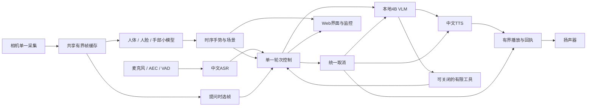

# 项目二新版计划：基于 Reachy Mini 的无机身端侧多模型部署服务

> 版本：v3.1｜2026-10-16｜面向Orin NX 16GB的实施与实操学习计划。
> 上游基底：NVIDIA-AI-IOT/reachy-mini-jetson-assistant，固定提交2673202a360a41935b45ac79141ef0bb529492ba。
> 当前状态：Reachy 派生实现已汇入 main，主目录默认运行四个新服务；完整应用循环、崩溃恢复与旧系统回退已验证，共存压力和准备工件的离线启动已验证，B0-SW 与架构导读已交付，等待用户从视觉复现开始；手势补测及后置验收保持开放。
> 执行边界：助手推进R0～R4基础工程与当前基线，R5按用户实操反馈推进。
> 2026-10-16用户确认：麦克风、扬声器实物环节暂时后置，不阻塞本阶段软件交接；用户接手后先从视觉项目开始优化。

## 0 项目目标与工作方式

### 0.1 核心目标

以陪伴机器人为应用场景，在Orin NX 16GB上交付一个**没有机器人运动载体、功能完整、结构清楚、可维护部署的端侧多模型服务**：

摄像头持续识别人体、人脸及手部状态；麦克风接收中文指令；4B主模型结合当前会话和必要画面理解语义；扬声器输出回应；挥手触发问候，静止举掌取消当前整轮。

先由助手复用真实项目源码搭建并夯实框架，跑通整体功能，交付当前模块与整机性能基线。随后由用户在逐步指导下，亲自使用专业工具测量、定位问题、分析瓶颈、制定和实施优化、回归并与基准对比。**最终完成同时要求工程可用和用户掌握方法。**

### 0.2 已确认范围

| 项目 | 当前决定 |
|---|---|
| 设备 | Orin NX 16GB；本机在线计算，不依赖云端或RK补算 |
| 应用基底 | 直接派生Reachy Mini Jetson Assistant源码，保留其可复用模块和主要业务顺序 |
| 物理表达 | 无机器人机身、头部/天线/电机表达，不使用SO-101 |
| 主模型 | 先用Qwen3.5-4B Q4_K_M＋匹配视觉投影，llama.cpp CUDA |
| 输入/输出 | D435i摄像头、ReSpeaker Lite双麦、扬声器；音频外设当前尚未接入 |
| 本阶段交接 | 软件框架＋D435i视觉实机链路＋文件/受控PCM语音验证＋软件基线B0-SW；物理录播/AEC/双讲/实际停播后置 |
| 感知 | 人体、人脸、手掌/手指；人脸仅检测和定位，无身份验证 |
| 手势 | 左右挥手→问候；静止举掌保持片刻→停止；挥动张掌不触发静止停止 |
| 停止语义 | 取消当前生成和播报、阻止未开始工具；已完成笔记/提醒保留 |
| 会话与工具 | 保留当前会话；有限笔记/提醒作为独立可关闭扩展，不成为感知初始化依赖 |
| 后置项 | 长期记忆、RAG、多Agent、其他模型选型和Edge-LLM性能对比 |
| 资源与性能 | 框架阶段先保证正确和有界；优化阶段由用户主导，不提前自动调参 |

### 0.3 三个交付节点

| 节点 | 主责 | 交付结果 |
|---|---|---|
| A：软件工程框架 | 助手搭建、修复并讲解；用户验收 | 无机身软件、D435i感知、中文文件/PCM语音、手势/工具、有限资源、异常恢复、可复现部署和架构交接 |
| B：软件性能基线B0-SW | 助手测量与报告；用户理解并复现 | 当前启用软件配置下的模块耗时、视觉实机与固定输入推理、软件响应及共存资源数据，固定输入和复现步骤 |
| C：先视觉、后扩展的指导式优化 | 用户动手；助手讲解、审查和按需协助 | 从相机/人体/人脸/手部推理与数据流开始，形成实际分析、修改、对比、回归及用户可独立讲解的案例 |

A/B完成后，助手不能自动代用户开展多轮优化。每次教学围绕一个问题，通常给出1～3条命令或一处改动；用户运行、观察并表达判断后再推进。用户明确要求代跑时记录执行者，代跑不等于学习验收通过。

麦克风/扬声器实物验收由用户明确后置。当前A/B的软件交接和视觉优化不等待外设；后续接入时另补声学指标和对应验收，不将软件文件输出记成实际播放。

框架正确性问题必须修复，例如死锁、泄漏、迟到结果、重复副作用和无法停止；这些修复可能顺带改变耗时，应记录原因，不把错误实现保留成性能基线。

### 0.4 工业落地的具体含义

目标是在明确的设备、外设和负载范围内做到：功能可重复、接口清楚、配置唯一、模型与依赖可追溯、资源有上限、错误可定位、故障可恢复、退出可清理、部署可复现、变更可回退。

上游是已提供Jetson应用实现的参考工程，其源码存在下述需要完善的边界。工业交付资格由本机真实验证建立，不由仓库所属组织或一次演示代替。外设缺失时只能标记软件阶段完成，不能宣称完整实机链路通过。

## 1 上游依据与复用方式

- [上游仓库](https://github.com/NVIDIA-AI-IOT/reachy-mini-jetson-assistant)
- [固定版本源码](https://github.com/NVIDIA-AI-IOT/reachy-mini-jetson-assistant/tree/2673202a360a41935b45ac79141ef0bb529492ba)
- 本机审查副本：/home/nvidia/AI_Stack/research/reachy-mini-jetson-assistant-2673202。
- [上游依赖兼容清单](https://github.com/NVIDIA-AI-IOT/reachy-mini-jetson-assistant/blob/2673202a360a41935b45ac79141ef0bb529492ba/packaging/jetson-wheels.json)
- 岗位方向延续[已核验的JD资料](../06_benchmarks/manifests/target-jd-20261014.json)：模型部署、C++/Python/Linux、数据流、资源与profiling、可靠交付。具体招聘资格不作假设。

“复用基底”指导入并派生实际代码，保留来源、许可证及上游commit，逐项记录本地差异。先固定可复现参考，再裁剪、适配和扩展；不只照目录另写一套，也不把旧项目主控整体塞入上游。

### 1.1 已核实的上游事实

| 事实 | 对本项目的影响 |
|---|---|
| 主入口串接STT、VLM、TTS及共享相机；采用Python线程/队列，未使用Pipecat或ROS2 | 新应用以此单一主线为基底，第一版不并入第二套会话/消息主框架 |
| 当前主路径配置为Orin Nano8GB、Python3.12、CUDA13.2、L4T39.2.0 | 我们是NX16GB，已记录L4T39.2.1；同为Orin不等于精确兼容，先核验 |
| 使用YuNet，人脸初始化取决于Reachy连接；FaceTracker包含运动控制 | 必须把人脸感知从机身和电机管理中拆开 |
| 无机身配置同时关闭face_tracking，且关闭AEC | 不能直接将该配置当作目标配置 |
| 默认ASR/语音设置偏英文，部分输入过滤和TTS分句按英文空格处理 | 中文适配包括模型、过滤、分句和播放，不能只替换prompt |
| VAD交出语音片段前暂停麦克风，主循环在处理/播放后恢复 | 需要改造监听与当前轮次处理关系，才能实现持续输入和整轮打断 |
| 部分音频/TTS队列无容量限制，退出有强制进程退出路径 | 增加有界缓冲、取消与清理，验证长期行为 |
| 启动辅助函数包含清理相机占用者/音频守护进程的行为 | 改为只管理自身资源，其他占用明确报告，不盲目结束无关进程 |
| 机器人“speaking gestures”是输出动作 | 不视作用户挥手/静止举掌已实现 |
| 提供网页、配置overlay、资源监控、部署材料和部分测试 | 直接复用并裁剪，减少新写通用管理代码 |

依据为固定版本的[主入口](https://github.com/NVIDIA-AI-IOT/reachy-mini-jetson-assistant/blob/2673202a360a41935b45ac79141ef0bb529492ba/run_web_vision_chat.py)、[音频流程](https://github.com/NVIDIA-AI-IOT/reachy-mini-jetson-assistant/blob/2673202a360a41935b45ac79141ef0bb529492ba/app/pipeline.py)及上述配置。这里是源码事实和待验证风险，不把尚未复现的每个风险都称为已发生故障。

## 2 目标范围与裁剪清单

### 2.1 保留、裁剪、适配、扩展

| 类别 | 文件/能力 | 处理 |
|---|---|---|
| 保留 | camera.py、llm.py、stt.py、tts.py、config.py | 以原接口和模块职责为起点，按需要增加本机后端适配 |
| 保留 | web.py、monitor.py、04_web/ | 保留画面、会话、运行状态和基础资源展示 |
| 保留并修正 | pipeline.py、audio.py、camera.py | 有界I/O、中文分句、取消、纯软件选帧、作用域内清理 |
| 保留并解耦 | face_detector.py、face_tracker.py | 保留检测/位置与时序状态，移除依赖电机的视觉伺服和扫描 |
| 从目标运行路径移除 | reachy.py、movement_manager.py、speaking_movements.py、运动测试和运动配置 | 不安装/启动Reachy SDK或daemon，不写电机目标；历史源码在上游/归档保留 |
| 后置 | rag.py、ChromaDB及embedding启动链 | 当前不加载，不让运行入口隐式依赖 |
| 必要新增 | perception.py、gestures.py、turn_control.py | 人体/手部结果、两个手势事件、单一活动轮次与取消 |
| 可关闭扩展 | actions/下有限工具/笔记/提醒 | 选择性迁移，保持独立持久化和执行回执，不引入Mem0/Qdrant |
| 部署补齐 | 启停/自检、依赖锁、模型锁、日志与基线脚本 | 复用现有已验证工具思路，保留最少必要入口 |

### 2.2 不进入当前主路径

不引入身份认证、人脸身份库、情绪推断、机械表达、机械臂、底盘、长期记忆、RAG、多Agent平台或模型排行榜竞赛。ROS2、Pipecat及其现有工程保留为历史资产，不作为新应用强制依赖。

第一版使用D435i的RGB画面满足当前2D感知和图文问答。原RGB-D/ROS时钟与深度能力有实际证据，但深度不再是本次默认数据链的前置条件；需要空间测距时单独恢复并验证。

## 3 功能模块与职责

| 模块 | 输入 | 输出 | 主责文件 | 边界 |
|---|---|---|---|---|
| 相机采集 | D435i/通用V4L2 RGB | 带frame ID、epoch和时间信息的帧 | camera.py | 单一采集者、共享有界缓冲，不直接调用LLM |
| 人体感知 | 最新RGB帧 | 人体框、置信度、可选姿态/匿名track | perception.py | 小模型推理与坐标变换；不认人、不播报 |
| 人脸感知 | 最新RGB帧 | 人脸框/有效性/位置状态 | face_detector.py、face_tracker.py | 与机身独立，不输出电机控制 |
| 手部感知 | 最新RGB或手部ROI | 手掌、21关键点、置信度 | perception.py | 单独验证预后处理，身体17点不能冒充手指模型 |
| 手势规则 | 连续的人/手结果 | wave、stop事件 | gestures.py | 去重、互斥、保持时间、有效期；不等待LLM解释 |
| 音频输入/VAD | 麦克风PCM | 带utterance ID的语音片段/说话事件 | pipeline.py、audio.py | 输入持续服务，缓冲有界；AEC与物理验证分开 |
| ASR | 一段语音 | 中文最终转写及错误/耗时 | stt.py | 固定后端契约；不自行开启新会话 |
| 主模型 | 文本、当前上下文、可选画面 | 回复流/工具请求/实际用量 | llm.py | 固定4B、预算检查、本地接口；不直接操作设备 |
| TTS | 当前轮次的文本片段 | PCM及合成状态 | tts.py | 音频格式、采样率、取消和能力明确 |
| 播放 | 当前轮次PCM | 实际播放/排空/停止回执 | pipeline.py、audio.py | 单一输出所有者，不播放过期轮次 |
| 会话控制 | 语音/文字/手势/结果 | 当前轮次、路由、取消与接纳决定 | turn_control.py | 仅实现单会话所需状态；不另造通用运行框架 |
| 有限工具 | 校验后的请求 | 实际执行与持久结果 | actions/ | 幂等、取消边界、真实回执；可关闭 |
| Web与监控 | 画面、事件、日志/资源 | 可视化状态和有限控制 | web.py、monitor.py | 展示和控制请求统一走主流程，不直接绕过状态 |
| 部署管理 | 一套有效配置、模型锁 | 受管理进程与健康状态 | main.py、05_scripts/、01_src/deploy/ | 只管理本项目拥有的进程/资源 |

所有模块具备明确的启动、就绪、请求、失败和关闭行为。状态上区分“进程存在”“端点可达”“模型就绪”“应用功能验证通过”，不能混用。

## 4 模型、后端与部署方式

| 角色 | 基础版本选择 | 选择依据与限制 |
|---|---|---|
| LLM/VLM | Qwen3.5-4B Q4_K_M＋F16投影，已有llama.cpp CUDA服务 | 用户已选择，已有本机加载及文件链路证据；迁入新应用后重验 |
| VAD | 上游Silero接口 | 保留32ms等实际模型输入契约，核验本机ONNX执行 |
| 中文ASR | 优先复用现有Qwen3-ASR0.6B本机服务，以薄adapter接入STT接口 | 初版采用已验证整句识别；不能仅因上游名称就宣称流式partial识别已实现 |
| 中文TTS | 优先复用现有Matcha/Vocos本机服务 | adapter保持上游合成/播放职责分离，核验中文标点和PCM契约 |
| 人脸 | 上游YuNet | 优先保留原实现与输出定义，完成无机身调用 |
| 人体/姿态 | 现有YOLOv8n/pose工件与参考输出 | 在新应用使用现成ORT/TensorRT推理接口；不强制保留ROS节点进程 |
| 手掌/手部 | OpenCV Zoo MediaPipe Palm＋HandPose候选 | 尚未本机接入，先固定原始模型和上游预后处理，再验证后端 |

上游的Whisper/Kokoro保留为参考，不作为与中文后端并行维护的第二套默认路径。主模型通过本机兼容接口接入；沿用上游LLM接口形式，不迁入旧AssistantSession或第二套主控。

主应用使用独立环境，首版优先复用现有本机原生推理工件和服务。上游Docker启动配方保留为参考；不在初版同时维护Docker与原生两套正式部署。以后更换方式必须形成独立配置与验证。

[YuNet](https://github.com/opencv/opencv_zoo/tree/main/models/face_detection_yunet)、[Palm](https://github.com/opencv/opencv_zoo/tree/main/models/palm_detection_mediapipe)、[HandPose](https://github.com/opencv/opencv_zoo/tree/main/models/handpose_estimation_mediapipe)均来自已核验的上游模型库。手部INT8有上游精度警示，首次使用参考精度。版本、权重、许可证、转换参数和实际provider均入锁，不静默回退CPU后声称GPU部署成功。

### 4.1 初始容量配置

- 固定4B，保留当前2048上下文、128输出作为起始配置，实际模板计数必须验证。
- 每次视觉问答先选择1张640×480画面；上游默认多帧配置不能直接与该容量组合。
- 单个活动LLM请求，有限的当前会话历史；按实际token预算裁剪，不按字符粗估。
- 每路感知至多一个正在处理输入及有界待处理输入；过载时视觉优先最新帧，记录丢弃。
- 音频、文本片段和PCM队列按时间/字节设置上限，停止时丢弃本轮待输出。
- 默认功能组合、线程、缓存、工作区和后台服务全部写入有效配置及基线快照。

这些是可运行与资源正确性的初始边界，不预设最优吞吐，也不把改变工作量当成优化收益。

## 5 数据流、交互与资源所有权



### 5.1 数据契约

| 数据 | 必须记录 |
|---|---|
| 图像 | frame_id、source_epoch、宽高/编码/stride、原始时间及时间类型、接收单调时间、owner/lease |
| 感知结果 | 对应frame_id、模型/工件版本、类别/置信度、坐标系、关键点定义、完成时刻 |
| 手势事件 | event_id、匿名来源、证据窗口、wave/stop、确认时刻、有效期 |
| 语音 | utterance_id、turn_id、VAD事件时间、音频格式、取消代次 |
| 模型与工具 | request/turn ID、实际用量、状态、幂等键、真实执行回执 |
| 输出 | 归属轮次、合成开始/首PCM、输出入队、实际播放/排空、取消原因与通道类型 |

V4L2/OpenCV路径如果只能取得主机收帧时间，应明确标记，不冒充传感器硬件采集时间。相机重启更换epoch；来源失效、过期帧、旧轮次和迟到回调不得污染当前交互。

### 5.2 单一轮次与取消

主交互状态为IDLE→LISTENING→TRANSCRIBING→GENERATING→SPEAKING→IDLE，并支持CANCELLING与DEGRADED。这是界面和轮次的状态摘要；流式生成、分句合成与播放可以重叠，各阶段另报实际状态。状态由一处控制，界面和各adapter仅报告事件。

语音监听、持续感知和输出控制独立于慢推理。取消使当前代次立即失效，停止新提交，关闭本轮模型流，取消可取消的合成工作，清空本轮待播数据，停止本应用拥有的播放器，再确认后端和缓冲释放。新输入的接纳受释放状态约束；不能只把前台future置为取消却继续接纳冲突请求。

已完成副作用保留；已开始的不可回滚事务必须收尾并记录实际结果。迟到文本/音频可以被拒绝接纳，但这不等于GPU已立即抢占；分别记录逻辑取消和后端实际释放。

### 5.3 两个手势

- wave：同一有效track/手部轨迹出现左右运动，确认后问候一次。保持静音、会话占用、冷却和过期规则；不抢占正在处理的用户指令。
- stop：有效张掌、相对静止并持续一段时间才确认。直接走统一取消，不由LLM判断。
- 挥动时不累计静止掌保持时间；遮挡/离场/track重建需重新积累。
- 基础单会话下，任何有效停止事件可停止当前轮次；多人问候去重并记录匿名来源，不做身份判断。
- 持续时间、运动和置信阈值属于可配置开发参数，使用有正反例的真实片段确定；不能以合成骨架证明真实手势质量。

### 5.4 初版资源分配与过载策略

沿用上游线程、队列和本地模型服务，先实现以下有限规则；不额外搭建通用调度平台。

| 路径 | 初始规则 | 满载或失败时 |
|---|---|---|
| 采集、VAD、取消控制 | 保持独立服务；停止消息不排在推理任务之后 | 报告输入丢失/溢出，取消仍走独立控制路径 |
| 人体/脸/手感知 | 按配置周期取最新帧，每个模型只接纳有限请求 | 跳过过期输入，保留丢弃量与最新有效结果年龄 |
| ASR、4B、TTS | 各后端限制在途请求和待处理量，启动时记录实际内存占用 | 超出容量明确拒绝或进入有界等待，不无限创建线程/请求 |
| 播放 | 一个设备所有者，按轮次接纳PCM | 缓冲上限触发背压；取消清空本轮，禁止后续迟到音频回灌 |
| 常驻模型与后台服务 | 只启动本配置必需项，记录工件、进程与内存预算 | 资源不足时明确报告缺失能力，不静默更换模型或伪造就绪 |

这些规则限制应用提交和积压，并不保证独立CUDA进程之间具有硬实时优先级或GPU抢占能力。R4报告共存时的实际内存余量和干扰；R5再由用户根据时间线决定感知周期、模型常驻、线程或提交时机是否需要调整。

## 6 目标代码结构与简洁性规则

沿用上游以模块文件为主的结构，按真实变化增加少量文件；不先创建大量空层级。

```text
project/
  main.py / run_web_vision_chat.py
  01_src/                    # app、deploy、benchmarks 源码包
  02_config/                 # 配置
  03_models/                 # 模型清单与哈希
  04_web/                    # 网页与调试界面
  05_scripts/                # 准备与功能验证脚本
  06_benchmarks/             # 固定语料、测量协议和结果
  07_tests/                  # 自动化回归
  08_docs/                   # 文档与历史索引
  09_patches/                # 最小上游补丁
  10_licenses/               # 第三方许可证
  references/                # 原参考资料保留
```

上图对应当前运行主线；2026-10-19 已清理旧方案文件，具体目录与阅读顺序以 [README](../README.md) 为准。精简要求：

1. 运行参数由上游typed config＋一个平台overlay解析，输出唯一effective config；模型身份/哈希另有manifest，但不重复维护运行参数。
2. 顶层入口只装配和管理生命周期；业务逻辑不复制到多个入口。
3. 一个相机所有者、一个播放所有者、一条取消路径和一处轮次状态。
4. app运行时代码不得导入实验脚本；测量代码通过明确观测接口采集，不侵入业务决策。
5. 异常不能大范围吞掉；返回明确状态并保留堆栈/请求归属。禁止把强制退出作为正常清理成功。
6. 旧长期记忆、历史评测和无关业务不整体搬入新app。按功能回归而非单纯文件数量评价精简程度。
7. 保留上游接口和代码来源，所有本地差异有原因与验证；不把使用上游功能写成自研。

## 7 新旧工程迁移与回退

### 7.1 隔离实施

- 固定旧项目快照和可运行配置，保留Git历史、原始报告、模型和用户数据。
- 在独立迁移分支/worktree导入固定上游应用树；不在仍工作的旧运行目录直接大面积覆盖。
- 上游审查副本保持不改；派生分支保留上游来源和差异清单。
- 新应用创建独立环境及配置目录，复用经校验的模型/原生工件，避免重复下载或复制大权重。
- 原始references/保留；旧代码通过历史分支、标签和归档追溯，不用两套生产app并排构成新主流程。

### 7.2 选择性复用清单

| 旧资产 | 迁移策略 |
|---|---|
| llama.cpp二进制、4B模型、锁定参数 | 优先复用服务能力，新的LLM adapter重新验证消息、图像和token |
| 已验证中文ASR/TTS | 复用本机后端，通过上游模块接口适配 |
| 检测/姿态ONNX/engine和参考结果 | 复用工件与正确性证据；新调用路径重验，不默认复制ROS图 |
| 轮次ID、epoch、lease、取消/幂等经验 | 迁入必要机制与针对性回归，不复制旧主控框架 |
| systemd管理、端口归属、自检经验 | 精简到新应用必需服务，保留可靠性能力 |
| 旧工具/提醒 | 按独立扩展迁移；不带入强制记忆初始化 |
| Mem0/Qdrant/BGE及历史数据 | 保留，不迁入默认运行路径、不删除数据 |
| 91个历史tools脚本和大量报告 | 分类归档；只保留当前部署/测试/基线所需入口 |

### 7.3 切换规则

相机、声卡和模型端口均登记所有者。新旧相机采集不能无说明争用同一设备；需要切换时通过项目管理入口停止自己的服务，不执行上游可能结束无关占用者的辅助操作。

只有新应用通过本阶段自检后才切换默认入口。失败则恢复已保存的旧配置与服务；用户数据不被测试覆盖。迁移过程不改系统镜像、不自动升级CUDA/TRT、不因版本差异盲装上游wheel。

## 8 实施阶段与交付物

| 阶段 | 任务 | 主责 | 离开条件 |
|---|---|---|---|
| R0 固定来源与迁移准备 | 锁定上游、旧项目快照、环境/模型核验、分支与差异表 | 助手 | 源码身份明确，兼容差异可追踪，旧系统可回退 |
| R1 上游参考与无机身基础 | 复现最小可用参考；裁剪运动/SDK/RAG；接通相机、文字、VLM和Web输出 | 助手 | 文字/图像路径可通过公开入口运行，人脸不依赖机身；无隐藏机器人服务 |
| R2 中文与多模型感知 | 4B/中文ASR/TTS适配，人体/脸/手模型接入，统一格式和观测 | 助手 | 各模型单体正确，实际provider明确，摄像头与语音链路贯通 |
| R3 交互控制与工程可靠性 | 当前会话、wave/stop、语音取消、队列/清理、工具、故障恢复 | 助手 | 核心功能与异常场景通过；无旧轮次输出或重复执行 |
| R4 软件交付与基线 | 视觉实机/软件功能复验、重复运行、冻结软件配置、B0-SW与架构交接；物理音频后置 | 助手交付，用户复现 | 当前A/B范围有真实证据，形成baseline标签；硬件后置项保持DEFERRED |
| R5 逐模块指导式优化 | 用户实操测量、定位、假设、修改、回归、对比；助手逐步指导 | 用户主导 | 各模块完成诊断与取舍记录，至少一个可信优化案例由用户亲自完成 |
| R6 综合验证与成果 | 合并有效改动、长时/故障/重部署、最终对照与技术讲解 | 共同；用户完成结果解释 | 工程与掌握验收均满足，简历陈述有可追溯证据 |

新版Goal激活后从R0开始，实际进度以任务清单和验证证据为准。R0–R4可以自主解决基础工程问题；R5不在用户缺席时自动连续优化。

### 8.1 每阶段的具体检查

**R0**
- 固定上游源码及许可证；现有本机环境不自动替换。
- 比较L4T39.2.0与39.2.1、Python/CUDA/TRT和实际ABI/库；记录可复用和需本机构建的工件。
- 保存旧有效配置、服务清单及数据目录；创建新的隔离路径与回退步骤。
- 明确推荐启动入口和配置层级，停止继续扩展旧主控。

**R1**
- 在隔离环境理解上游原始启动、处理和退出路径。
- 继续使用已选4B，通过配置适配上游客户端；不为复现额外筛选或下载Gemma等主模型。参考的配置差异明确记录，音频主线在R2接入中文后端后验证。
- 无法原样复现时，先记录具体阻塞，不把适配后的结果称为原样复现。
- 去掉机器人表达和后台daemon，将人脸检测独立初始化。
- 保留Web画面/对话/状态，剔除电机与机身面板。
- 没有音频硬件时先完成文字和相机链路，中文录制音频/文件输出在R2接入后验证，明确测试模式。
- 为上游入口补齐无音频硬件的软件模式：文字/图像可运行，后续接入真实ASR/TTS的文件输入输出；设备缺失不产生虚假的采集/播放回执。

**R2**
- 保留4B推理服务；实现中文ASR/TTS接口适配及基础质量检查。
- 启用工具时保留已验证的原生串行调用策略；模型预检与真实请求使用一致模板/布尔参数，并按轮次核对实际用量。
- 修正英文空格过滤/分句，正确处理中文短指令和中文标点。
- 核验人体、人脸、手关键点的输入变换、坐标、模型身份和输出有效性。
- 同一摄像头帧只按需要复制，模型和界面共用有界缓存。
- 缺模型、格式错误、provider不匹配时明确失败，不隐式加载另一模型顶替。

**R3**
- 监听与处理分离，只有一个活跃业务轮次；慢推理不阻塞停止事件。
- 加入手势互斥、事件过期和去重，完成语音/界面/手势共享取消。
- 限制语音片段、TTS文本、PCM和图像缓冲；验证队列满的实际行为。
- 当前上下文只接纳应保留的用户输入和实际交付结果，取消轮次不伪装完整回答。
- 工具启用时验证创建/查询/取消、幂等、重启及持久状态。
- 修复失败清理、后台线程、连接和本项目子进程残留。

**R4**
- 真实设备走完整场景；分别记录合成、回放、文件和实物结果。
- 记录所有剩余缺口，做公开命令复现和基础持续运行。
- 冻结基础版本、默认功能、模型、输入集和测量口径。
- 提交基线报告、原始数据及一份从入口到输出的代码导读。

**R5**
- 从用户能亲自复现基线开始，逐模块采集、判断和提出假设。
- 一次改变一个因素；实际结果与预期不一致时先解释，不连续扫参数。
- 不是热点的模块也须有测量和判断，可以选择不改并说明原因。
- 经过回归的有效修改才进入合并配置，保留失败/无收益尝试。

**R6**
- 合并后重跑同一基准，核验收益、退化和资源余量。
- 完成8h代表性共存与适用故障重复验证。
- 用户独立讲清模型部署、数据路径和至少两个根因/取舍案例。
- 记录上游贡献与本地改动归属，形成可复现交付。

## 9 功能验收与问题修复

### 9.1 正常场景

| 编号 | 场景 | 期望结果 |
|---|---|---|
| F01 | 启动/停止/再次启动 | 配置一致、模型身份正确、端口/设备归属明确，退出后资源释放 |
| F02 | 摄像头持续感知 | 人体/脸/手类型区分，时间与帧归属正确，界面可见有效状态 |
| F03 | 中文文字与语音问答 | 请求进入4B、生成相关回复并由实际TTS输出，错误可见 |
| F04 | 当前画面问答 | 使用本轮有效画面，断流时拒绝旧图 |
| F05 | 当前会话连续两轮 | 保持必要上下文，清空会话后不错误继承 |
| F06 | 挥手问候 | 同一逻辑事件一次回应，遮挡/过期/忙碌规则生效 |
| F07 | 静止张掌停止 | 取消当前生成与播放；挥手不会误走静止停止路径 |
| F08 | 语音/界面打断 | 旧轮次不继续输出，新轮次在资源状态允许后正确开始 |
| F09 | 有限工具扩展 | 启用时有真实执行回执，重复请求不新增副作用，取消边界一致 |
| F10 | 网页和监控 | 展示的有效配置、当前状态、模型与资源对应实际运行 |
| F11 | 断网与重启 | 已准备工件可离线启动，缺失工件明确报告，数据保持 |
| F12 | 过载/故障恢复 | 缓冲有界、不无限排队；恢复后下一轮可用，状态不污染 |

每个场景保留实际输入、预期、结果和失败原因。基础版本至少对重复启动/请求/取消/退出做20次循环，对不同取消阶段和错误路径分别覆盖。手势须有真实正反例及遮挡/多人片段；合成点位只用于规则测试。

核心流程存在未解决的崩溃、死锁、迟到输出、重复副作用、无界积压或无法恢复时，基础版本不能标为完成。模型泛化正确率仍单列，不以历史选择题80%目标卡住框架建设，也不能用不相关答复冒充功能正确。

### 9.2 故障矩阵

| 故障 | 要验证的行为 |
|---|---|
| 相机断流/拔插/重启 | 输入不可用、旧帧失效、恢复更换epoch |
| ASR/LLM/TTS服务退出或连接失败 | 当前轮明确结束/失败，恢复后下一请求正常 |
| 请求超时/部分输出中断 | 不重复工具、不拼接跨轮次音频、实际释放可追踪 |
| 音频设备消失/播放失败 | 明确状态，不伪造played回执，用户可重新选择设备 |
| 队列满/消费者变慢 | 预定丢弃、背压或拒绝，停止控制仍可响应 |
| 模型/配置不匹配 | 自检失败并指出身份/格式差异 |
| 提醒/笔记写入与停止交错 | 已提交结果保留，未开始操作不执行，重启后状态一致 |
| 应用退出/重复启动 | 不遗留本项目线程/进程/端口/图像引用，不杀其他应用 |

基础阶段每类至少验证一次真实故障和恢复；最终版本每类适用故障至少10次，保存全部尝试。测试用独立数据，不故意耗尽整机内存或破坏用户状态。

### 9.3 硬件缺失时的交付边界

用户于2026-10-16明确要求暂时跳过麦克风/扬声器实物接入，并在接手后先优化视觉。当前交接包含D435i实机、软件数据流、真实模型文件/受控PCM输入、逻辑取消与资源释放，以及B0-SW。实体录播、AEC、双讲、首个可听回应和实际停播时间标记DEFERRED，不作为本阶段交接或视觉实操的阻塞。它们仍是后续独立验收项目，软件证据不能将其标为PASS。

## 10 初始性能基线

### 10.1 三类记录

- U0：固定上游参考版本的资料或实际复现，注明其模型、语言、设备与工作负载。未经本机复现的数据标“上游报告”。
- B0-SW：当前无机身软件版本的第一份正式功能基线，由助手交付；包括视觉实机、固定输入单模块与启用软件的共存。本文后续B0对比在本阶段均指B0-SW。
- E编号：用户指导式单因素实验；最终合并配置重新对比B0，并保留单项结果。

不能把上游Gemma/英文/多帧结果直接与本机4B/中文/单帧结果计算软件优化加速比。B0与后续实验保持同一业务工作量和测量定义，部署配置变更单列。

### 10.2 模块与整机指标

| 范围 | 必须报告 |
|---|---|
| 相机/帧缓存 | 实际输入率、取帧等待、有效/过期/丢弃数、缓冲字节、时间戳口径 |
| 人体/脸/手模型 | 预处理、实际推理、后处理、有效输出率、周期采样最新结果年龄、无结果比例 |
| 音频/VAD | 采集与缓冲、端点确认耗时、分段/漏段/误触发情况 |
| ASR | 音频时长、转写耗时/实时率、固定语料CER及执行错误 |
| LLM/VLM | 排队、图像准备、输入tokens、TTFT、生成速率、输出长度和错误 |
| TTS/播放 | 首PCM、合成RTF、输出排队、实际首播/排空/停止；合成和设备时间分开 |
| 整体交互 | 话音结束到首个相关可听回应；图像问答、普通问答分别统计 |
| 取消 | 事件确认→逻辑取消、后端释放、实际停播；手势保持时间另计 |
| 资源 | MemAvailable、进程PSS/RSS、CPU/GPU/EMC、温度/时钟、队列、FD/线程及工件/缓存 |

上述指标保留完整目标定义。当前B0-SW报告实际可测的软件项：视觉采集/推理/帧龄、ASR文件RTF、LLM/VLM时延、TTS首PCM/合成RTF、软件取消/后端释放和多模型共存。使用文件或受控PCM时明确标记时间起点；物理录音延迟、AEC质量、可听首声和实际停播记为DEFERRED，不填估算值。

Orin共享系统内存；文件大小、RSS、设备分配不能简单相加。GPU异步API提交耗时不等于执行耗时。单模型快不代表共存时端到端快，持续感知不能只统计已经完成的好帧。

### 10.3 测量协议与交付

- 基线固定模型/依赖/有效配置、输入集、到达时间、初始会话与工具状态、功耗模式、预热条件和后台服务。
- 普通语音、图文语音、持续感知、手势/打断、工具和过载分别形成场景。
- 报告样本数、P50/P95、最大值及全部失败/拒绝/丢弃。首次基线每类至少20个事件，正式优化对照至少5轮、每类累计至少100个事件；样本不足明确标注。
- 真实场景与固定回放分别记录；有界回放保持输入到达时刻，不按处理完成动态放慢输入。
- 正式性能测试期间不并行构建、下载、跑其他测试或改变代码/配置。
- 低开销监控用于时延/长时，短Nsight trace用于根因，插桩开销单列。
- 交付effective config、模型/环境指纹、events.jsonl、resources.csv、baseline.json、可读报告及复现命令；大文件放AI_Stack，仓库保留索引和哈希。
- 原3/5秒、500ms、20%收益为历史目标，不直接变成当前硬门槛；用户理解B0后，在优化前固定有依据的交互目标与服务/内存约束。

B0的作用是告诉用户“当前系统各部分实际怎样运行”。不能先完成自动调优再把优化后状态称作初始基线。

## 11 按模块指导用户优化

每个模块都走：**理解职责→复现指标→观察证据→提出假设→选择方案→改一个因素→回归→对比B0→解释取舍**。不是所有模块都必须改动，但每个模块都要有分析和判断。

本阶段实操顺序按用户最新选择固定为：L0架构/基线复现 → L1视觉模型部署契约 → L2相机与人体/人脸/手部数据流 → L6视觉与4B共存 → 已定位的L7热点 → L8回归对比。L4的图像输入路径可随视觉问题纳入；语音专题和实物声学优化安排在后续。助手完成B0-SW及导读后等待用户执行第一组视觉命令，再按结果逐步推进。

| 实操单元 | 用户要回答的问题 | 主要工具 | 可研究因素（由证据选择） |
|---|---|---|---|
| L0 架构与操作 | 一轮请求经过哪些进程、缓冲和状态？ | 公开CLI、日志/请求ID、进程/线程 | 先不优化，独立复现与解释 |
| L1 模型部署 | 输入/输出、预后处理、精度和实际后端是否正确？ | ONNX/engine信息、参考输出、trtexec | shape/profile、精度选择、部署偏差 |
| L2 相机与感知 | 时间花在采集、转换、模型还是积压？ | 阶段计时、Nsight Systems、队列/帧龄 | 最新帧策略、ROI、布局和缓冲复用 |
| L3 语音输入/ASR | 慢在端点、排队还是识别？ | 音频时间轴、RTF、CPU/GPU采样 | 分段、线程、后端配置；保留识别质量 |
| L4 主模型 | 慢在图像准备、prefill、decode还是等待？ | llama-bench/实际接口、NVTX、Nsight | 缓存、批量、工作区、并发；不混入模型更换 |
| L5 TTS/播放 | 首声慢在合成还是队列/设备？ | PCM/播放回执、RTF、音频日志 | 中文切句、输出块、线程和缓冲 |
| L6 多模型共存 | 哪些负载争抢CPU/GPU/内存？ | Nsight Systems、tegrastats、perf、PSS | 提交准入、感知周期、线程和缓存预算 |
| L7 原生热点与故障 | 是否确有C++/CUDA热点、越界或泄漏？ | gdb/core、ASan；适用时Nsight Compute | 只针对已定位路径做原生修改 |
| L8 综合复测 | 收益能否重复，是否伤害其他模块？ | 固定基准、质量/功能回归、长时曲线 | 合并有效变化、回退退化配置 |

工具以本机已支持版本为准；先确认可用能力，不为了工具名升级系统。CUDA Graph区间和请求重叠不等于SM同时执行；复杂stream/Graph等优化须先有热点证据。

每轮记录用户的初始判断、命令、原始输出、标注、假设、修改及结果。助手给出方法、可选解释和代码审查，不在用户未反馈时自动跑下一轮或替用户宣布结论。用户亲自完成至少两个模块的实验过程，其中至少一项形成可重复的有效改善；未达预期的实验也是必须解释的工程材料。

## 12 最终验收

### 12.1 工程完成

| 编号 | 完成条件 |
|---|---|
| E01 来源与部署 | 上游/本地差异明确，工件锁定，部署/离线/重启/回退可复现 |
| E02 结构与模块 | 一套主流程，模块输入输出和生命周期明确，无默认机器人/长期记忆依赖 |
| E03 完整功能 | F01～F12按启用范围有真实证据；人体/脸/手、中文、画面与实体声音贯通 |
| E04 取消与数据一致性 | 语音/界面/手势取消正确，无跨轮次输出与重复副作用 |
| E05 资源与恢复 | 缓冲有界、资源可收回；最终适用故障重复检查通过 |
| E06 基线可信 | B0配置、输入、指标、样本和原始数据齐全，可由用户复现 |
| E07 优化可验证 | 用户主导的有效改变可重复，质量与其他服务约束同时报告，合并后复测 |
| E08 长时与维护 | 代表性8h无未恢复崩溃/OOM/持续积压；内存/温控变化可解释，已知局限清楚 |

### 12.2 用户掌握

| 编号 | 用户能够独立完成 |
|---|---|
| K01 | 启停系统、解释模块和一次完整请求的数据流/资源所有权 |
| K02 | 复现单模块及整机基线，说明输入、预热和计时口径 |
| K03 | 使用专业工具读一次真实时间线，区分等待、数据处理与执行 |
| K04 | 提出可检验假设并实施单因素配置或代码改动 |
| K05 | 完成功能/精度回归，判断与基准对比是否可信并解释代价 |
| K06 | 独立复现并讲清至少两个根因/优化案例，包括一个无收益或退化尝试 |

最终完成要求E01～E08与K01～K06都满足。历史自动化报告、已启动服务数、文档数和测试数量不能替代用户掌握或完整功能验收。新E/K口径与旧JT、SF/DP分别保留，不混合计算通过率。

当前软件阶段按已启用范围验收，E03/E04/E06中的实物声学部分保留DEFERRED；其缺失不阻塞本次软件交接与视觉优化。软件阶段通过和全部后置项目通过必须分别陈述。

## 13 风险、决策和范围控制

| 风险/差异 | 处理与离开条件 |
|---|---|
| 上游精确BSP/wheel与本机不同 | 在隔离环境验证或本机构建，保留兼容记录；不静默忽略版本条件 |
| 人脸/捕获逻辑与机身耦合 | 保留检测、重构纯感知状态；无SDK/daemon时验证启动和持续运行 |
| 上游半双工式主循环 | 单轮控制与监听/处理分离，先证明停止与资源释放；这是功能改造，不包装为已有能力 |
| 中文短句/分句不适配 | 用中文边界用例验证过滤、标点、合成和回读 |
| 新增感知模型挤占16GB资源 | 固定必要模型与明确预算；先保证功能，后续用户测共存和优化 |
| D435i/声卡争用旧服务 | 明确所有权，受控切换，失败恢复旧服务 |
| 仍缺少实体音频/真人手势样本 | 继续独立软件工作，实物验收单列，不以模拟代替 |
| 再次长成重型自建系统 | 所有新增模块须对应当前功能或已复现问题；不扩展通用框架、长期记忆和无需求业务 |
| 将上游演示误当工业交付 | 逐项验证指定设备/负载，保留上游、本地和用户实操证据范围 |

若复现暴露根本兼容障碍或需要重写大部分上游主链，应先记录失败和裁剪/适配成本，再重新评估基底；不得悄悄回到新写一套主框架的路线。

## 14 文件、进度与实施边界

- 当前计划：本文件；[总览](project-overview.md)只维护定位与分工。
- [上游审查锁](../01_src/deploy/reachy-upstream.lock.json)：固定源码身份和关键文件哈希，状态为审查，不代表已部署。
- [新版任务清单](../06_benchmarks/manifests/reachy-headless-roadmap-v3.json)：R0～R6、工程与学习验收、当前执行状态。
- [迁移缺口清单](../06_benchmarks/manifests/reachy-gap-ledger-v3.json)：来源差异、待验证风险、处理与证据。
- [旧实现进度](archive/repository-cleanup-20261019.json)保留历史通过范围；新应用未自动继承。
- [旧版计划](archive/02-plan-v2.1-before-reachy-20261015.md)与[旧版使用说明](archive/README-pre-reachy-20261015.md)留作追溯。
- 外部源码、环境、模型及原始数据统一位于/home/nvidia/AI_Stack；references/不删除。

计划修订已完成，现已恢复基础工程实施。隔离迁移和验证通过前，主目录默认代码与服务保持旧版本；新入口是否可用以迁移分支及验证记录为准。R5仍以用户实际反馈推进，不由自动Goal循环代做。

### 最终Goal文本

以下保留完整项目目标。当前交接按2026-10-16用户确认分期：物理音频后置，先交付软件/视觉框架与B0-SW，之后等待用户从视觉开始实操优化。

> 基于固定版本的NVIDIA Reachy Mini Jetson Assistant实际源码，在Orin NX16GB上派生无机身端侧多模型服务。保留上游模块组织及语音/视觉主线，裁掉机器人运动与默认RAG依赖，固定Qwen3.5-4B和本地中文ASR/TTS，补齐人体、人脸、手部感知、挥手问候、静止举掌整轮取消与必要有限工具。由助手先完成清晰简洁的工程结构、数据流、生命周期、有界资源、异常恢复、可复现部署及真实完整功能验证，再交付未预先调优的各模块/整机B0性能基线和架构导读。之后由用户在逐步指导下亲自使用专业工具，逐模块测量、定位、分析、提出并实施优化，回归并与冻结基准比较；助手负责解释、审查和明确请求的协助，不自动代替用户连续优化。最终同时满足E01～E08工程验收和K01～K06用户掌握验收。长期记忆另阶段，身份验证和机器人表达不包含，Edge-LLM仅作后续独立对照；所有完成结论以真实证据及其适用范围为准。
