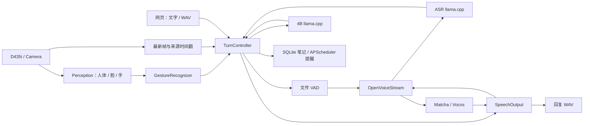

# Orin NX 端侧多模型陪伴服务

基于固定版本的 [NVIDIA Reachy Mini Jetson Assistant](https://github.com/NVIDIA-AI-IOT/reachy-mini-jetson-assistant)，在 Orin NX 16GB 上连接相机、人体/人脸/手部感知、中文语音和 4B 图文模型。没有机器人机身控制；身份验证已移除，长期记忆留到后续阶段。

当前软件框架与 B0 基线已交付。**接手顺序：亲自启停完整系统 → 理解服务与数据流 → 复现视觉基线 → 在指导下分析和优化。** 实物麦克风/扬声器、真人手势负例、8 小时长稳和干净环境重部署仍待验收。

[项目定位与分工](docs/project-overview.md) · [完整实施计划](docs/implementation-plan.md) · [部署说明](deploy/systemd/README.md) · [B0 总清单](benchmarks/results/reachy-b0-sw.json) · [阶段验证记录](docs/reachy-migration.md)

## 从停止状态亲自启动

以下命令在板端以 `nvidia` 用户执行。模型与运行环境已经准备在 `~/AI_Stack/`。

```bash
cd /home/nvidia/Multi_Model_Inference
source /home/nvidia/AI_Stack/environments/reachy-headless/bin/activate

# 结束当前对话后，停止本项目四个服务，确认 STOPPED。
python main.py services down
python main.py services status

# 查看有效配置；check 校验工件，并列出各服务实际启动命令。
python main.py config
python main.py services check

# 第一次按顺序启动，理解每个服务；每条成功返回后再执行下一条。
python main.py services up --components llama
python main.py services up --components asr
python main.py services up --components speech
python main.py services up --components app
python main.py services status
```

最后应为 `READY`，四个服务均就绪，摄像头持续出图。以后用 `python main.py services up` 一次启动全部服务。失败时查看对应组件日志，例如 `python main.py services logs --components app --lines 80`。

`up` 会复用已运行的依赖。退出终端不会停止 systemd 服务；完整停止使用 `services down`，仅停止应用使用 `services down --components app`。详细生命周期、冻结配置与回退方式见 [部署说明](deploy/systemd/README.md)。

## 四个服务与数据流

| 服务 | 职责 | 板端端口 |
|---|---|---:|
| `llama` | llama.cpp，Qwen3.5-4B 图文理解 | 8088 |
| `asr` | 独立 llama.cpp，Qwen3-ASR-0.6B 语音识别 | 8089 |
| `speech` | OpenVoiceStream，ASR 接口及 Matcha/Vocos TensorRT TTS | 8621 |
| `app` | 网页、相机、视觉小模型、手势、对话轮次、工具与诊断 | 8090 |

人体、人脸、手部模型由 `app` 内的感知 worker 调用。systemd 管进程，`TurnController` 管当前请求，模型后端执行推理。



视觉始终保留帧来源；挥手触发问候，静止举掌取消整轮。取消阻止新输出和未开始的工具，等待后端释放后才接纳下一轮；已提交的笔记/提醒保留。

## 代码仓地图

```text
main.py                    CLI：配置、自检、服务管理、单次问答
run_web_vision_chat.py      应用组装、启动与退出；由 app 服务调用
app/                       当前业务与模型适配，保持 Reachy 的模块组织
  actions/                 笔记/提醒工具、SQLAlchemy 持久回执
config/                    基础配置 + Orin NX 平台配置
models/                    模型身份、来源和哈希；实际权重在 AI_Stack
  baselines/、candidates/  历史模型与候选清单，默认模型以 manifest.json 为准
deploy/                    systemd 管理、原生启动参数、工件与上游锁
  speech/                  OVS 接入和语音兼容层
  systemd/                 单元模板、启停与回退说明
static/                    index.html；app.css/app.js；debug.css/debug.js
scripts/                   prepare_* 准备工件；probe_* 功能验证
benchmarks/                性能采集、汇总、绘图；不参与业务决策
  corpora/                 当前 B0 的固定中文文本/语音提示
  manifests/               固定输入与测量协议、任务及验收清单
  results/                 当前 Reachy 阶段证据与冻结 B0
tests/                     自动化回归
docs/                     项目定位、实施计划、阶段记录
  archive/                 历史计划与清理恢复索引
  upstream/                固定上游的原始文档
references/                原有学习参考子模块，保持原样
```

实际源码、权重、编译产物、环境、数据库与运行日志集中在 `/home/nvidia/AI_Stack/`，见 [依赖目录说明](deploy/dependencies-layout.md)。根目录 `.venv*` 是旧环境的兼容链接，部分已安装脚本仍通过它们启动；当前应用使用上面的 `reachy-headless` 环境。

## 按运行顺序阅读

| 顺序 | 文件 | 先回答的问题 |
|---|---|---|
| 1 | [main.py](main.py) → [app/cli.py](app/cli.py) → [deploy/services.py](deploy/services.py) → [deploy/runtime.py](deploy/runtime.py) | 一个启动命令如何变成四个受管理服务？ |
| 2 | [run_web_vision_chat.py](run_web_vision_chat.py) | 谁创建相机、模型接口、感知线程和轮次控制器？谁负责退出？ |
| 3 | [app/camera.py](app/camera.py) → [app/perception.py](app/perception.py) → [app/gestures.py](app/gestures.py) | 一帧如何得到三类识别结果？为什么目标频率为 5 FPS？ |
| 4 | [app/turn_control.py](app/turn_control.py) | 请求如何接纳、选帧、调用模型/工具、提交输出和取消？ |
| 5 | [app/llm.py](app/llm.py)、[app/stt.py](app/stt.py)、[app/tts.py](app/tts.py)、[app/request_io.py](app/request_io.py) | 后端契约、超时和取消由谁保证？ |
| 6 | [app/pipeline.py](app/pipeline.py)、[app/audio.py](app/audio.py) | VAD、文本分块、PCM 队列和文件提交如何协作？ |
| 7 | [app/web.py](app/web.py)、[app/web_limits.py](app/web_limits.py)、[app/diagnostics.py](app/diagnostics.py)、[static/](static/) | 网页输入、慢客户端和板端观测如何接入？ |

配置由 [app/config.py](app/config.py) 加载 `config/settings.yaml`，默认叠加 `config/settings.orin-nx-headless.yaml`。启动后四个服务共用一份冻结配置，位置见部署说明。

## 网页调试与基线

在你的电脑上执行端口转发：

```bash
ssh -N -L 18090:127.0.0.1:8090 nvidia@板子IP
```

然后打开 `http://127.0.0.1:18090/debug`，或在主网页点击“板端调试”。面板约每 2 秒显示板端实际采集/识别 FPS、最新帧的模型耗时/帧龄、资源和当前轮次时间线，支持导出最近 60 个样本；浏览器接收 FPS 单独标注。

第一轮操作是启动后完成一次文字问答、一次当前画面问答和一次取消。当前音频验收以文件输入/输出为范围。随后再按 [阶段记录中的 V1/V2 命令](docs/reachy-migration.md)复现视觉基线，使用新的实验输出目录。

冻结标签为 `b0-sw-20261016`。正式前后对比需要固定版本、输入、配置和观测条件，实时面板读数与固定 B0 分开解释。[视觉](benchmarks/results/reachy-b0-vision-summary.json)、[模型接口](benchmarks/results/reachy-b0-models-summary.json)、[完整应用](benchmarks/results/reachy-b0-e1-summary.json)和 [原始包索引](benchmarks/results/reachy-b0-archive.json)均保留。

## 验证与历史恢复

```bash
python -m pytest -q
```

`tests/` 为软件回归；真实模型/设备验证位于 `scripts/probe_*`，其中故障、回退和基准脚本会切换服务，运行前阅读对应脚本说明及部署文档。

当前目标及剩余项见 [任务清单](benchmarks/manifests/reachy-headless-roadmap-v3.json)和 [迁移缺口](benchmarks/manifests/reachy-gap-ledger-v3.json)。性能优化由用户执行和判断，助手提供指导与审查。

旧 ROS/长期记忆部署、旧评测及无调用兼容入口已从当前工作树移出。完整恢复点为 `before-repository-cleanup-20261019`；[逐文件归档索引](docs/archive/repository-cleanup-20261019.json)包含原路径、哈希和本地归档位置。历史文档中的旧路径按对应历史版本解释。参考资料、当前 Reachy 证据、模型数据、许可证及固定旧运行快照保持保留。
