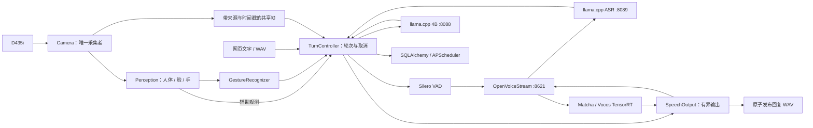

# Orin NX 无机身多模态陪伴服务

基于[NVIDIA Reachy Mini Jetson Assistant](https://github.com/NVIDIA-AI-IOT/reachy-mini-jetson-assistant)的派生工程：保留其语音、视觉、模型接口、网页和监控，裁掉机器人运动表达，在Orin NX16GB上接入中文语音、4B主模型及人体/人脸/手部感知。

**软件框架与初始 B0-SW 已交付，现等待用户从视觉开始复现与分析。** 冻结标签：`b0-sw-20261016`。 默认运行四个服务：4B 图文模型、ASR、OpenVoiceStream 和 Reachy 应用。主目录为 `/home/nvidia/Multi_Model_Inference`，本机网页为 `http://127.0.0.1:8090`。

入口：[B0 总清单](benchmarks/results/reachy-b0-sw.json) · [原始数据包索引](benchmarks/results/reachy-b0-archive.json) · [完整应用图表](benchmarks/results/reachy-b0-e1.png) · [实际请求时间线](benchmarks/results/reachy-b0-e1-trace.png) · [部署与回退](deploy/systemd/README.md)。详细口径与复现命令见 [阶段记录](docs/reachy-migration.md)。

当前软件路径已通过真实模型问答、文件语音、工具回执/持久性、取消、过载、重复启停、故障恢复和准备工件的离线启动检查；173 项自动化测试通过。**这不是全部工程验收完成。** 真人手势负例/遮挡/多手仍待补测；麦克风/扬声器声学项按用户决定后置；8 小时长稳、干净机器重部署和用户掌握验收仍未完成。原旧七服务已停止，旧源码与数据保留用于回退。

| 完整应用场景：提交→回复 WAV 发布 | P50 | P95 |
|---|---:|---:|
| 文字问答 | 2.81 s | 4.84 s |
| 语音文件问答 | 4.78 s | 11.74 s |
| 语音文件＋画面 | 11.46 s | 17.43 s |
| 创建笔记并回复 | 10.69 s | 10.89 s |

每类 20 个事件，图像采用固定公开街景回放；这是文件交付时间，不是可听回应。场景的输出长度、工具回合和数据状态不同，不能把场景间时延比例直接当作某个模块的开销。已知问题包括模型多余的只读工具调用、少量合成语音转写差异和长输出；原始结果均保留，尚未自动调优。

### 你接手的第一步

板端网页右上角 **板端调试** 可切换视觉画面与性能面板，也可直接访问 `http://127.0.0.1:8090/debug`。
从电脑连接板子时，在电脑终端运行 `ssh -N -L 18090:127.0.0.1:8090 nvidia@板子IP`，然后打开 `http://127.0.0.1:18090/debug`。
面板约每 2 秒推送板端实际采集/识别 FPS、最新帧的各阶段耗时与帧龄、CPU/GPU/内存/温度/频率/模块输入功率，以及当前或最近请求的 VAD/ASR/LLM/工具/TTS/资源释放时间线。
可导出最近 60 个观测样本与最新轮次时间线；断线或超过 6 秒未更新会标记过期。浏览器接收 FPS 单独标注。实时样本与冻结 B0 分开呈现，正式优化前后对比仍使用基准脚本。

先执行下面三行，暂不改配置：

```bash
cd /home/nvidia/Multi_Model_Inference
/home/nvidia/AI_Stack/environments/reachy-headless/bin/python main.py services status
/home/nvidia/AI_Stack/environments/reachy-headless/bin/python main.py config
```

把四个服务的状态，以及 `vision.capture_fps`、`perception.fps`、`llm.context_tokens` 的值发给助手。随后先解释输入帧率、感知频率和模型上下文各控制什么，再按你实际运行的结果进入视觉基线复现。下一阶段由用户执行和判断，助手负责指导与审查。

## 当前确定的流程

1. 固定上游源码与模块职责，完成无机身适配并汇入主项目。
2. 接通完整中文语音、视觉、手势与输出，修复生命周期和异常问题。
3. 整体功能跑通后，由助手交付各模块与整机当前性能基线。
4. 用户在逐步指导下，使用专业工具逐模块定位、分析、优化、回归并对比基准。

挥手触发问候；静止举掌保持片刻取消当前整轮，停止生成和播放，阻止未开始的工具；已完成笔记/提醒保留。身份验证删除，长期记忆后置。主模型暂用Qwen3.5-4B，首版后端采用llama.cpp。

## 架构与代码阅读入口

框架沿用固定版本 Reachy 的应用组织；推理由 llama.cpp、OpenVoiceStream、TensorRT 和 OpenCV 执行。systemd 管理四个进程组，应用内的 `TurnController` 管理一个交互轮次，两者职责分开。下图表示逻辑数据流，ASR/TTS 实际均通过 OVS 的 HTTP 接口收发。



| 先读哪个文件 | 负责什么 | 需要理解的边界 |
|---|---|---|
| [run_web_vision_chat.py](run_web_vision_chat.py) | 创建组件、启动与退出、连接回调 | 主入口组装已有模块，退出按资源所有权收尾 |
| [app/camera.py](app/camera.py) | V4L2 采集、最新原图、JPEG 时间窗口 | 单一采集者；来源 epoch、帧序号、主机收帧时间；过期帧不作为新输入 |
| [app/perception.py](app/perception.py) | 同一帧上的人体、脸和手部模型 | 一个感知 worker；输出保留原帧归属；无人/无手的有效结果与“没有新鲜结果”不同 |
| [app/gestures.py](app/gestures.py) | 将连续手部结果转成挥手/静止举掌事件 | 时间窗口、保持时间、互斥、冷却、过期；真实负例矩阵仍待补测 |
| [app/turn_control.py](app/turn_control.py) | 接纳、当前会话、工具调用、取消与后端释放 | 一个活跃轮次；新语音可以先占一个待处理位置；旧轮未释放时不启动新轮 |
| [app/llm.py](app/llm.py)、[app/stt.py](app/stt.py)、[app/tts.py](app/tts.py) | 本地模型接口与模型身份/格式检查 | native token 预算、独立请求连接、实际后端空闲确认；不负责管理服务器进程 |
| [app/pipeline.py](app/pipeline.py) | VAD、文本分块、有限 PCM 与输出生命周期 | 当前文件输入/输出；实物录播和声学延迟后置；不能把 WAV 写入当作播放成功 |
| [app/actions/store.py](app/actions/store.py) | 幂等请求回执、笔记、提醒及重启恢复 | 已提交结果保留；重试同一请求不重复执行；不是长期记忆/RAG |
| [deploy/services.py](deploy/services.py) | 配置冻结、systemd 生命周期和归属检查 | 接口就绪不等于语义正确或性能达标；只管理本项目拥有的服务 |
| [benchmarks/](benchmarks/) | 冻结输入、测量、统计和复现 | 测量脚本不进入业务请求路径；B0 与后续用户 E 系列实验分开记录 |

一条图文请求的阅读顺序是 `Web → TurnController._admit → 选择新鲜帧 → LLM.generate_stream → SpeechOutput → 发布结果 → 确认后端释放`。语音文件在模型理解前增加 `Silero → STT`。工具调用由同一轮次串行执行，不另建一套调度框架。

停止操作先设置当前轮的取消标记，阻止新输出和未开始的工具，再中断该轮持有的模型连接/输出。随后等待原生后端空闲，才重新接纳工作；停止生成不表示模型权重退出显存。已提交笔记或提醒继续保留。

当前会话最多保留 4 轮已交付上下文，进程重启后清空；笔记和提醒使用独立 SQLite 数据持久保存。手部的 z 值是模型相对手腕的估计，不是 D435i 深度测距；人脸模块只检测位置，不做身份验证。

当前 B0 数据已齐。接下来先由用户核对模型/输入输出契约并复现视觉基线，再按实际结果进入专业工具分析和单因素优化。

## 审查入口

- [完整新版计划书与最终Goal](02-jetson-multimodel-inference.md)
- [总览与工作分工](00-project-overview.md)
- [上游版本与源码审查锁](deploy/reachy-upstream.lock.json)
- [实施阶段和验收清单](benchmarks/manifests/reachy-headless-roadmap-v3.json)
- [迁移缺口与风险范围](benchmarks/manifests/reachy-gap-ledger-v3.json)
- [端侧部署岗位资料](benchmarks/manifests/target-jd-20261014.json)

## 现有系统与资料

- [旧实现使用说明及历史结果](docs/archive/README-pre-reachy-20261015.md)
- [旧工程进度和证据](benchmarks/manifests/progress.json)
- [外部依赖目录](deploy/dependencies-layout.md)
- [4B默认模型清单](models/manifest.json)

旧系统的模型、数据、代码历史及references/均保留。性能和正确性证据只适用于各自配置，新派生工程必须重新验证。迁移阶段的独立环境、功能证据和进度见任务清单；后续性能优化由用户在指导下完成。
