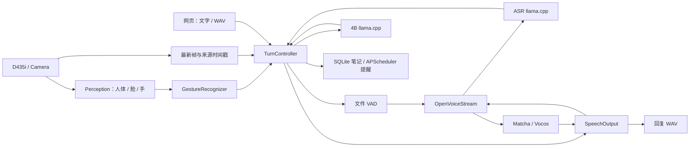

# Orin NX 端侧多模型陪伴服务

本项目在 Orin NX 16GB 上连接相机、人体/人脸/手部感知、中文语音和 4B 图文模型。没有机器人机身控制；身份验证已移除，长期记忆留到后续阶段。

当前默认启动 **B1 R2：公开视觉模型的 TensorRT 部署与链路复现**。10 个视觉 TensorRT 模型已接通，单模块及七组整链路/共存基线已测量，R2 运行包已通过独立副本离线恢复，默认启动、相机和调试页面已验证。张掌已取消真实生成轮次；固定选帧回放完成了挥手问候，但实时采样仍有漏触发，保持未验收。B0 工件与历史数据继续保留。

B1 深度采用 D435i 自带输出和 RealSense SDK 的 RGB 对齐；TensorRT 用于视觉神经网络。神经双目深度按用户决定后置，不作为本阶段验收项。

[B1 当前目标与实施边界](docs/implementation-plan.md#b1-当前阶段目标) · [B1 验收清单](benchmarks/manifests/vision-b1-v1.json)。交付 B1 后由用户亲自使用专业工具分析和优化；实物声学、机身控制、导航及长期记忆继续后置。

[B1 启动、代码阅读与首次视觉实验](docs/b1-handoff.md) · [B1 实测数据和复现口径](docs/visual-baseline.md)。B1 交接尚未完成，不把已有基线数据当作整体验收通过。

[项目定位与分工](docs/project-overview.md) · [完整实施计划](docs/implementation-plan.md) · [部署说明](01_src/deploy/systemd/README.md) · [B0 总清单](benchmarks/results/b0-sw.json) · [阶段验证记录](docs/migration-history.md)


## 项目内直接运行

```bash
./run.sh services up
./run.sh services status
./run.sh services logs --components app --lines 80
./run.sh services down
```

`run.sh` 使用项目自带的 Python 环境，默认选择 `02_config/settings.orin-nx-b1.yaml`；已有 `EDGE_ASSISTANT_CONFIG` 或显式 `--config` 可覆盖。原生分析工具可用 `./run.sh llama-bench --help` 和 `./run.sh llama-cli --help`，启动器会设置项目内共享库搜索路径。

运行依赖存放在 `05_runtime/` 并排除出普通 Git 提交。旧 B0 包约 6 GB，包含新增视觉模型的 B1 包约 7.14 GB。本机项目已具备这些依赖；**单独克隆 Git 仓库后，需要恢复匹配的运行包**。运行包不包含笔记数据库、录音、回复和日志，恢复步骤见 [依赖与恢复说明](01_src/deploy/dependencies-layout.md)。

## 在 VS Code 中阅读和跳转代码

通过 Remote SSH 打开整个 `Multi_Model_Inference/` 文件夹，并在远端安装推荐的 **Python** 和 **Pylance** 扩展。仓库的 `.vscode/settings.json` 已声明 `01_src/`、`scripts/` 源码搜索路径，以及项目内 Python 解释器；运行时的 `sys.path.insert(...)` 不会自动成为编辑器的搜索路径。

如果 VS Code 已经选过解释器，请执行 `Ctrl+Shift+P` → `Python: Select Interpreter` → `Enter interpreter path`，选择项目下的 `05_runtime/environments/edge-assistant/bin/python`。根目录的 `.venv` 是保留的旧环境链接，不用于当前开发。默认解释器设置不会覆盖已经保存的选择。

执行 `Developer: Reload Window` 后，打开 `main.py`，在 `from app.cli import main` 的 `main` 上按 **F12** 或 **Ctrl+鼠标左键**，应跳到 `01_src/app/cli.py`。macOS 使用 **Cmd+鼠标左键**。如果 F12 可以跳转但鼠标不行，检查 `Editor: Multi Cursor Modifier`：设为 `alt` 时，Ctrl/Cmd+点击用于跳转，Alt+点击用于多光标。

运行工件与参考仓库不参与默认批量分析，避免在板端扫描大量外部文件；被源码导入的依赖仍可参与分析。

## 从停止状态亲自启动

以下命令在板端以 `nvidia` 用户执行。模型、推理程序和 Python 环境均已准备在本项目 `05_runtime/`。系统层仍需要兼容的 Jetson Linux、CUDA、TensorRT 和 Python 3.12。

```bash
cd /home/nvidia/Multi_Model_Inference
source ./05_runtime/environments/edge-assistant/bin/activate
# 直接调用 Python 时显式选择 B1；run.sh 已设置此默认值。
export EDGE_ASSISTANT_CONFIG="$PWD/02_config/settings.orin-nx-b1.yaml"

# 结束当前对话后，停止本项目四个服务，确认 STOPPED。
python main.py services down
python main.py services status

# 查看有效配置；check 校验工件，并列出各服务实际启动命令。
python main.py config
python main.py services check

# 第一次按顺序启动，理解每个服务；每条成功返回后再执行下一条。
python main.py services up --components llama
python main.py services up --components asr
python main.py services up --components speech
python main.py services up --components app
python main.py services status
```

最后应为 `READY`，四个服务均就绪，摄像头持续出图。以后用 `python main.py services up` 一次启动全部服务。失败时查看对应组件日志，例如 `python main.py services logs --components app --lines 80`。

`up` 会复用已运行的依赖。退出终端不会停止 systemd 服务；完整停止使用 `services down`，仅停止应用使用 `services down --components app`。详细生命周期、冻结配置与回退方式见 [部署说明](01_src/deploy/systemd/README.md)。

## 四个服务与数据流

| 服务 | 职责 | 板端端口 |
|---|---|---:|
| `llama` | llama.cpp，Qwen3.5-4B 图文理解 | 8088 |
| `asr` | 独立 llama.cpp，Qwen3-ASR-0.6B 语音识别 | 8089 |
| `speech` | OpenVoiceStream，ASR 接口及 Matcha/Vocos TensorRT TTS | 8621 |
| `app` | 网页、相机、视觉小模型、手势、对话轮次、工具与诊断 | 8090 |

人体、人脸、手部模型由 `app` 内的感知 worker 调用。systemd 管进程，`TurnController` 管当前请求，模型后端执行推理。



视觉始终保留帧来源；挥手触发问候，静止举掌取消整轮。取消阻止新输出和未开始的工具，等待后端释放后才接纳下一轮；已提交的笔记/提醒保留。

## 代码仓地图

```text
main.py                    统一 CLI
run.sh                     使用项目内环境的启动器
run_web_vision_chat.py      应用组装与生命周期入口
01_src/                    核心源码
  app/                     感知、对话、语音、工具、网页后端与诊断
  deploy/                  服务管理、推理启动、工件锁与语音接入
  benchmarks/              性能采集、汇总和绘图代码
  project_paths.py         公共位置和历史路径解析
02_config/                 运行配置
03_models/                 模型清单与哈希；实际权重在 05_runtime/models
04_web/                    网页与调试界面
05_runtime/                必需框架、模型、环境和运行数据（不进 Git）
benchmarks/                固定语料、测量协议和结果
scripts/                   工件准备与功能验证脚本
tests/                     自动化测试
docs/                      文档与历史索引
patches/                   上游补丁
licenses/                  第三方许可证
references/                原有学习参考子模块
```

当前框架源码、权重、原生程序、环境、数据库与日志位于 `05_runtime/`，见 [依赖与恢复说明](01_src/deploy/dependencies-layout.md)。旧 `AI_Stack` 和 `.venv*` 链接仅保留用于回退，不参与当前服务启动。

## 按运行顺序阅读

| 顺序 | 文件 | 先回答的问题 |
|---|---|---|
| 1 | [main.py](main.py) → [01_src/app/cli.py](01_src/app/cli.py) → [01_src/deploy/services.py](01_src/deploy/services.py) → [01_src/deploy/runtime.py](01_src/deploy/runtime.py) | 一个启动命令如何变成四个受管理服务？ |
| 2 | [run_web_vision_chat.py](run_web_vision_chat.py) | 谁创建相机、模型接口、感知线程和轮次控制器？谁负责退出？ |
| 3 | [01_src/app/camera.py](01_src/app/camera.py) → [01_src/app/perception_b1.py](01_src/app/perception_b1.py) → [01_src/app/gestures.py](01_src/app/gestures.py) | 同帧 RGBD 如何触发检测、姿态和属性模型？为什么目标频率为 5 FPS？ |
| 4 | [01_src/app/turn_control.py](01_src/app/turn_control.py) | 请求如何接纳、选帧、调用模型/工具、提交输出和取消？ |
| 5 | [01_src/app/llm.py](01_src/app/llm.py)、[01_src/app/stt.py](01_src/app/stt.py)、[01_src/app/tts.py](01_src/app/tts.py)、[01_src/app/request_io.py](01_src/app/request_io.py) | 后端契约、超时和取消由谁保证？ |
| 6 | [01_src/app/pipeline.py](01_src/app/pipeline.py)、[01_src/app/audio.py](01_src/app/audio.py) | VAD、文本分块、PCM 队列和文件提交如何协作？ |
| 7 | [01_src/app/web.py](01_src/app/web.py)、[01_src/app/web_limits.py](01_src/app/web_limits.py)、[01_src/app/diagnostics.py](01_src/app/diagnostics.py)、[04_web/](04_web) | 网页输入、慢客户端和板端观测如何接入？ |

配置由 [01_src/app/config.py](01_src/app/config.py) 加载基础 `02_config/settings.yaml` 和所选 overlay。`run.sh` 默认选择 B1；直接执行 Python 且没有配置环境变量/参数时仍沿用历史 B0 overlay，因此请按上面的命令显式设置。启动后四个服务共用一份冻结配置，位置见部署说明。

## 网页调试与基线

在你的电脑上执行端口转发：

```bash
ssh -N -L 18090:127.0.0.1:8090 nvidia@板子IP
```

然后打开 `http://127.0.0.1:18090/debug`，或在主网页点击“板端调试”。面板约每 2 秒显示板端实际采集/识别 FPS、最新帧的模型耗时/帧龄、资源和当前轮次时间线，支持导出最近 60 个样本；浏览器接收 FPS 单独标注。

第一轮操作是启动后完成一次文字问答、一次当前画面问答和一次取消。当前音频验收以文件输入/输出为范围。随后再按 [视觉基线复现命令](docs/visual-baseline.md)复现视觉基线，使用新的实验输出目录。

冻结标签为 `b0-sw-20261016`。正式前后对比需要固定版本、输入、配置和观测条件，实时面板读数与固定 B0 分开解释。[视觉](benchmarks/results/b0-vision-summary.json)、[模型接口](benchmarks/results/b0-models-summary.json)、[完整应用](benchmarks/results/b0-e1-summary.json)和 [原始包索引](benchmarks/results/b0-archive.json)均保留。

## 验证与历史恢复

```bash
python -m pytest -q
```

`tests/` 为软件回归；真实模型/设备验证位于 `scripts/probe_*`，其中故障、回退和基准脚本会切换服务，运行前阅读对应脚本说明及部署文档。

当前目标及剩余项见 [B1 验收清单](benchmarks/manifests/vision-b1-v1.json)；[原 B0 任务清单](benchmarks/manifests/headless-roadmap-v3.json)和 [迁移缺口](benchmarks/manifests/gap-ledger-v3.json)保留为历史记录。性能优化由用户执行和判断，助手提供指导与审查。

旧 ROS/长期记忆部署、旧评测及无调用兼容入口已从当前工作树移出。完整恢复点为 `before-repository-cleanup-20261019`；[逐文件归档索引](docs/archive/repository-cleanup-20261019.json)包含原路径、哈希和本地归档位置。历史文档中的旧路径按对应历史版本解释。参考资料、当前验证证据、模型数据、许可证及固定旧运行快照保持保留。

仅五类核心目录保留编号并排在前面；脚本、测试、基准、文档、补丁和许可证目录使用普通名称。Python 包仍使用 `app`、`deploy`、`benchmarks`；主入口和直接运行的脚本会加入 `01_src` 搜索路径。交互式导入可使用 `PYTHONPATH=01_src python`。测试路径已在 `pytest.ini` 配置，无需额外设置。

冻结清单和历史报告保持原字节，其中旧路径由 `01_src/project_paths.py` 解析。迁移前恢复点为 `before-numbered-layout-20261019`；旧命令中的脚本路径应使用当前编号路径，例如 `python 01_src/benchmarks/vision_modules.py --help`。

应用基底、固定上游版本及本地适配的来源见 [第三方说明](THIRD-PARTY-NOTICES.md) 和 [导入清单](01_src/deploy/upstream-import.json)。项目名称为“多模型端侧助手”，运行服务统一使用 `edge-assistant-*`。
