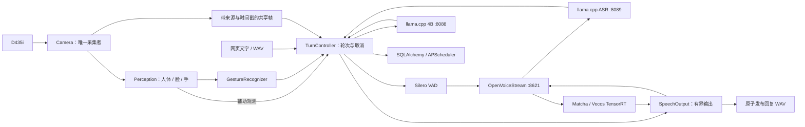

# Orin NX 无机身多模态陪伴服务

基于[NVIDIA Reachy Mini Jetson Assistant](https://github.com/NVIDIA-AI-IOT/reachy-mini-jetson-assistant)的派生工程：保留其语音、视觉、模型接口、网页和监控，裁掉机器人运动表达，在Orin NX16GB上接入中文语音、4B主模型及人体/人脸/手部感知。

**当前主目录和 `main` 已采用 Reachy 派生实现。** 默认运行四个服务：4B 图文模型、ASR、OpenVoiceStream 语音服务和 Reachy 应用。人体/脸/手、图文问答、中文文件语音、当前会话、笔记/提醒及整轮取消已贯通；真实手势负例/遮挡/多手质量和 B0-SW 尚待完成。

主目录：`/home/nvidia/Multi_Model_Inference`。网页：`http://127.0.0.1:8090`。使用独立环境管理服务：

```bash
/home/nvidia/AI_Stack/environments/reachy-headless/bin/python main.py services status
/home/nvidia/AI_Stack/environments/reachy-headless/bin/python main.py services up
/home/nvidia/AI_Stack/environments/reachy-headless/bin/python main.py services down
```

操作细节见 [部署与回退](deploy/systemd/README.md)，数据流和阶段记录见 [迁移说明](docs/reachy-migration.md)。当前验证包括 173 项自动化测试、20 次连续完整应用启停、实际进程崩溃恢复、两次旧系统回退、20 轮真实模型共存压力及隔离网络离线启动。证据见 [部署报告](benchmarks/results/reachy-r4-deployment-summary.json)。这些是软件功能与可靠性检查，视觉 V1/V2 基线已采集，见[数据与边界](benchmarks/results/reachy-b0-vision-summary.json)及[图表](benchmarks/results/reachy-b0-vision.png)。3 份图像、20 份合成中文语音及[冻结协议](benchmarks/manifests/reachy-b0-sw-v1.json)保持固定；ASR、4B 文字/图像及 TTS 的组件基线现已采集，见[接口数据与局限](benchmarks/results/reachy-b0-models-summary.json)和[图表](benchmarks/results/reachy-b0-models.png)；完整应用 E1 与最终交接仍待完成。

按用户 2026-10-16 决定，麦克风/扬声器实物环节后置；真实手势补测稍后进行。当前继续软件框架与 B0-SW 交接，交接后由用户先开展视觉优化。旧系统固定在 `~/AI_Stack/archives/legacy-runtime-972de50`，默认旧七服务已停止。

## 当前确定的流程

1. 固定上游源码与模块职责，完成无机身适配并汇入主项目。
2. 接通完整中文语音、视觉、手势与输出，修复生命周期和异常问题。
3. 整体功能跑通后，由助手交付各模块与整机当前性能基线。
4. 用户在逐步指导下，使用专业工具逐模块定位、分析、优化、回归并对比基准。

挥手触发问候；静止举掌保持片刻取消当前整轮，停止生成和播放，阻止未开始的工具；已完成笔记/提醒保留。身份验证删除，长期记忆后置。主模型暂用Qwen3.5-4B，首版后端采用llama.cpp。

## 架构与代码阅读入口

框架沿用固定版本 Reachy 的应用组织；推理由 llama.cpp、OpenVoiceStream、TensorRT 和 OpenCV 执行。systemd 管理四个进程组，应用内的 `TurnController` 管理一个交互轮次，两者职责分开。下图表示逻辑数据流，ASR/TTS 实际均通过 OVS 的 HTTP 接口收发。



| 先读哪个文件 | 负责什么 | 需要理解的边界 |
|---|---|---|
| [run_web_vision_chat.py](run_web_vision_chat.py) | 创建组件、启动与退出、连接回调 | 主入口组装已有模块，退出按资源所有权收尾 |
| [app/camera.py](app/camera.py) | V4L2 采集、最新原图、JPEG 时间窗口 | 单一采集者；来源 epoch、帧序号、主机收帧时间；过期帧不作为新输入 |
| [app/perception.py](app/perception.py) | 同一帧上的人体、脸和手部模型 | 一个感知 worker；输出保留原帧归属；无人/无手的有效结果与“没有新鲜结果”不同 |
| [app/gestures.py](app/gestures.py) | 将连续手部结果转成挥手/静止举掌事件 | 时间窗口、保持时间、互斥、冷却、过期；真实负例矩阵仍待补测 |
| [app/turn_control.py](app/turn_control.py) | 接纳、当前会话、工具调用、取消与后端释放 | 一个活跃轮次；新语音可以先占一个待处理位置；旧轮未释放时不启动新轮 |
| [app/llm.py](app/llm.py)、[app/stt.py](app/stt.py)、[app/tts.py](app/tts.py) | 本地模型接口与模型身份/格式检查 | native token 预算、独立请求连接、实际后端空闲确认；不负责管理服务器进程 |
| [app/pipeline.py](app/pipeline.py) | VAD、文本分块、有限 PCM 与输出生命周期 | 当前文件输入/输出；实物录播和声学延迟后置；不能把 WAV 写入当作播放成功 |
| [app/actions/store.py](app/actions/store.py) | 幂等请求回执、笔记、提醒及重启恢复 | 已提交结果保留；重试同一请求不重复执行；不是长期记忆/RAG |
| [deploy/services.py](deploy/services.py) | 配置冻结、systemd 生命周期和归属检查 | 接口就绪不等于语义正确或性能达标；只管理本项目拥有的服务 |
| [benchmarks/](benchmarks/) | 冻结输入、测量、统计和复现 | 测量脚本不进入业务请求路径；B0 与后续用户 E 系列实验分开记录 |

一条图文请求的阅读顺序是 `Web → TurnController._admit → 选择新鲜帧 → LLM.generate_stream → SpeechOutput → 发布结果 → 确认后端释放`。语音文件在模型理解前增加 `Silero → STT`。工具调用由同一轮次串行执行，不另建一套调度框架。

停止操作先设置当前轮的取消标记，阻止新输出和未开始的工具，再中断该轮持有的模型连接/输出。随后等待原生后端空闲，才重新接纳工作；停止生成不表示模型权重退出显存。已提交笔记或提醒继续保留。

当前会话最多保留 4 轮已交付上下文，进程重启后清空；笔记和提醒使用独立 SQLite 数据持久保存。手部的 z 值是模型相对手腕的估计，不是 D435i 深度测距；人脸模块只检测位置，不做身份验证。

当前仍在补齐完整 B0。完成后先带用户核对模型/输入输出契约、复现视觉基线，再按用户实际结果进入专业工具分析和单因素优化。

## 审查入口

- [完整新版计划书与最终Goal](02-jetson-multimodel-inference.md)
- [总览与工作分工](00-project-overview.md)
- [上游版本与源码审查锁](deploy/reachy-upstream.lock.json)
- [实施阶段和验收清单](benchmarks/manifests/reachy-headless-roadmap-v3.json)
- [迁移缺口与风险范围](benchmarks/manifests/reachy-gap-ledger-v3.json)
- [端侧部署岗位资料](benchmarks/manifests/target-jd-20261014.json)

## 现有系统与资料

- [旧实现使用说明及历史结果](docs/archive/README-pre-reachy-20261015.md)
- [旧工程进度和证据](benchmarks/manifests/progress.json)
- [外部依赖目录](deploy/dependencies-layout.md)
- [4B默认模型清单](models/manifest.json)

旧系统的模型、数据、代码历史及references/均保留。性能和正确性证据只适用于各自配置，新派生工程必须重新验证。迁移阶段的独立环境、功能证据和进度见任务清单；后续性能优化由用户在指导下完成。
