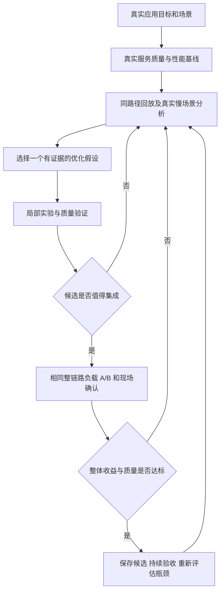

# 人体检测完整优化实操

> 整合说明（2026-10-21）：当前管线为 `VisionPipeline`，工具入口为 `scripts/benchmark.py`；历史协议须使用匹配源码。当前基准复现见 [视觉基线](visual-baseline.md)。本次整合验收保持原模型和运行参数。

以 YOLOv8n-seg 为切入口，完整实践部署效率优化与模型压缩。当前单模型案例以同一数据、任务和目标板建立效果与部署基线，分别验证两条路线，再组合有效改动。

**2026-10-21 最新范围：在一个模型上走完两条路线，按“假设选择 COCO”展开。当前操作顺序见 [YOLOv8n-seg + COCO 实操](yolov8n-seg-coco-optimization.md)。** 本页保留此前的全视觉系统讨论、触发规则和历史测量证据；十模型真实相机基线及系统集成属于后续扩展，不是当前案例的前置任务。

2026-10-20 调整实操顺序：先确定本轮真实场景和可验收要求，用当前服务基线核对可行性，再决定第一项优化。已有单模块 benchmark 和 Nsight 时间线继续作为内部成本参考；它们不直接决定整机优化优先级，也不能换算成实际应用延迟。本文后面的单模块命令保留作诊断复现入口。

用户亲自执行与解释实验，助手每轮提供一个明确问题及通常 1～3 条命令或一处改动。至少走通一项部署实现优化、一组 INT8 量化候选，以及一组结构化剪枝与微调候选的导出、部署和评测流程；具体方案是否保留，由实际效果与成本决定。

2026-10-21 用户再次明确：**优化由用户自己实施。** 助手本轮仅核对源码、整理目标与触发规则；后续提供操作指导并分析用户结果，不自行改动运行参数、模型、调度或代跑优化实验。用户明确另行委托时再调整分工。

[项目目标和场景](project-overview.md#11-当前目标与使用场景2026-10-21)用于后续家庭场景验收。当前先完成单模型 COCO 案例；下面的整机阶段数字属于此前讨论建议，不是本案例的单模型验收门槛。

## 实验对象

本案例固定刚才测过的模型与原始记录。系统后续升级不会覆盖这个起点；若更换模型、输入尺寸或任务范围，另列方案与基线。

| 工件 | 项目位置 |
|---|---|
| 原始浮点权重 | `05_runtime/models/b1/detection_segmentation/yolov8n-seg.pt` |
| 部署 ONNX | `05_runtime/models/b1/detection_segmentation/yolov8n-seg-deploy.onnx` |
| 原始 FP32 引擎 | `05_runtime/models/b1/runtime/detection_segmentation.fp32.engine` |
| 来源与导出契约 | [vision-b1.json](https://github.com/Qin-tuo/Multi_Model_Inference/blob/before-historical-file-retirement-20261021/03_models/candidates/vision-b1.json) 中的 `detection_segmentation` |
| 引擎与版本锁 | [vision-b1-runtime.json](https://github.com/Qin-tuo/Multi_Model_Inference/blob/before-historical-file-retirement-20261021/03_models/vision-b1-runtime.json) |
| 预后处理入口 | [segmentation.py](../01_src/app/segmentation.py) |
| TensorRT 执行入口 | [tensorrt_runner.py](../01_src/app/tensorrt_runner.py) |

2026-10-20 已核对上述 `.pt`、部署 ONNX 和 FP32 引擎的哈希。原始权重可作为量化、剪枝和微调的起点，原始引擎继续保留作性能对照。

当前模型同时提供 80 类检测与实例 mask。人体类别是主学习指标；接回现有项目时，还要回归仍被使用的其他类别和 mask，因为它们参与测距与后续任务触发。学习阶段先保持任务与输出契约，纯人体检测或取消 mask 属于另一个方案。

## 设备分工

| 位置 | 主要工作 |
|---|---|
| 有 NVIDIA 独显的电脑或服务器 | 数据准备、训练框架质量评测、剪枝、微调；按所选工具进行量化校准或 QAT；导出 ONNX；查看性能报告 |
| Jetson | 按目标环境构建 TensorRT 引擎，核对转换后的效果，测耗时、内存、功耗、温度和多模型共存 |

面向 Jetson 的引擎在目标板上构建。训练机生成的 ONNX 等中间工件迁入板端后，核对形状、算子和实际计算精度。最终质量验收也使用部署工件及项目真实预后处理。

本机已有的 `05_runtime/builds/vision-export` 是 CPU PyTorch 导出环境，2026-10-20 的包信息为 PyTorch `2.9.1+cpu`、Ultralytics `8.4.175`、ONNX `1.23.2` 和 pycocotools `2.0.11`。GPU 训练环境在独显设备上独立准备，版本与实验一起记录。

## 第一版整体验收要求（讨论草案）

2026-10-21 较早的系统讨论：用户曾将阶段限定为**仅视觉模型运行**，并要求助手先拟定合理目标、梳理模型触发条件。助手建议第一阶段采用 **10 Hz 更新目标、观察帧龄 P95 ≤250 ms**，将用户原先提出的 **10 Hz、观察帧龄 150 ms** 保留为进阶目标。这是助手提出的阶段性放宽建议，未经验证达成；不覆盖用户后来明确的单模型双路线学习范围。

本阶段“仅视觉”定义为相机、全部 B2 视觉模型、测距、跟踪和必要结果发布正常工作，LLM/VLM、ASR、TTS 不加载、不执行；手势规则可继续计算和记录，但不向聊天后端派发请求。这不同于聊天服务加载后空闲，也不同于只运行 YOLO。本轮只更新目标与规则说明，未执行服务切换或性能实验。

要求由业务是否够用、目标硬件的能力证据和实现成本共同决定。历史性能可以帮助提出第一版门槛，但不能只为了让当前版本通过而降低业务要求。可参考 [Google SRE：Implementing SLOs](https://sre.google/workbook/implementing-slos/) 中从用户任务选择指标、区分指标定义与测量实现、逐步验证目标的方法。

已确认的项目边界继续沿用 [实施计划](https://github.com/Qin-tuo/Multi_Model_Inference/blob/before-historical-file-retirement-20261021/docs/implementation-plan.md)：Orin NX 16GB 本地计算，D435i 视觉及文字/图像/受控文件语音链路；物理录播/AEC、运动机身和长期记忆后置。当前十个视觉模型及实际门控保留，不能通过少跑功能来隐瞒退化。姿态上限 1 人、人脸属性 2 个目标、物体特征 1 个目标是当前任务预算，不等同于只检测 1 人。

目标的依据是 [2026-10-20 B2 历史汇总](../benchmarks/results/b2-vision-stream-v1.json) 的 `replay-only`：约 5 FPS，整帧处理 P50/P95 为 121.26/169.16 ms，观察帧龄 P95 为 399.98 ms。它仅运行视觉，但输入是固定回放加模拟深度，不能当成真实相机同负载的保证；每组约 60 秒，且不含浏览器/WebSocket。旧逐帧目录已经清理，需采新的基线。

第一阶段标准场景建议为室内正常光照、640×480 原生 RGBD、距离约 1～2 米的一个主要交互人、一个可见人脸和一个可触发 CLIP 的物体，使全部模型类型有实际工作。额外记录空场景、人体背向/脸不可见、无效深度、遮挡和两张脸等压力/边界场景；不能用空场景的轻负载成绩代表标准场景。当前配置的 0.35～3 m 门控是代码范围，不代表整个范围已经完成质量验证。

| 项目 | 目标或待讨论要求 | 依据及待确认项 |
|---|---|---|
| 感知更新频率 | **10 Hz 目标**；建议以 60 秒窗口至少 570 个有效新帧结果验收，即允许 5% 调度容差 | 9.5 Hz 是明确提出的验收容差，不能表述成严格达到 10.000 Hz；同一帧重复读取/显示不增加计数 |
| 结果新鲜度 | 第一阶段 **观察帧龄 P95 ≤250 ms**；进阶阶段 **P95 ≤150 ms** | 从主机接收当前输入到板端消费者观察该结果，包含结果发布后的老化；暂不覆盖曝光到浏览器显示 |
| 更新抖动 | 第一阶段相邻有效新结果发布间隔 P95 ≤150 ms | 同时报最大间隔，防止平均频率掩盖长停顿 |
| 运行范围 | 所有视觉模型按当前规则触发；非视觉模型不加载、不执行 | 聊天共存属于后续独立验收，不能用仅视觉成绩代替 |
| 人体检测与 mask 质量 | 必须建立标注基线；关键场景 Recall/Precision、person AP 与 mask 指标单列；允许退化幅度待确认 | 目前缺真值评测，不能声称 95% 准确率或零精度损失；原版若不够用，先解决质量问题 |
| 资源 | 无 OOM，记录进程内存、可用内存、板功耗、温度与时钟；热稳态后无持续无界增长 | 固定部署电源/散热策略；暂不依据含聊天模型的旧数据设纯视觉内存或功耗限值 |
| 正确性与工程稳定性 | 验收窗口无崩溃、死锁、错帧/跨轮次输出及非预期整帧失败，启动/停止/恢复按原功能要求验证 | `B2-EXIT-01` 退出超时仍未定位；不能因后续一次正常停止就关闭 |
| 持续运行 | 第一阶段候选连续运行 30 分钟，重复窗口检查时效与稳定性；原最终计划的 8h 验收留在后续阶段 | 30 分钟是本次拟定的阶段检查，不代替最终长时及聊天共存验收 |

帧龄应明确主机接收至刚完成、接收至消费方观察，或曝光至屏幕显示三种边界中的一种。本文既有“观察帧龄”采用第二种，不能偷偷换成较短的刚完成时延来验收 150 ms。验收应同时记录不可用结果并将其计入不达标情况，不能只对有效样本算 P95 而隐藏中断。主动跳过旧相机帧、RGBD 组拒绝、预期模型输入拒绝和非预期失败分别统计，不设置不合理的“所有相机帧零跳过”要求。

10 Hz 对应约 100 ms 的更新周期。当前配置 `perception.fps=5.0` 将更新上限限制在 5 Hz；这是必须评估的调度约束，但只把配置改成 10 并不能使计算自动满足要求。当前单 worker 串行方案需要把每轮总成本压到约 100 ms 以下并留出抖动余量，同时缩短取帧/发布/消费等待。相机实际输入到达率和抖动也要测量，不能只看配置。

150 ms 帧龄对计算的预算可能比 150 ms 更紧。例如在理想的 100 ms 等间隔更新、每次发布时帧龄固定为 L、均匀观察最新结果的条件下，观察帧龄会在 L 到 L+100 ms 之间增长，P95 约为 L+95 ms。此时若要求观察帧龄 P95 ≤150 ms，发布时帧龄需约 ≤55 ms；若要求所有观察时刻都满足，需约 ≤50 ms。这是解释计时边界的理想模型，不是当前系统的预测，也不是已经分配给模型的最终预算。

仅视觉历史处理 P50/P95 为 121.26/169.16 ms，还需要降低完整路径成本才能接近 100 ms 周期。第一阶段内部预算可争取整帧处理 P95 ≤90 ms，为取帧、发布和调度留余量；这属于工程预算而非实测结果。完整视觉管线的 10 Hz、观察帧龄 150 ms 尚不能保证可达，需要进一步压缩发布时帧龄和抖动。不能以复用旧姿态/身份结果、降低其他模块频率或漏检导致少算来冒充原有同帧契约。

人体检测单模块延迟先作为诊断指标，暂不独立要求“必须低于 10 ms”。先依据真实关键路径为检测、姿态、等待和其他工作分配时间预算，再判断检测需要加速多少。每项最终要求必须写齐适用场景、指标边界、数值、统计窗口、失败处理、验证方式与证据。

## 当前视觉模型驻留与触发规则

依据 2026-10-21 当前 B2 源码和配置核对。`VisionPipeline.load()` 无角色筛选地调用 `VisionModels.load()`，所以**全部 10 个模型在启动时加载、保持驻留，关闭感知时释放**；不是检测到目标才加载模型。条件只控制是否执行本帧推理，未触发的模型仍占用其驻留资源。

“每帧”在下表指感知 worker 接受的有效新帧，不是相机每个原始帧，也不是网页每次刷新。正常路径下按同帧串行执行；过期帧、无效输入或异常可以中断某个阶段。

| 模型角色 | 当前模型 | 执行方式 | 触发条件与每个处理帧的预算 |
|---|---|---|---|
| `detection_segmentation` | YOLOv8n-seg | 每个处理帧 | 不依赖已知人体/人脸；执行全图检测与 mask，最多输出 10 个目标（人和物合计） |
| `face` | YuNet 2023mar | 每个处理帧 | 独立执行全图人脸检测，不要求 YOLO 已检出人；管线最多取分数最高的 2 张脸继续处理 |
| `person_reid` | OSNet x1.0 | 条件触发 | YOLO 检出人体且深度/距离合格，按距离选最近的最多 1 人；不要求先有跟踪 ID |
| `object_embedding` | CLIP ViT-B/32 图像编码器 | 条件触发 | YOLO 检出非人体目标且深度/距离合格，按置信度选最多 1 个物体 |
| `body_hand_pose` | RTMW-L 2D，133 点 | 条件触发 | 当前人体有确认的跟踪 ID，深度/距离合格，按距离选最近的最多 1 人；不需要已经看见手或触发手势 |
| `face_identity` | ArcFace-MobileNetV1 | 条件触发 | YuNet 保留的脸深度/距离合格且五点对齐输入有效，最多 2 次；不要求脸先有跟踪 ID，不要求已登记身份 |
| `head_pose` | head-pose-estimation-adas-0001 | 条件触发 | 脸有确认的跟踪 ID且深度/距离合格、ROI 有效，最多 2 次 |
| `gaze_landmarks` | facial-landmarks-35-adas-0002 | 条件触发 | 同一合格跟踪脸的头姿调用正常完成后执行，最多 2 次 |
| `gaze` | gaze-estimation-adas-0002 | 条件触发 | 同脸头姿和 35 点关键点已获得，左右眼 ROI 有效，最多 2 次；眼 ROI 小于 4 像素或越界会在模型执行前拒绝 |
| `expression` | Progressive Teacher / MobileFaceNet | 条件触发 | 脸有确认的跟踪 ID且深度/距离合格、五点对齐输入有效，最多 2 次；与 gaze 的 ValueError 拒绝相互独立 |

共同的距离门控来自 `range_from_mask()` 和 `_eligible()`：目标区域有效深度像素至少 25 个、有效比例至少 15%，有效深度中位数在 **0.35～3.0 m**。人体/物体用分割 mask，人脸用检测框区域。无有效深度时，仍可得到基础检测框，但这些条件分支不执行。

检测阈值当前为 0.25、NMS IoU 为 0.45。配置字段 `max_people=10` 实际传给检测分割的 `max_detections`，因此它限制总检测目标，不是允许后续对 10 人同时跑姿态。姿态/行人特征受 `max_pose_people=1` 限制；人脸后续任务受 `max_face_targets=2` 限制；物体特征受 `max_object_targets=1` 限制。

跟踪由 Norfair 提供，新目标可能尚未形成确认 ID，这时姿态和人脸属性暂不执行。人脸属性不强制要求关联到某个人体框；只要人脸自身的跟踪和距离合格就能执行。用户选定目标仅更新选择状态，没有把其他模型变成“选中后才运行”。

当前没有“身份只在注册时算”“ReID 仅丢失目标时算”“表情只在变化时算”的调度：条件持续满足，就每个处理帧再次调用。条件不触发也不自动卸载模型。满足所有条件的 1 人、1 脸、1 物体场景会执行 10 次模型推理；两张脸均合格时最多可到 15 次，而不是固定每帧 10 次。

测距、跟踪、手势规则、JPEG/结果发布还会消耗时间，但不是额外视觉神经网络。B2 双手关键点由 RTMW-L 提供，没有另跑 B0 的掌检测/手关键点模型。手势规则继续观察视觉输出，本阶段不派发非视觉推理请求。

主要代码入口：[模型加载](../01_src/app/vision_models.py)、[逐帧触发](https://github.com/Qin-tuo/Multi_Model_Inference/blob/before-mainline-consolidation-20261020/01_src/app/perception_b1.py)、[跟踪确认](../01_src/app/visual_tracks.py)、[眼部输入检查](../01_src/app/head_gaze.py)、[有效配置](https://github.com/Qin-tuo/Multi_Model_Inference/blob/before-mainline-consolidation-20261020/02_config/settings.orin-nx-b2.yaml)。

## 阶段路线

| 阶段 | 亲自完成的工作 | 主要工具 | 交付结果 |
|---|---|---|---|
| 1 固定真实工作条件 | 明确相机、人数/距离/光照、模型触发条件、对话频率、显示端、功耗散热和验收指标 | 正式配置、现场观察、输入记录 | 场景表、工作量定义、质量和时效要求 |
| 2 建立真实服务基线 | 保持正式进程、模型驻留及调度，记录每帧检测、整帧、帧龄、失败和对话响应；准备标注评测 | 现有应用指标、低开销事件日志、tegrastats、质量评测 | 各实际场景的质量与运行基线 |
| 3 建立可重复整链路对照 | 录制代表性 RGBD 和请求时间表，按原节奏走同一应用路径；核对工作量与现场差异 | 正式管线回放、逐帧/逐请求记录 | 可以重复比较的系统 benchmark 及适用边界 |
| 4 定位影响目标的问题 | 在实际慢场景采集短 trace，沿关键路径追踪到 CPU、GPU、传输、等待或调度 | nsys/NVTX；按证据补 cProfile、perf、trtexec 或 ncu | 具体瓶颈、影响范围和一项可证伪假设 |
| 5 生成独立候选 | 按证据选择实现优化、FP16、INT8 或结构化剪枝；每次只改一个因素 | 部署代码、TensorRT、量化/训练工具 | 独立工件、改动说明及预期收益 |
| 6 局部筛选 | 验证实际部署输出的质量、单模块成本和兼容性 | 固定验证集、单模块 benchmark、必要的短 trace | 质量与局部性能对照，拒绝无效候选 |
| 7 每个有效候选回到系统 | 用相同回放和请求负载做 A/B，再在原现场场景确认 | 正式服务、整链路 benchmark、资源监控 | 视觉、对话、功耗内存的实际收益与代价 |
| 8 组合与持续验收 | 组合已验证改动，再做热稳态、故障恢复、质量测试集和现场验收 | 长时运行记录、业务事件评测 | 保留/回退结论、适用范围和下一轮瓶颈 |



部署实现、FP16、INT8、剪枝是候选方法，不是必须按顺序采用的四个生产改动。为完成学习案例，可以分别实践这些方法，但每种方法能否进入正式部署，由质量和系统收益决定。涉及共享资源、线程或调度的改动，尽早在多模型共存场景验证；无需等所有模型优化完才测整体。QAT 可在 PTQ 质量不足时开展。

## 对应当前真实工作环境

当前默认 B2 应用通过 `run_web_vision_chat.py` 创建 `VisionPipeline`，模型集合由 `02_config/settings.orin-nx-b2.yaml` 指定。正式链路包括：

```text
D435i RGBD → Camera 发布最新帧/JPEG/历史缓存
  → Perception._loop 取帧与调度
  → VisionPipeline.process_frame
      → detection_segmentation → mask 测距/跟踪
      → 按距离、目标数等条件执行 ReID、姿态、人脸及属性模型
  → 更新场景状态 → 业务回调/结果发布 → 消费方

同板并存：ASR、LLM/VLM、TTS 及其请求控制
```

视觉处理目前是一个受限速的串行 worker，配置上限 5 FPS；其他服务可能同时占用 CPU、GPU 和共享内存。5 FPS 对应约 200 ms 的调度周期，不是已经满足了 200 ms 结果帧龄，也不是硬性业务时限。优化目标和合格线必须单独登记。

当前先验收仅视觉场景；下表中的聊天共存条件留到后续阶段：

| 场景 | 应保留的运行条件 | 必须记录的工作量 |
|---|---|---|
| 仅视觉感知（当前阶段） | 相机与全部视觉模型常驻，非视觉后端不加载、不运行，正常板端结果发布 | 人数、有效深度、姿态/属性等模型触发次数 |
| 感知与语音对话共存（后续） | 同样的视觉场景，加现有受控 WAV/PCM→ASR→LLM→TTS 链路 | 请求时间、音频长度、输出长度、缓存/会话策略 |
| 感知与带图问答共存（后续） | 正式 VLM 请求路径、正常视觉工作量 | 请求频率、图像数、上下文和输出长度 |
| 多人/运动/遮挡等困难输入 | 保留检测、mask、距离门控和任务预算 | 每帧候选数、输出数、目标大小、各下游任务次数 |
| 持续运行 | 实际部署的功耗、动态时钟及散热策略 | 时钟/温度变化、内存增长、超时与恢复 |

当前语音验收仍限定为文件/受控 PCM，物理麦克风和扬声器的录播体验另行验收。若验收指标包含用户看到框的时间，必须包含正常显示/传输路径；仅测板端完成时间时明确写出不包含浏览器和 WebSocket。

## 三种测量如何配合

| 层次 | 保留什么 | 可以回答 | 不能直接推出 |
|---|---|---|---|
| 正式服务现场观察 | 实际相机、服务、调度、消费者和真实负载 | 当前使用条件下体验、质量和资源是否达标 | 不同现场画面之间的差值全由某个改动造成 |
| 同路径整链路回放 | 同一套应用代码和驻留模型，固定 RGBD/请求到达时间 | 同工作量下某个改动或共存负载的影响 | 包含未回放的设备、传感器或显示时延 |
| 隔离单模块/引擎实验 | 同一模型与预后处理，固定输入，显式改变隔离条件 | 内部成本、原因验证、候选快速筛选 | 正式应用的 FPS、帧龄或优先级 |

这是本文结合当前项目采用的实验设计。[NVIDIA ros2_benchmark](https://github.com/NVIDIA-ISAAC-ROS/ros2_benchmark) 提供了相近参考：固定节奏/原始时序回放、完整处理图、延迟与丢帧，以及带真实相机的 live 模式。本项目借鉴其方法，不需要为此迁移到 ROS 2。

实际回放应保留颜色、深度、有效掩码、尺寸和时间关系。仅用 RGB 静态图加统一模拟深度，会改变距离门控与后续模型调用，不能当成真实 RGBD 的等价负载。源帧按时间表到达，不能等上一帧处理结束才发送下一帧，从而掩盖积压或主动跳帧。

当前先用同一段代表性输入比较模块独立与仅视觉完整管线；后续再加入聊天模型常驻及繁忙条件。对照检测输出与下游触发数，记录 P50/P95 的变化。变化比例只属于对应场景，不能作为统一修正系数。

## 正式应用需要记录什么

以 `(source_epoch, frame_id)` 串联同一帧，使用同一单调时钟记录主机接收、检测开始/结束、整帧完成和结果发布。跨设备/浏览器时钟需要同步或单独测量。主机接收时刻不等于传感器曝光时刻。

| 指标 | 当前入口或边界 | 用途 |
|---|---|---|
| 人体检测完整调用 | `vision_pipeline.py` 中 `stages.detection_segmentation_ms`，其内部为正式适配器 | 判断检测在共存环境下是否变慢 |
| 完整感知处理 | `elapsed_ms` 及同帧开始/完成记录 | 包含检测、后续模型及非模型逻辑 |
| 接收至完成 | 同帧完成时间减 `frame.received_monotonic` | 包含取帧等待与处理 |
| 消费时结果帧龄 | 消费方观察时间减所用帧接收时间 | 判断业务使用的结果是否已经过时 |
| 处理/跳过/失败/超时 | `processed`、`skipped_capture_frames`、`failures`，辅以逐帧记录 | 防止只统计成功帧而隐藏失效 |
| 其他任务响应 | 请求 ID 与对话控制各阶段时间 | 检查视觉加速是否牺牲对话体验 |
| 资源与负载 | tegrastats、内存指标、模型触发数、请求时间表 | 解释争用、热稳态和工作量变化 |

`VisionModels.snapshot()` 的分位数是有限滚动窗口，`/api/state` 是状态快照；重复轮询同一帧不能当成多个独立样本，也可能漏掉中间完成帧。正式窗口分位数应来自完成事件或可靠的逐帧记录。`/api/debug/baseline` 当前返回历史 B0 静态 JSON，不能拿来测 B2 当前服务。

现有 `vision_b1_modules.py --nsys` 只给隔离 worker 打标签，不会自动给正式 app 或 systemd 独立启动的模型后端打标签。正式场景 profiling 需要覆盖实际推理进程，在相关调用处启用可关闭的 NVTX；仅 profile HTTP 客户端或启动协调器不足以观察后端 GPU。

常规 A/B 采用低开销指标，短 Nsight trace 用于归因。观测开销单独核对；不把 Nsight、cProfile、ncu 下的数值直接当成正常运行基线。当前 trace 缺少准确 CPU 调度信息和 Unified Memory 跟踪；涉及线程抢占或托管内存的结论，需要先补足对应证据。

## 实验与保留条件

每轮先写明“哪个真实场景、哪个指标、什么问题、预计改哪里、哪些结果会推翻假设”。然后选择一项候选：

| 证据 | 候选方向 | 必须回到真实环境验证 |
|---|---|---|
| 同输入下 CPU 预后处理明显拖长关键路径 | 向量化、缓冲复用、减少重复处理 | 完整帧龄、CPU 争用和输出语义 |
| GPU 执行确实限制目标且质量有余量 | FP16；之后按需要评估 INT8 或结构化剪枝 | 最终引擎效果、共存延迟、其他任务和功耗 |
| 独立正常、共存时下降 | 线程/调度/任务预算/内存带宽与并发策略 | 所有受影响任务的尾延迟，不只视觉平均速度 |
| 处理不慢、使用的结果过旧 | 取帧节奏、等待、发布和消费者路径 | 结果帧龄、有效更新率、主动跳帧与漏事件 |
| 真实场景漏检/误检或 mask 退化 | 数据/标注、训练、阈值、模型方案与部署一致性 | 标注质量与业务成功率，以及新增计算成本 |

固定代码、引擎、输入、服务负载、阈值/目标预算、时钟策略和统计边界；比较时交替或配对运行原版/候选，观察重复窗口与热状态。探索时可以先短测，验收样本数和运行时长按业务与波动登记，不以一个窗口或少量 P99 判断稳定性。

候选检测少了，姿态/ReID 调用也可能变少，整帧于是变快。必须核查这是正确减少冗余，还是漏检导致少做任务；后者不是合格的优化。任何降低质量、触发频率或目标预算的方案，都单独报告取舍。

## 质量与性能双基线

### 数据与质量

准备有标注的公开检测与分割数据，并补充机器人使用场景中的距离、光照、遮挡、运动和多人输入。少量固定图片用于调试与输出核验，任务质量需要独立的标注评测。

训练与微调数据、量化校准数据、开发验证集和最终测试集分别记录用途与重叠情况。视频按录制序列或场景划分，避免相邻近似帧同时进入训练与测试。最终测试集不参与训练、校准或反复调参。先在开发验证集筛选候选，再对确定的方案执行最终验收。

| 项目 | 记录内容 |
|---|---|
| 人体检测主指标 | person AP50、AP50–95，业务阈值下 Precision 和 Recall |
| 分割与现有任务回归 | 需要保留的 mask 效果及其他在用类别，必要的测距与触发回归 |
| 错误分析 | 漏检、误检、小目标、遮挡、多人等分场景案例 |
| 评测配置 | 数据版本、输入大小、补边、置信度阈值、NMS、最大目标数 |

训练框架验证与生产阈值评测分别记录。模型质量评测可使用 Ultralytics 的验证能力；最终 TensorRT 工件需要接入相同标注评测，并保持项目预后处理与指标定义一致。[Ultralytics 验证说明](https://docs.ultralytics.com/modes/val/)

### 速度与资源

| 范围 | 必须记录的项目 |
|---|---|
| 引擎 | GPU 执行、H2D、D2H、提交开销、延迟分布、吞吐和运行配置 |
| 完整调用 | 图像预处理、同步原生调用、后处理、完整调用的 P50/P95 |
| 资源 | 稳态与峰值内存、最低可用内存、平均和峰值功耗、温度与时钟 |
| 多模型系统 | 相同输入与负载下的视觉 FPS、帧龄、失败/丢弃、对话响应及内存余量 |

原生调用、CUDA 事件区间与 kernel 时间按各自边界解释。文件大小、参数量和 FLOPs 用于说明模型变化，板端实际延迟与资源决定部署收益。

## 独立候选与组合实验

不同方法先保留独立对照，避免把多项变化混在一起：

```text
原始权重与 FP32 实现
  ├─ 部署实现优化 保持权重和精度
  ├─ FP16 保持模型结构与任务
  ├─ INT8 校准后验证最终引擎
  └─ 浮点权重结构化剪枝 微调 导出 在相同精度下比较

独立候选筛选后 → 组合有效改动 → 质量与整机复测
```

剪枝从浮点网络和权重开始，微调后重新导出和构建引擎。剪枝与量化可以进一步组合，但要先知道它们各自的效果。训练中观察到的损失变化，也要落实到部署后的任务指标。

INT8/PTQ 与 QAT 的工具可参考 [NVIDIA Model Optimizer](https://nvidia.github.io/Model-Optimizer/guides/_basic_quantization.html)，结构化剪枝工具可参考 [Torch-Pruning](https://github.com/VainF/Torch-Pruning)。具体操作前在独立环境验证与当前 YOLO 分割网络、Ultralytics 版本、ONNX 及板端 TensorRT 的兼容性。

## 每个候选的验收

一次候选实验按以下顺序收集证据：

1. 记录唯一改动、代码与模型版本、输入和预期作用。
2. 验证输出契约；实现优化检查语义，低精度或剪枝候选检查任务质量变化。
3. 测引擎与完整调用，分别记录速度、内存和功耗。
4. 对照同一基线和验收门槛，分析收益、退化与失败案例。
5. 对准备保留的候选测关键多模型场景，记录对视觉与对话的影响。
6. 保留或回退候选；阶段性组合方案再做完整回归与持续运行测试。

模型更小或参数更少，仍可能没有板端加速。候选没有达到预期时，保留数据并解释原因；学习验收看是否完整完成分析与验证，部署验收看是否满足任务要求。

最终报告至少包含：原始基线、部署实现候选、FP16、INT8、结构化剪枝与微调、组合候选各自的质量、耗时、资源、共存结果及选择理由。表格和记录字段沿用 [优化指南的实验模板](inference-optimization-guide.md#实验记录)。

## 当前进度与下一步

2026-10-20，用户在 Jetson 上完成了原始 FP32 引擎的 trtexec 初测，使用随机输入、预热 1 秒、测量约 10 秒，共记录 748 次推理：

| 项目 | 用户本次初测 |
|---|---:|
| GPU 执行平均值 | 13.3936 ms |
| 含传输延迟平均值 | 13.9936 ms |
| 含传输延迟 P95 | 14.0479 ms |
| 工具调度下吞吐 | 74.5538 qps |

这是引擎层的速度参考，不是正式应用 FPS。人体 AP、业务阈值下的 Precision/Recall 及代表性 mask 效果仍需补齐。

已有 B1 测量入口因当前开发源码变化触发冻结校验，已准备匹配协议的 `.worktrees/b1-body-baseline`，单模块协调程序支持 `--source-root`。副本共享模型、环境和固定输入等资产，保留独立的 `runtime-data`；当前项目仍负责管理服务。

2026-10-20 用户确认 B2 模型替换已完成。当前默认服务为 B2，四服务就绪且应用空闲；人体检测仍使用上述相同的 YOLOv8n-seg 引擎。当前源码通过 B2 冻结协议校验，可直接使用 `--protocol benchmarks/manifests/b2-vision-measurements-v1.json` 复现当前单模块基线。B1 独立副本保留作历史复现。

用户随后已完成单模块基线，结果在 `05_runtime/validation/body-b2-baseline-20261020-165328/`。三个输入的普通调用 P50 分别为 26.07、29.94、28.84 ms；Nsight 中分析的 `public-person/plain/10` 是另一次带 profiler 调用，适配器耗时 27.477 ms。

下面是已完成测量的复现命令，后续确需隔离对照时再使用；程序会临时停止并恢复当前服务：

```bash
BODY_RUN="05_runtime/validation/body-b2-baseline-$(date +%Y%m%d-%H%M%S)"
./05_runtime/environments/edge-assistant/bin/python 01_src/benchmarks/vision_b1_modules.py \
  --protocol benchmarks/manifests/b2-vision-measurements-v1.json \
  --role detection_segmentation --output "$BODY_RUN"
```

历史 [B2 整链路汇总](../benchmarks/results/b2-vision-stream-v1.json) 中，相同固定回放的检测 P50 在仅视觉条件为 28.12 ms，对话压力条件为 45.35 ms。它们是每组约 60 秒的旧场景记录，原始逐帧目录已经清理；不代表当前正式服务。两组 live 场景的任务触发数不同，不能据其差值计算等负载并发开销。

**当前下一步：按 [COCO 单模型实操](yolov8n-seg-coco-optimization.md#7-当前先做什么)准备 val2017 与 instances 标注，固定评测划分，建立原始 PyTorch 权重和 FP32 引擎的效果基线，再补同条件 Jetson 性能基线。** 优化与实验由用户执行，助手给步骤、解释和分析；起点无需训练。GPU QAT 与剪枝微调后续使用独显电脑/服务器。

以下真实服务观察方案保留作后续系统集成参考，不是当前单模型 COCO 案例的下一步。

现有 `vision_b1_stream.py` 的 `replay-only` 是固定图片加模拟深度；`live-resident` 会启动聊天后端。代码还没有可直接代表本阶段“真实相机＋仅视觉”的 `live-only` 条件。准备测量入口时必须复用正式 Camera/VisionPipeline 和逐帧规则，明确停止/恢复后端及禁用手势请求派发，另存新工作负载定义；不能只改条件名称冒充不同负载。本轮尚未实施这些修改。

已准备只读观察器 [observe_live_service.py](../01_src/benchmarks/observe_live_service.py)。它在 Jetson 上读取正常 app 的 `/api/state`，不加载模型或管理服务，按帧号去重并核对 `processed` 完成计数。它仍是轮询采样：计数不匹配、服务重启、HTTP 失败或空闲场景出现对话，都会写入限制项；不能把有漏采的分位数当成完整窗口结果。观察器增加的 HTTP 工作量尚未做正式开销对照。

下面保留的是此前“正常 app、聊天服务常驻但空闲”的观察命令，**不是本阶段仅视觉运行的验收命令**；观察器本身不检查或卸载后端模型：

```bash
LIVE_RUN="05_runtime/validation/body-b2-baseline-20261020-165328/live-idle-$(date +%Y%m%d-%H%M%S)"
./05_runtime/environments/edge-assistant/bin/python 01_src/benchmarks/observe_live_service.py \
  --seconds 120 --condition resident-idle \
  --note "一人入镜，距离和光照稳定，对话空闲，维持通常显示端状态" \
  --output "$LIVE_RUN"
cat "$LIVE_RUN/report.md"
```

先检查 `report.md` 的完成计数、唯一帧数、漏采和任务触发次数，再解释时延。`report.json` 保存统计边界与限制，`frames.jsonl` 保存观察到的去重帧，`observations.jsonl` 保存逐次观察及错误。首次观察不作为检测精度或长期稳定性验收，也不代表已经完成正式服务 NVTX 采集。有漏采或观察开销显著时，下一步补正式服务完成事件记录，而不是用插值或盲目提高轮询频率掩盖问题。

## 本机测量目录清理

2026-10-20 按用户要求删除旧测试与临时输出，`05_runtime/validation/` 当前仅保留 `body-b2-baseline-20261020-165328/`。完整调用数据在其 `detection_segmentation/report.json`，引擎初测日志一并保存在 `trtexec.log`。不设置固定报告入口。

仍被验证脚本使用的参考输入和模型来源记录迁入 `05_runtime/datasets/validation-inputs/`，读取脚本兼容原元数据中的路径。版本化汇总与冻结协议继续保留在 `benchmarks/`；已删除的旧原始测量目录不再作为本机可访问路径。

## Nsight Systems 阶段采集

使用单模块脚本的 `--nsys` 选项。协调进程先管理当前服务，再调用官方 `nsys profile` 采集实际模型 worker；实际命令会显示并写入 `detection_segmentation/worker-command.json`。服务控制过程位于采集范围之外。

```bash
TRACE_DIR="05_runtime/validation/body-b2-baseline-20261020-165328/nsys-$(date +%Y%m%d-%H%M%S)"
./05_runtime/environments/edge-assistant/bin/python 01_src/benchmarks/vision_b1_modules.py \
  --protocol benchmarks/manifests/b2-vision-measurements-v1.json \
  --role detection_segmentation --nsys --output "$TRACE_DIR"
```

成功后显示 `detection_segmentation PROFILED`，报告位于 `$TRACE_DIR/detection_segmentation/timeline.nsys-rep`。该模式产生诊断计时，普通基线继续使用不带 `--nsys` 的测量。

NVTX 标记仅在诊断 worker 中启用，范围包括 `frame/输入/调用类型/序号`、`adapter_total`、`preprocess`、`native_sync`、`input_validation`、`runtime_helper`、`postprocess` 和 `mask_decode`。它们描述主机代码区间，需与 CUDA API、传输和 GPU 内核时间线对照。测量结束或异常时恢复原函数。

NVTX Python 包以固定版本和哈希安装在 `05_runtime/builds/profiling-python/`，依赖记录为 `01_src/benchmarks/requirements-profiling.lock`，由采集进程显式加载。

2026-10-20 17:51 的首次采集在停止服务时失败：应用报告退出超时，但所有受管进程组随后已空，服务恢复 READY。该次 `report.json` 的 `modules` 为空，生成的 trace 不包含模型测量。此问题与已有 `B2-EXIT-01` 相符，根因仍待定位。

诊断模式允许在确认所有服务归属正确、主 PID 为零、进程组为空且状态为 inactive/failed 后继续；退出异常保存到 `shutdown-warning.json`。有残留进程或状态不能确认时仍拒绝采集。普通基线保持原有的正常退出要求，退出时限未调整。

18:12 对应用做了一次受控停止与恢复，约 2.12 秒正常退出并恢复 READY，未复现超时，因此没有取得挂起线程栈。记录位于本轮目录的 `shutdown-rootcause-20261020-181255/`。当前证据尚不能区分应用进程的解释器/原生库收尾与日志包装进程等待；下一次复现时需要在超时前检查仍存活的进程及其线程栈。

## 教程与实践资料

2026-10-20 检索并核对。前五项适合当前阶段；后面用于模型压缩阶段。内容中的 GPU、框架和版本并不等同于当前 Jetson，学习方法后按本机工具版本核对命令。

| 资料 | 阅读重点 | 与本项目的对应关系 |
|---|---|---|
| [NVIDIA：端到端 AI 优化入门](https://developer.nvidia.com/blog/end-to-end-ai-for-pcs-an-introduction-to-optimization/)（英文，2022） | 输入、推理、输出怎样共同影响用户体验 | 建立应用边界；文中桌面 GPU 内存与批处理方案不直接套用到 Jetson |
| [NVIDIA ros2_benchmark](https://github.com/NVIDIA-ISAAC-ROS/ros2_benchmark)（英文，含示例） | Overview、Results、Profiling、Live Benchmark Mode | 参考真实数据源、按节奏回放、延迟/丢帧和版本记录；本项目继续使用现有 Python 应用 |
| [NVIDIA：CUDA 开发者工具视频教程入口](https://developer.nvidia.cn/blog/new-video-series-cuda-developer-tools-tutorials/)（中文导读，2023） | Nsight Systems 简介、时间线阅读、Compute 工具分工 | 继续学习当前 GUI；视频语言及界面以原视频为准 |
| [NVIDIA：用 Nsight Systems 优化 CUDA 内存传输](https://developer.nvidia.cn/blog/optimizing-cuda-memory-transfers-with-nsight-systems/)（中文，2023） | 比较应用版本，关联 CPU/GPU 空隙和搬运，再深入 kernel | 适合学习证据到假设的过程；案例应用并非 YOLO |
| [NVIDIA 论坛：trtexec QPS 与 DeepStream FPS 的关系](https://forums.developer.nvidia.com/t/deepstream-nvinfer-batch-size-and-tensorrt-engine-qps-relationship/347153/3)（英文，2025） | 单引擎结果不能用固定公式换算成完整应用 FPS | 直接对应本轮关于 benchmark 适用性的疑问；不使用帖中硬件成绩作本机目标 |
| [Brendan Gregg：Performance Analysis Methodology](https://www.brendangregg.com/methodology.html)（英文） | 工作负载刻画、逐层分析、假设与验证 | 选择值得解决的问题，避免只按工具输出寻找热点 |
| [TensorRT 10.x 性能最佳实践](https://docs.nvidia.com/deeplearning/tensorrt/10.x.x/performance/best-practices.html) | 测量、环境、引擎与执行优化 | 对应本机 TensorRT 10.x；具体参数以本机 `--help` 为准 |
| [Ultralytics Validation](https://docs.ultralytics.com/modes/val/) | 标注数据、指标和验证设置 | 建立检测/分割质量基线；正式引擎仍要通过项目真实预后处理评测 |
| [NVIDIA Model Optimizer：量化基础](https://nvidia.github.io/Model-Optimizer/guides/_basic_quantization.html) | PTQ/QAT、校准及量化表示 | INT8 学习起点；YOLOv8n-seg、导出及当前 TensorRT 的兼容性先做小验证 |
| [Torch-Pruning](https://github.com/VainF/Torch-Pruning) | 结构依赖、剪枝、微调和速度测量 | 结构化剪枝支线；不能把参数/FLOPs 降幅直接当作 Jetson 加速比 |
