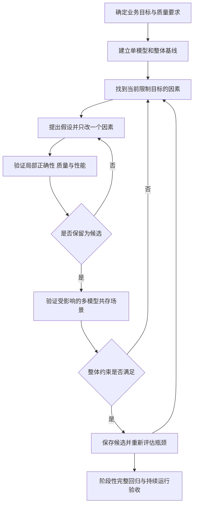

# 多模型推理优化学习指南

多模型推理优化的目标，是让完整应用在指定硬件、功耗、内存和负载下，持续、正确、及时地完成任务。工作同时涉及模型效果、模型压缩、推理部署、数据处理、任务调度和工程稳定性。

本指南按初学者在当前 Jetson 项目中的实际工作组织：理解任务，建立质量与性能基线，定位问题，每次验证一个改动，再检查多模型共存的影响。由用户亲自执行实验，助手负责解释、审查和按明确要求协助。

整理日期：2026-10-20。B0 与 B1 的代码和工作量分别说明；启动方式及当前验收状态以 [B1 实操入口](b1-handoff.md)、[视觉基线](visual-baseline.md)和[实施计划](implementation-plan.md)为准。

## 问题索引

| 讨论过的问题 | 阅读位置 |
|---|---|
| 当前项目如何开始优化，怎样定位、修改和比较 | [优化职责](#优化职责)、[工作流程](#工作流程)、[实验记录](#实验记录) |
| 从 YOLO 开始应该看哪些代码，第一步做什么 | [YOLO 代码与首次实验](#yolo-代码与首次实验) |
| 用人体检测完整实践部署优化、量化和剪枝 | [人体检测完整优化实操](body-detection-optimization.md) |
| 需要哪些工具，什么时候使用 | [工具分工](#工具分工)、[根据现象选择方向](#根据现象选择方向) |
| cProfile、pstats、perf 分别是什么 | [Python 与 CPU 分析](#python-与-cpu-分析) |
| 板端采集后是否一定要在 Linux 上用 nsys 和 ncu 分析 | [板端采集与电脑分析](#板端采集与电脑分析) |
| 一个视觉模型应该从哪些方面评价 | [评价指标](#评价指标)、[实机部署验收](#实机部署验收) |
| 量化、剪枝与运行效率优化有什么关系 | [模型优化与运行优化](#模型优化与运行优化)、[模型改动的验证](#模型改动的验证) |
| 为什么修改模型之后还要跑 benchmark | [Benchmark 与 Profiling](#benchmark-与-profiling)、[模型改动的验证](#模型改动的验证) |
| 多模型优化的主要职责包括什么 | [优化职责](#优化职责) |
| 先逐个优化再整体优化，还是每次都测整体 | [工作流程](#工作流程) |
| 模型 benchmark 好，部署到实机怎样判断好坏 | [实机部署验收](#实机部署验收) |
| Jetson 的功耗、频率和风扇为什么影响测量 | [公平对照](#公平对照) |

## 优化职责

一项完整的优化工作，要形成可复现的证据：问题在哪里、为什么选择这个方案、效果有什么变化、其他任务是否受到影响。

| 方面 | 需要完成的工作 |
|---|---|
| 需求与基线 | 确定场景、负载、质量要求、响应要求和资源预算，保存原始版本与测量数据 |
| 模型本身 | 模型选型、输入尺寸、量化、剪枝、蒸馏，以及必要的训练或微调 |
| 推理部署 | 核对输入输出和预后处理，导出与构建引擎，选择后端、计算精度及执行配置 |
| 数据链路 | 分析采集、解码、缩放、内存分配、CPU/GPU 传输、后处理和输出 |
| 多模型协同 | 管理依赖、线程、并发、队列、模型驻留、缓存及任务接纳上限 |
| 性能分析 | 用阶段计时与 profiler 找到 CPU、GPU、传输、等待或排队的具体问题 |
| 质量与性能回归 | 同时比较识别效果、响应速度、资源、共存干扰和稳定性 |
| 工程交付 | 固定代码、模型、依赖和配置，保留复现方式、运行记录及回退方案 |

并非每个模块都需要修改。能够用证据说明某个模块已经满足要求，也属于有效工作。

## 模型优化与运行优化

两类优化会相互影响，应当一起评估。

| 方向 | 常见方法 | 主要验证内容 |
|---|---|---|
| 模型方案 | 换用更小模型、调整输入尺寸、修改网络结构 | 任务效果与实机收益是否值得 |
| 数值精度 | FP16 部署、INT8 等量化 | 数值变化是否影响识别，硬件和后端能否实际加速 |
| 模型压缩 | 剪枝、蒸馏 | 压缩后是否需要训练恢复效果，导出和运行是否受支持 |
| 运行实现 | 向量化、缓冲复用、减少拷贝、优化后处理、CUDA Graph 等 | 输出语义是否保持，完整调用是否改善 |
| 系统调度 | 调整线程、任务周期、并发、队列和模型驻留 | 各任务在共存时能否共同满足要求 |

几个容易混淆的概念：

- **FP16 部署**采用较低的浮点精度，不等同于 INT8 校准或量化感知训练。
- **量化**主要改变数值表示和计算精度，通常保留网络的主要拓扑。PTQ 是训练后量化，通常需要代表性校准数据；QAT 在训练时模拟量化影响。
- **结构化剪枝**移除通道、卷积核或模块等结构，通常需要微调；**非结构化剪枝**把部分权重置零，实际加速依赖稀疏计算支持。
- **蒸馏**用教师模型指导学生模型训练，部署时通常运行学生模型。

量化可参考 [NVIDIA Model Optimizer 基础概念](https://nvidia.github.io/Model-Optimizer/guides/_basic_quantization.html)；结构化剪枝可参考 [Torch-Pruning](https://github.com/VainF/Torch-Pruning)。工具对具体 YOLO 版本、算子、导出格式及 Jetson 后端的支持需要逐项核对。

参数量、FLOPs 和模型文件大小适合筛选候选。真实速度还受算子支持、张量形状、内存访问和引擎实现影响，最终需要在目标设备上测量。选择 YOLO 系列或其他架构时，也应在相同任务、数据和硬件条件下比较。

## 评价指标

### 识别效果

| 任务 | 常用指标 | 需要覆盖的实际问题 |
|---|---|---|
| 目标检测 | Precision、Recall、AP、mAP，以及分场景漏检和误检 | 小目标、遮挡、逆光、运动模糊、多人 |
| 实例分割 | mask AP、IoU 等 | 轮廓质量、重叠目标、用于测距的区域是否可靠 |
| 关键点 | 任务适用的 AP、PCK 或关键点误差 | 手部小 ROI、遮挡、关键点抖动和丢失 |
| 跟踪与关联 | ID 切换、IDF1 等 | 交叉、遮挡、离开后重现、错误关联 |
| 手势业务 | 事件召回率、误触发次数、触发延迟 | 一次完整挥手能否触发，静止张掌是否正确取消 |

Precision 表示预测出的目标中有多少是对的；Recall 表示真实目标中有多少被找到。AP 综合评价不同置信度阈值下的检测表现；AP50 使用 IoU 0.5，AP50–95 对多个 IoU 阈值取平均，mAP 还对所评估的类别取平均。只关心人体时，应单列人体类别及业务阈值下的 Precision/Recall。[Ultralytics 指标说明](https://docs.ultralytics.com/guides/yolo-performance-metrics/)

模型输出的置信度与实际准确率需要分别理解。几张图片上的输出一致性检查，可以验证转换或计时插桩是否改变结果；任务效果需要代表性的标注数据和业务事件。

### 时间与吞吐

| 指标 | 含义 |
|---|---|
| 引擎执行时间 | 输入张量准备好以后，执行引擎的时间；要说明是否包含传输和同步 |
| 单模型完整调用 | 该模型的预处理、原生推理调用和后处理 |
| 端到端延迟 | 按业务定义的起点到结果被使用或动作完成的时间 |
| FPS 或吞吐 | 单位时间完成的帧或任务数量；相机、处理、浏览器的 FPS 分别统计 |
| 结果帧龄 | 使用或观察结果时，该结果对应的图像已经过去多久 |
| 超时率与无结果比例 | 未能在要求时限内交付结果的情况 |

在当前相机链路中，帧龄采用主机接收时间作为参考：

```text
单模型完整调用 = 预处理 + 同步原生调用 + 后处理
排队时间 = 开始处理时刻 − 输入进入等待的时刻
结果帧龄 = 观察或使用结果的时刻 − 对应图像的主机接收时刻
```

主机接收时间与传感器曝光时刻有区别。相机到屏幕的完整延迟还涉及采集、编码、网络及显示，计时起止点应与用途一致。

每项时间至少报告样本数、P50、P95 和最大值。P50 表示典型水平，P95 表示约 95% 的样本不超过的时间。对尾部延迟要求较高时增加 P99，并收集足够样本。失败、超时、跳帧和没有结果的情况同时记录。

流水线存在并发、固定周期和跳帧时，不能用单模型的 P50 直接推算整体 FPS；各阶段的 P95 也不能直接相加得到整体 P95。

### 多模型与资源

视觉与语音、4B 共存时，需要同时记录视觉帧率和帧龄、ASR 耗时、4B 首 token 延迟与生成速率、TTS 首 PCM 和完整合成时间。输入长度、输出长度及缓存状态也影响对话时延。

资源指标包括 CPU/GPU 负载与频率、内存余量、进程 PSS/RSS、功耗、温度、队列长度及长期趋势。Jetson 的 CPU 与 GPU 共享系统内存，解释内存数据时要避免重复计数。GPU 利用率的高低需要结合业务指标与时间线判断。

## Benchmark 与 Profiling

**Benchmark 衡量表现，Profiling 帮助解释原因。** 两者都适用于已固定的模型，也适用于量化、剪枝或更换模型后的候选。

| 评测范围 | 要回答的问题 | 典型输出 |
|---|---|---|
| 模型质量 benchmark | 在指定数据上识别得怎样 | AP、Precision/Recall、关键点误差、错误案例 |
| 单模型部署 benchmark | 最终部署工件在板上运行得怎样 | 引擎耗时、完整调用 P50/P95、内存 |
| 系统 benchmark | 在指定到达率和并发任务下，业务运行得怎样 | 帧龄、按时成功率、对话延迟、失败率、功耗 |
| Profiling | 哪段代码、等待或设备活动导致问题 | 函数统计、CPU/GPU 时间线、kernel 指标 |

例如，INT8 候选需要先检查质量变化，再比较板端性能；若收益较小，继续分析实际执行精度、数据转换、预后处理和系统等待。

正式性能对照使用低开销计时与监控。cProfile、Nsight Systems 和 Nsight Compute 的分析运行单独保存，测量开销也需要考虑。[TensorRT 性能测量说明](https://docs.nvidia.com/deeplearning/tensorrt/latest/performance/benchmarking.html)

## 工具分工

| 工具 | 用来做什么 | 何时使用 |
|---|---|---|
| 标注集与任务评测程序 | 评估检测、分割、关键点及业务效果 | 建立质量基线，验证模型和部署变化 |
| 项目阶段计时、日志、调试页 | 看模块耗时、帧龄、排队、触发次数和失败 | 第一轮观察与持续监控 |
| `trtexec` | 测 TensorRT 引擎、检查层与执行配置 | 判断引擎侧成本，和完整调用分开对照 |
| `tegrastats` | 观察 Jetson 内存、负载、时钟、温度、功耗 | 性能测试与持续运行监控 |
| `cProfile` 与 `pstats` | 采集和查看 Python 函数调用统计 | Python 循环、重复计算、预后处理 |
| `perf` | Linux CPU 采样与计数器分析 | C/C++ 原生热点、CPU 调度与缓存等问题 |
| Nsight Systems `nsys` | 看 CPU/GPU、CUDA 调用、传输、同步和并发时间线 | 排队、等待、GPU 空隙与多模型干扰 |
| Nsight Compute `ncu` | 分析指定 CUDA kernel 的计算、访存和占用情况 | 已定位到值得优化的 kernel 后 |
| Netron 等图查看工具 | 查看网络节点、张量形状和连接 | 理解模型、导出结构与剪枝位置 |
| Model Optimizer、Torch-Pruning 等 | 进行受支持的量化或结构化剪枝 | 已准备好模型、数据、训练与部署验证流程后 |

工具不需要一开始全部使用。先找出性能下降的阶段，再选择能回答当前问题的工具。Nsight Systems 与 Nsight Compute 的分析范围分别见 [Systems 用户指南](https://docs.nvidia.com/nsight-systems/UserGuide/index.html)和 [Compute 分析指南](https://docs.nvidia.com/nsight-compute/ProfilingGuide/index.html)。

2026-10-20 的本机检查中，`nsys`、`ncu`、`trtexec`、`tegrastats` 在 PATH 中可用，`perf` 未在 PATH 中找到。具体功能、权限和报告兼容性仍按所用版本确认。

### Python 与 CPU 分析

`cProfile` 收集 Python 函数调用数据，`pstats` 读取、排序和展示这些数据。它们属于 Python 标准库。常见字段如下：

| 字段 | 含义 |
|---|---|
| `ncalls` | 函数调用次数 |
| `tottime` | 函数自身耗时，不包含子函数时间 |
| `cumtime` | 函数及其子调用的累计耗时 |
| `percall` | 对应时间除以调用次数得到的每次平均值 |

报告中的时间通常以秒为单位。先按 `cumtime` 找到较大的调用分支，再按 `tottime` 和调用次数找具体热点。同步等待 GPU 的时间也可能计入函数耗时，因此需要结合 CUDA 时间线解释。[Python cProfile 与 pstats 文档](https://docs.python.org/3.12/library/profile.html)

`perf` 分析 Linux CPU 执行行为。`perf stat` 统计事件，`perf record` 采样，`perf report` 查看采样结果。它能补充 Python 层看不到的原生调用信息；可用的硬件事件和权限取决于内核与设备。[perf 维护者教程](https://perfwiki.github.io/main/tutorial/)

本项目的部分 benchmark 会启动独立 worker。分析对象应当是实际执行模型的 worker 或函数，只分析协调父进程会漏掉子进程的 Python 热点。

### 板端采集与电脑分析

常用工作方式是：

1. 在 Jetson 上运行真实模型和目标负载，采集性能数据或 trace。
2. 将 `.nsys-rep` 或 `.ncu-rep` 复制到分析电脑。
3. 使用兼容的 Nsight Systems 或 Nsight Compute GUI 查看，定位到源码后修改，再回到 Jetson 验证。

Linux 电脑适合承担 GUI 分析工作；板端也可以使用 `nsys stats`、`ncu` 报告读取等命令行功能。是否能本地打开 GUI，要看安装包、显示环境和依赖。分析电脑需要支持所采集的 Jetson/Tegra 报告及其版本。

性能采集必须覆盖真正执行 CUDA 的进程。若模型服务由 systemd 单独运行，仅跟踪发送 HTTP 请求的客户端，通常无法得到服务端模型的 GPU 时间线。

## 工作流程

实际工作由整体目标和当前瓶颈驱动，在单模型与系统层之间迭代。



不必等全部模型都优化完才集成，也不必每改一行代码就运行完整长时测试。验证范围按变化的影响和候选成熟度扩大：

| 阶段 | 验证范围 |
|---|---|
| 探索中的小改动 | 相关输入的正确性、局部质量和单模块性能 |
| 准备保留的候选 | 局部通过后，测试受影响的关键共存场景 |
| 涉及调度、线程、并发或共享资源的改动 | 尽早测试多模型，因为收益和代价主要发生在共存时 |
| 模型大改、合并前或阶段交付 | 完整质量与性能基准、异常恢复和规定时长的稳定性 |

例如，减少某个模型的 CPU 线程可能使其单独运行略慢，却使视觉与对话共存时的 P95 改善。决策依据是整体任务要求及可重复测量。

剪枝产生很多候选时，可以先用验证集和单模型性能筛选，再把有价值的候选接入系统。固定测试集用于阶段验收，避免反复根据测试结果调参。

## 根据现象选择方向

| 现象 | 优先调查 | 可验证的方案方向 |
|---|---|---|
| 真实场景漏检或误检多 | 数据分布、标注、阈值、模型能力、部署偏差 | 数据与训练、模型选型、阈值及预后处理修正 |
| 模型独立运行也慢 | 预处理、引擎、传输、后处理各自成本 | 优化热点、低精度部署、压缩或模型替换 |
| 独立运行正常，共存时变慢 | CPU/GPU/内存带宽竞争、线程和提交时间线 | 调整资源预算、线程、并发与调度 |
| 引擎快，但整帧慢 | Python/CPU 后处理、拷贝、转换、分配 | 向量化、缓冲复用、减少重复操作 |
| 处理 FPS 正常，帧龄却高 | 输入等待、调度间隔、结果更新、积压 | 有界队列、最新帧策略、缩短等待 |
| 启动或首个请求慢 | 加载、初始化、预热、首次图像处理和缓存 | 区分冷暖态，按使用需求优化初始化 |
| 运行越久越慢或内存增长 | 温度、频率、缓存、对象与缓冲生命周期 | 检查热稳态、限制缓存、修复未释放资源 |

表中的方向是待验证假设。看到高利用率、较多参数或一段时间线重叠，还需要进一步判断它与业务退化的关系。

## YOLO 代码与首次实验

### 先选择对应版本

| 范围 | 代码与数据入口 | 阅读重点 |
|---|---|---|
| B0 人体检测 YOLOv8n | [body_detector.py](../01_src/app/body_detector.py)、[perception.py](../01_src/app/perception.py)、[模型清单](../03_models/perception.json) | 单模型预处理、同步调用、后处理，以及在感知周期中的使用 |
| B0 单模块测量 | [vision_modules.py](../01_src/benchmarks/vision_modules.py)、[冻结结果](../benchmarks/results/b0-vision-summary.json) | 普通与计时调用的配对、分阶段耗时与输出一致性 |
| B1 检测分割与扩展视觉 | [segmentation.py](../01_src/app/segmentation.py)、[vision_models.py](../01_src/app/vision_models.py)、[perception_b1.py](../01_src/app/perception_b1.py) | 检测、测距、按条件调用后续模型、目标预算与发布 |
| B1 单模块与连续管线测量 | [vision_b1_modules.py](../01_src/benchmarks/vision_b1_modules.py)、[vision_b1_stream.py](../01_src/benchmarks/vision_b1_stream.py) | 单模块成本、真实调用次数和共存影响 |

最初加中文注释的是 B0 的 `body_detector.py`。B1 使用检测分割和不同的后续任务，比较两套方案时应分别说明任务和质量范围；不能把不同工作量的耗时差直接解释成一次实现优化收益。

### 理解单模型调用

先读 `BodyDetector.infer()`，再依次读它调用的函数：

```text
相机 BGR 图像
  → preprocess()：补边、缩放、通道和布局转换、归一化
  → predict_tensor()：传输、引擎执行、同步、取得 CPU 输出
  → postprocess()：类别筛选、坐标转换、NMS、还原原图坐标
  → 人体检测结果
```

当前 B0 实现把原图放在正方形左上角，右侧或下侧补边，输入张量为 `1×3×640×640`，输出为 `1×84×8400`。后处理既检查最高分类为人体，也检查人体分数达到阈值；修改筛选实现时要保留这些语义。

`last_timings` 中的 `native_sync_ms` 包括传输、执行、同步及取得输出的工作。它与纯 GPU kernel 时间有区别。

### 用已有数据形成假设

B0 在 2026-10-16 的固定 `public-camera-shape.png` 上记录了：

| 测量项 | P50 |
|---|---:|
| 完整普通调用 | 55.32 ms |
| 插桩预处理 | 1.66 ms |
| 插桩同步原生调用 | 11.14 ms |
| 插桩后处理 | 41.97 ms |

数据来自 [B0 视觉汇总](../benchmarks/results/b0-vision-summary.json)。普通调用与插桩调用分别测量，各阶段分位数不能直接相加；这些固定图片也不提供代表性检测精度结论。

这组数据支持优先调查 CPU 后处理。下一步可以用 cProfile 检查逐候选框筛选、重复调用与 NMS 等部分的成本，再决定具体修改。量化引擎的收益也应结合后处理占比评估。

### 第一轮只复现基线

人体检测专项按 [完整优化实操](body-detection-optimization.md)补齐模型质量与部署性能基线。下面是完整视觉管线的通用复现入口，可用于后续系统对照。

选择 B1 实操时，先按 [B1 实操入口](b1-handoff.md)核对协议、代码和配置。在项目根目录执行以下三条命令；测量程序会临时调整项目服务并在结束后尝试恢复，输出目录必须是新目录：

```bash
OPT_RUN="05_runtime/validation/vision-learning-$(date +%Y%m%d-%H%M%S)"
./05_runtime/environments/edge-assistant/bin/python 01_src/benchmarks/vision_b1_stream.py \
  --conditions replay-only --output "$OPT_RUN"
./05_runtime/environments/edge-assistant/bin/python 01_src/benchmarks/vision_b1_stream_summary.py \
  --output "$OPT_RUN"
```

第一轮先解释四件事：处理 FPS、整帧 P50/P95、结果帧龄，以及各模型实际触发次数。随后用相同输入测关键共存场景，确认问题主要来自单模型还是系统负载，再选 profiler。

若选择 B0 的人体检测作为第一课，则使用对应 B0 单模块入口与协议。每轮学习围绕一个问题，运行、观察和解释后再进入下一轮。

### 冻结源码校验报错

`B1 frozen file changed` 表示当前源码与所选协议记录的版本不同。即使只测人体检测，B1 协议也会核对整套受保护的运行文件；人脸或手势模块的开发改动同样会触发校验。

复现原始基线时，可把匹配协议的提交放在独立 Git worktree，共享模型、环境和固定输入等资产，副本保留自己的 `05_runtime/runtime-data` 目录。给单模块测量命令增加 `--source-root .worktrees/b1-body-baseline`，协调进程仍管理当前项目的服务，独立 worker 从该副本加载并校验冻结代码；结果会保存实际源码、输入协议和协调程序。原目录的开发改动继续保留。新实验使用新的输出目录。

改进后的实现需要建立独立实验协议和版本记录；不要直接改写旧协议的哈希，或删除校验来让候选冒充原基线。

## 模型改动的验证

对量化、剪枝、蒸馏或网络替换，可以按下面的链路验证：

```text
原始模型与质量基线
  → 准备训练或校准数据
  → 生成候选 必要时微调
  → 用验证集检查质量并筛选候选
  → 导出 ONNX 并构建目标设备引擎
  → 使用实际预后处理评估最终工件
  → 测单模型与关键共存场景
  → 固定测试集及完整系统验收
```

训练数据用于学习参数，校准数据用于估计量化所需的数值范围，验证集用于选择方案，独立测试集用于最终评价。校准数据应覆盖目标场景，独立测试集不参与校准、训练或反复调参。

每个候选同时回答：

1. **效果变化**：AP、Recall、误检、关键场景及业务事件是否满足要求。
2. **部署收益**：板端实际使用了什么精度，是否存在回退或额外转换，引擎和完整调用各改善多少。
3. **整体影响**：是否减少峰值内存或功耗，共存时视觉和对话是否仍达标。

训练框架中效果正常，还需要核对部署链路里的颜色顺序、缩放补边、归一化、坐标还原和 NMS。剪枝后的新形状也需要重新导出和构建引擎。实现保持语义的优化与允许数值变化的模型候选，分别采用适合的输出一致性或质量验收标准。

## 实机部署验收

实机验收要同时判断**是否满足要求**和**是否比原版本改善**。一个候选可能比原版本快，但仍达不到业务时限；一个已经达标的方案，也可以继续降低功耗或为其他模型释放资源。

优化前把使用条件与合格线写清楚：

| 验收项 | 需要预先固定的内容 |
|---|---|
| 场景 | 距离、光照、人数、目标大小、遮挡、运动速度与背景 |
| 工作量 | 输入到达率、每帧目标预算、哪些模型同时运行、请求长度与频率 |
| 效果 | 人体 Recall、误检，或手势事件成功率与每小时误触发上限 |
| 时效 | 视觉处理频率、P95 帧龄、事件触发时限、对话响应时限 |
| 资源 | 允许的功耗、峰值内存与内存余量、缓存和队列上限 |
| 稳定性 | 持续运行时长、允许失败率、故障恢复范围及恢复时限 |

对业务事件，可以增加一个综合指标：

```text
任务按时成功率 = 正确且在规定时限内完成的事件数 / 应完成的事件总数
```

例如 100 次规定场景下的挥手中，90 次在时限内正确触发，则按时成功率为 90%；误触发另按无挥手观察时长统计。连续视频中的主动跳帧按采样策略记录，不能直接用所有相机帧数代替业务事件数。

### 用当前项目数据判断

B1 R2 的 2026-10-20 固定回放记录如下，两组使用相同的视觉输入与配置：

| 条件 | 处理 FPS | 结果帧龄 P95 |
|---|---:|---:|
| 仅视觉 | 4.97 | 409.37 ms |
| 视觉与文件语音 ASR 4B TTS 共存 | 3.93 | 658.66 ms |

假设业务要求 P95 帧龄不超过 **500 ms**，则第一组满足这一项，第二组不满足。这是解释验收方法的示例门槛，项目的正式门槛需要在优化前确定。固定回放不能代替真人手势召回率和长期稳定性验收。[B1 R2 测量说明](visual-baseline.md)、[原始汇总](../benchmarks/results/b1-vision-stream-r2-summary.json)

当前语音范围以文件或受控 PCM 为主，首 PCM 和文件输出时间按软件链路解释。实体麦克风、扬声器的实际录播时延与可听回应，按项目既定范围后续单独验收。

## 公平对照

一次可信的 A/B 对照，至少固定或记录以下条件：

- 代码版本、模型和引擎哈希、依赖、有效配置，以及本轮唯一改动。
- 同一输入、到达时间、目标数量、触发条件；真实相机与固定回放分别解释。
- 相同电源模式、时钟策略、散热和风扇策略，并记录温度及热稳态变化。
- 相同后台服务、并发任务、线程、缓存、会话长度、预热和冷暖态。
- 相同计时边界、统计方法和失败处理规则，保存逐次原始数据。

MAXN、电源预算、CPU/GPU 频率锁定和风扇控制是不同设置。MAXN 下仍可能采用动态时钟，风扇策略也影响持续负载下的温度。实验应在预定部署配置下比较；功耗与温度可用 `tegrastats` 持续记录。[Jetson tegrastats 文档](https://docs.nvidia.com/jetson/archives/r38.2/DeveloperGuide/AT/JetsonLinuxDevelopmentTools/TegrastatsUtility.html)

项目根目录可用以下只读方式核对环境：

```bash
nvpmodel -q
jetson_clocks --show
tegrastats --interval 1000
```

`tegrastats` 持续输出，按 `Ctrl+C` 停止；前两条的部分信息可能受系统读取权限限制。

短时探索可以先快速筛选。正式优化对照按项目测量约定至少 5 轮、每类累计至少 100 个事件，并记录波动和全部失败；长期稳定性另按验收时长执行。原始冻结记录保持不变，新候选使用新的编号、协议和输出目录。

## 实验记录

每轮保留一份记录，让他人能复现你的判断：

| 字段 | 记录内容 |
|---|---|
| 问题 | 哪个场景的哪个指标不满足要求 |
| 基线 | 代码、模型、配置、环境、输入、原始数据路径 |
| 证据 | 阶段计时、质量错误案例、函数统计或 trace |
| 假设 | 怀疑的原因，以及什么结果会支持或推翻它 |
| 方案 | 只改的因素、预计作用范围和可能代价 |
| 局部结果 | 质量、完整调用、引擎、预后处理、失败情况 |
| 共存结果 | 视觉、ASR、4B、TTS 各自变化，资源与稳定性 |
| 结论 | 保留或回退、适用场景、剩余问题与下一步 |

比较表可以从下面开始，填入真实测量值：

| 指标 | 原版本 | 候选 | 验收要求 | 判断 |
|---|---|---|---|---|
| 人体 AP 或业务阈值下的 Recall | 待测 | 待测 | 优化前固定 | 待判定 |
| 手势按时成功率与误触发 | 待测 | 待测 | 优化前固定 | 待判定 |
| 单模型完整调用 P50/P95 | 待测 | 待测 | 优化前固定 | 待判定 |
| 共存时视觉 FPS 与帧龄 P95 | 待测 | 待测 | 优化前固定 | 待判定 |
| 共存时对话响应 P95 | 待测 | 待测 | 优化前固定 | 待判定 |
| 峰值内存与最低可用内存 | 待测 | 待测 | 优化前固定 | 待判定 |
| 平均功耗与规定时长稳定性 | 待测 | 待测 | 优化前固定 | 待判定 |

耗时下降比例可按 `(原耗时 − 新耗时) / 原耗时` 计算，加速比按 `原耗时 / 新耗时` 计算。使用相同指标与统计口径，并把收益与质量、功耗和其他模型的变化一起解释。

下一次实操从 [B1 首次视觉实验](b1-handoff.md)或选定的 B0 单模块开始。先完成测量和解释，再依据证据选择一项实现优化或模型候选；保留候选后，回到关键共存场景验证。
