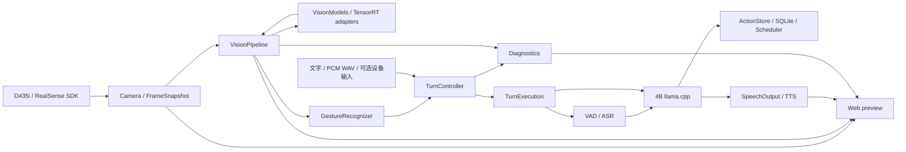

# 软件架构与代码地图

当前目标是在 Orin NX 16GB 上运行陪伴场景的端侧多模型服务，建立可复现的数据流、资源边界和性能基准。应用基于已固定版本的 NVIDIA 开源助手代码演进；模型运行复用 llama.cpp、OpenVoiceStream、TensorRT 和 RealSense SDK。当前没有 ROS、机器人运动控制或 Triton 服务层。

## 四个服务

| 服务 | 职责 | 本机端口 |
|---|---|---|
| `llama` | Qwen3.5-4B 图文推理、流式文本和工具调用 | 8088 |
| `asr` | llama.cpp 承载 Qwen3-ASR-0.6B | 8089 |
| `speech` | OpenVoiceStream 语音 API、ASR 适配、Matcha/Vocos 合成 | 8621 |
| `app` | 相机、十模型视觉、手势、请求控制、动作存储、Web 和诊断 | 8090 |

systemd 负责进程、启动依赖、重启和进程组回收。视觉模型在 `app` 内通过 TensorRT 顺序执行，模型适配器保留各自的预后处理；它们没有独立网络服务。现有后端、线程数、上下文、精度和调度参数在本轮保持不变。

## 数据如何流动

相机发布带 `source_epoch`、`frame_id`、主机接收时间和失效标记的 RGBD 快照。深度通过 SDK 对齐到 RGB；无效深度保持未知。视觉工作线程只选择最新帧，同一轮检测、姿态、特征和属性结果携带同一个帧标识，过期或重连前的结果不再发布。图文问答从同一份感知预览中取得图像与辅助观察，避免把不同帧的信息拼在一起。

检测分割先提供人体和物体候选、mask 及距离。只有满足深度有效性与距离条件的目标，才进入姿态、ReID、物体特征及人脸属性处理。Norfair 负责轨迹关联；人脸特征图库只提供可选的登记/匹配能力，不作为语音指令的身份授权关卡。

挥手触发问候；静止张掌达到既定证据要求后取消整轮。取消会传播到生成、语音输出和待执行工具；已提交的笔记或提醒保留。`TurnController` 管理接纳、状态和取消边界，`TurnExecution` 负责一轮内的输入准备、模型调用、提交、清理和结束。确认后端资源释放后才能接纳后续工作。

## 谁拥有资源

| 模块 | 负责的资源与边界 |
|---|---|
| `app/application.py` | 组装组件、启动顺序、应用生命周期和释放顺序 |
| `app/camera.py`、`realsense_source.py` | 唯一相机采集者、RGBD 时间匹配、JPEG 与有界帧历史 |
| `app/frame_worker.py`、`vision_pipeline.py` | 最新帧处理、目标预算、模型调用和结果关联 |
| `app/vision_models.py` 及适配器 | 引擎/缓冲区所有权、模型契约、预后处理与调用指标 |
| `app/turn_control.py`、`turn_execution.py` | 单轮执行状态、取消、工具执行边界、后端释放确认 |
| `app/speech/` | 设备、采集、VAD、播放、文件发布与类型化语音事件 |
| `app/actions/` | SQLite 事务、幂等回执、笔记、提醒与调度 |
| `app/web.py`、`broadcast.py` | HTTP/WebSocket、预览、消息发布和有界客户端队列 |
| `app/diagnostics.py`、`monitor.py` | 板端采样、轮次/模型时间与资源快照 |
| `deploy/` | 后端命令、服务归属、构建租约、工件校验、运行包 |
| `validation/`、`benchmarks/` | 功能/故障检查，以及有明确条件和统计范围的测量 |

当前采集目标 10 FPS，视觉处理上限 5 FPS，帧有效期 1.5 秒；这三个是配置，不是实测吞吐。距离触发区间 0.35–3.0 米，单帧最多处理 1 人姿态、2 张人脸、1 个物体特征，最多发布 2 只手。全部参数以 `./run.sh config` 和 `02_config/settings.orin-nx.yaml` 为准。

## 阅读顺序

1. `main.py` / `run.sh` → `app/cli.py`：启动与配置。
2. `app/application.py`：组件在哪里创建、由谁关闭。
3. `app/camera.py` → `app/vision_pipeline.py` → `app/vision_models.py`：一帧如何经过十模型。
4. `app/segmentation.py` / `tensorrt_runner.py`：先从用户准备优化的人体检测模块看预处理、传输、执行和后处理。
5. `app/turn_control.py` → `turn_execution.py` → `speech/output.py`：一轮对话的执行和取消。
6. `benchmarks/vision_modules.py` / `vision_stream.py`：隔离模块与共存场景如何测量。

公共代码不导入 `scripts/`。四个脚本入口只选择任务，正式实现分别位于部署、验证和基准包。模型版本由 `03_models/` 的清单表达，历史实现通过 Git 恢复点查阅。

## 交付边界

本轮工作清单见 [整合 Goal](consolidation-goal.md)。实体麦克风/扬声器、AEC、真人手势完整准确率、长时间稳定性和长期记忆仍需要后续证据。已知退出超时 `B2-EXIT-01` 的状态单独保留；软件回放与文件语音通过不能代替这些验收。
