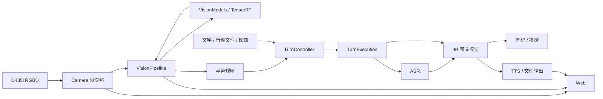

# 软件架构与运行逻辑

程序在 Orin NX 16GB 上提供本地陪伴交互。systemd 管理四个服务；模型运行复用 llama.cpp、OpenVoiceStream/VoxEdge、TensorRT 和 RealSense SDK。

| 服务 | 职责 | 本机端口 |
|---|---|---:|
| llama | Qwen3.5-4B 图文推理、流式文本与工具调用 | 8088 |
| asr | llama.cpp 承载 Qwen3-ASR-0.6B | 8089 |
| speech | 语音 HTTP API、ASR 适配、Matcha/Vocos 合成 | 8621 |
| app | RGBD、十模型视觉、手势、轮次、笔记/提醒、Web 与实时状态 | 8090 |

## 数据流



相机发布带 `source_epoch`、`frame_id` 和主机接收时间的 RGBD 快照。深度由 RealSense SDK 对齐到 RGB；无效深度不作为有效距离。视觉线程只取最新帧，各模型输出携带同一帧标识；过期和相机重连前的结果不再发布。

检测/分割先提供人体、物体、mask 和距离。满足距离与质量条件的目标进入姿态、ReID、物体特征及人脸属性处理。模型在应用内顺序调用，Norfair 负责轨迹关联。人脸图库是可选匹配能力，不是语音指令的授权关卡。

挥手触发问候；静止张掌取消当前整轮。取消传播到生成、播报和未执行工具；已提交的笔记或提醒保留。轮次控制负责接纳和状态，单轮执行对象负责输入准备、模型调用、工具提交与清理；释放未确认时拒绝接纳下一轮。

## 代码目录与阅读顺序

`app` 根目录只放组装入口、命令入口和配置；子目录按运行职责划分。

```text
01_src/app/
├── application.py          # 组装资源与管理应用生命周期
├── cli.py                  # 命令入口
├── config.py               # 配置加载与校验
├── vision/                 # 视觉采集、同帧管线与交互感知
│   ├── camera.py
│   ├── realsense_source.py
│   ├── frame_worker.py
│   ├── pipeline.py
│   ├── tracking.py
│   ├── face_state.py
│   ├── identity_gallery.py
│   ├── gestures.py
│   ├── geometry.py
│   ├── roi.py
│   └── models/             # 各视觉模型的预后处理与模型集合
│       ├── manager.py
│       ├── segmentation.py
│       ├── wholebody_pose2d.py
│       ├── face_trt.py
│       ├── face_tasks.py
│       ├── head_gaze.py
│       └── appearance.py
├── conversation/           # LLM 接口、轮次接纳/取消与单轮执行
├── speech/                 # 语音格式、采集、VAD、ASR、TTS 与输出
├── inference/              # TensorRT、工件校验与可取消 HTTP 基础
├── web/                    # HTTP/WebSocket、传输限制与广播
├── monitoring/             # 板端状态与阶段计时
└── actions/                # 笔记、提醒、事务与调度
```

| 模块 | 核心文件与职责 |
|---|---|
| 应用入口 | `application.py` 负责资源组装、启动和释放顺序；`cli.py` 与 `config.py` 管理命令和配置 |
| 视觉采集 | `vision/camera.py`、`realsense_source.py` 管理唯一 RGBD 采集者、时间戳和有界缓存 |
| 视觉管线 | `vision/frame_worker.py`、`pipeline.py` 管理最新帧、目标预算和同帧结果 |
| 视觉模型 | `vision/models/manager.py` 管理模型所有权；其余适配器实现必要预后处理 |
| 视觉交互 | `vision/tracking.py`、`identity_gallery.py`、`gestures.py` 管理轨迹、图库和手势证据 |
| 对话 | `conversation/turn_control.py`、`turn_execution.py` 管理接纳、取消、工具边界和输出提交；`llm.py` 适配模型接口 |
| 语音 | `speech/stt.py`、`tts.py` 适配语音服务，其余文件负责格式、设备、分段和输出 |
| 推理基础 | `inference/tensorrt_runner.py` 管理引擎和缓冲区；`model_artifacts.py` 校验工件；`request_io.py` 处理 HTTP 时限和取消 |
| Web | `web/server.py`、`limits.py`、`broadcast.py` 管理接口、客户端队列及消息发布 |
| 监控 | `monitoring/diagnostics.py`、`monitor.py` 采集实时指标 |
| 动作 | `actions/` 保持数据库事务、幂等回执和提醒调度；持久调度回调路径保持稳定 |

建议先读 `application.py`，视觉路径依次看 `vision/camera.py` → `vision/pipeline.py` → `vision/models/manager.py`。学习检测推理时读 `vision/models/segmentation.py` 和 `inference/tensorrt_runner.py`；理解对话时读 `conversation/turn_control.py` → `turn_execution.py` → `speech/output.py`。

当前配置：采集目标 10 FPS、视觉处理上限 5 FPS、帧有效期 1.5 秒、距离范围 0.35–3 米；每帧最多 1 人姿态、2 张人脸、1 个物体特征、2 只手。这些是调度参数，不是识别准确率或实测吞吐保证。


## 新版分层与多模型调度目标（实施中）

2026-10-23：用户批准整理完整 goal 后开始实施。上文仍描述当前正式运行版本；以下是迁移目标，不表示已经接入正式服务。

将 /home/nvidia/Multi_Model_Inference 重构为基于成熟开源运行时、六层职责清晰、可配置多模型调度且具备完整观测能力的 Orin NX 16GB 端侧推理系统。保留现有功能，完成稳定性验收和可复现性能基线后交给用户亲自优化。用户已明确要求整理完整 goal 后开始实施。

【技术方案】
首选 Holoscan 4.6 的图执行、执行条件、调度与资源组件；沿用 TensorRT 10.16.2.10、CUDA 13.2/L4T 39.2.1。MMDeploy 借鉴模型适配和后端分层，Isaac ROS 借鉴编码/推理/解码边界，暂不增加 Triton/ROS 运行依赖。优先发行包，固定版本/哈希，不自建通用调度框架。
先验证真实兼容性：系统源提供 Holoscan CUDA13，PyPI 有 holoscan-cu13 4.6.0 的 cp312/aarch64 wheel；通用 holoscan 包依赖 CUDA12，不能误装。核实 bindings/原生库一致且无重复 SDK；安装试算不能冒充运行通过。若阻碍实质性存在，先定位并提交证据、评估成熟替代；不静默升级/降级 CUDA、TensorRT、L4T。
迁移固定现有模型、引擎精度、输入输出和前后处理。用户 FP16/INT8/QAT 实验独立，不覆盖实验记录或自行推广候选。保护所有已有未提交修改。

【功能范围】
保留 D435i 原生 RGBD；YOLOv8n-seg、YuNet、RTMW-l、OSNet x1.0、ArcFace MobileNet V1、头姿、面部关键点、视线、表情、CLIP 共十模型；跟踪、挥手问候、静止张掌取消当前整轮；现有 llama.cpp 4B/ASR、TTS/文件音频、Web/debug、笔记提醒和四服务管理。
身份图库仅保留原有可选能力，不新增授权关卡。长期记忆、导航、机械执行不纳入。实体录播/AEC/双讲和缺少的真实手势样本列后续验收，不阻塞本阶段软件交付，也不以模拟冒充真机通过。

【六层架构】
1应用接口：Web/CLI/HTTP/WebSocket及展示。
2场景策略：交互状态、目标选择、手势行为、任务重要性和模式切换。
3编排调度：Holoscan图、依赖、执行条件、有界队列、准入和期限策略。
4模型适配：ROI/坐标变换、预处理、框/Mask/关键点/特征解码。
5推理后端：现成TensorRT推理算子与语言/语音适配；视觉张量和流式语言接口分别定义。
6设备资源：RealSense/音频、缓冲池、CUDA流/事件及生命周期。
application.py只组装资源；稳定契约和依赖注入隔离边界。Web不操作CUDA，模型不包含交互业务，调度不解析输出，策略不分配设备内存。保留数据库和actions持久回调兼容。新改函数有合理中文说明。不能只改目录或把原串行大函数包成一个算子。

【数据与调度】
定义Frame/Task/Result/Event/Metrics契约，携带source_epoch、frame_id、target_id/轨迹代次、坐标系、形状类型、数据位置、观测/完成时间、有效期、依赖与状态。缓存不改写为新观测；重连、轨迹失效和特征空间变化时失效。头姿/关键点须同帧同目标。缓冲区明确所有者，CUDA完成前不释放/覆盖。
关键分支检测→跟踪→姿态→手势独立发布，不等待所有属性。人脸检测独立运行；视线等待头姿和面部关键点；ReID/ArcFace/CLIP依业务事件和刷新期限运行，表情低频。异步特征与跟踪关联要验证。
任务频率、目标预算、容量、deadline/TTL和降级规则配置化，起点沿用当前10FPS采集/5FPS处理上限及目标预算，未测量不承诺吞吐。
最新数据策略仅淘汰待执行任务；全局/各分支队列有界。手势保留有界有序历史，采样断裂/换人重置。Holoscan temporal/activation重发缓存的行为须标记真实来源。优先级通过准入/条件/预算实现并测低优先级饥饿，不把线程或CUDA优先级当硬实时抢占保证。
先受控串行GPU在途基线；CPU准备可安全重叠。GPU并发、GPU预后处理、C++/CUDA热点迁移与最优调参留用户后续实验。
四服务维持，app内接入视觉运行时。空闲/交互/生成/播报/资源紧张采用不同视觉预算；外部LLM/ASR/TTS竞争由场景级准入协调，不声称视觉框架控制其GPU执行。现有文件租约不是GPU调度器。
可恢复输入错误返回不可用状态；致命运行时错误安全停图/重启。覆盖取消、退出和回收，处理已知间歇性shutdown超时。

【里程碑】
M0：固定依赖，验证官方动态触发/周期/异步生命周期例程和真实引擎，记录新增资源开销。
M1：冻结当前功能/性能对照，完成六层职责、契约、依赖图及迁移映射。
M2：逐模型接入图运行时，优先InferenceOp；临时桥接须记录边界，保持原顺序/工作量/处理以验证一致性。
M3：接通检测/跟踪/姿态/手势独立发布及有界队列、时效和取消。
M4：接通其余全部模型，完成动态触发、刷新、缓存与同帧join/轨迹验证。
M5：集成四服务、工具取消、Web、模式和资源策略，完成稳定性/故障恢复。
M6：交付完整基线、报告、代码文档及用户操作指南；正式路径只保留一套主实现，清理临时桥接。

【验证与证据】
分别记录R0原系统、R1同工作量新运行时、R2新调度策略，量化另立实验。R2同时报告实际模型调用量和业务质量，不能把少执行模型全算为框架加速。
固定输入单模型输出一致或在预先登记可解释容差内；YOLO沿用dev1000及相同生产工作点/COCO评测。时序变化另测事件、轨迹ID、属性新鲜度。无真值只报告一致性。十模型均须有效真实输入覆盖。
验证无跨帧跨人混用、无重复手势副作用、无无界排队、无过期结果伪装新结果。
计划20次启停、至少2小时混合负载，覆盖断流重连、无目标、无效深度、慢客户端、模型故障、服务断开、任务过期/取消；无挂死、资源残留和持续内存增长。失败定位修复再验。
基线覆盖空场景、单人、多目标、目标进出、视觉与LLM/TTS重叠；固定输入/引擎哈希/配置/软件及功率频率策略，记录热状态。
测排队、预处理、传输、GPU计算、后处理和发布；报告P50/P95、实际频率、帧龄、超时丢弃原因、CPU、系统内存、GPU/EMC频率、温度功率。异步提交不等于GPU耗时，RSS不等于独占显存，不累加并行P95。
M1依实测波动登记可接受开销/响应预算，不预设加速比例或十模型FPS。功能与基线完成不依赖用户尚未做的优化。
debug展示分支、队列、当前任务、结果年龄、耗时、降级原因和服务状态。交接包含从零启动、单模型检查、全链路、报告复现与阅读路径。

【仓库和完成边界】
主仓保留运行组件、必要文档和锁定清单；必要验证/分析工具放独立实验区，不作为部署运行依赖。不恢复AI_Stack、旧版本备份或长期双管线；保留业务数据。用Git提交记录变更，验证所需基线只保留必要结果/配置/哈希，不复制旧工程。
按验收里程碑及时提交推送，只提交本目标变更，保护用户README、论文/量化资料及实验文件。大模型使用现有工件清单/哈希机制。
完成条件：成熟运行时板端通过，六层真实落地，十模型和原业务可用，多分支调度/所有权/取消/故障测试通过，有可复现混合负载基线和待验硬件清单，代码文档已推送，用户能独立启动观测复测。交付后将goal标为完成，不继续代做PTQ/QAT或全面性能优化；后续由用户做实验，助手指导与复核。

### M0 已取得的证据

- 独立验证环境：`/home/nvidia/multimodel-runtime-lab/holoscan-4.6-cu13`。生产环境和系统 CUDA/TensorRT 未修改。
- 固定依赖：Holoscan CUDA13 4.6.0、CuPy CUDA13 13.6.0、NumPy 1.26.4；完整带哈希清单为实验目录的 `m0-requirements.lock`。
- 原生库映射确认使用主机 `libnvinfer.so.10.16.2` 与 CUDA 13.2。
- 固定 COCO 图片 139、正式 YOLO FP32 引擎，经 `Source → InferenceOp → Sink` 与 `EventBasedScheduler` 执行 3 次：两个原始输出张量最大绝对差均为 0，10 个目标和 mask 与现有适配器一致，异步运行正常结束。
- 官方周期执行例程通过；动态模型启用例程完成 7 轮。报告在实验目录 `reports/m0-upstream-checks.json`。
- 接入约束：当前 Python InferenceOp 构造参数仍为 `pre_processor_map` / `inference_map`；输入需要设备或 CUDA pinned host 内存；进程栈限额按官方提示设为至少 32 MiB。
- 失败尝试及纠正记录均保留于实验报告，未修改引擎。原引擎已有跨设备型号警告仍保留，不能用此验证宣称性能收益。
- 20 轮同进程图创建、3 次真实推理、取消和退出通过，输出保持一致，退出后线程数均为 25，停止约 46–51 ms。RSS 从约 899 MiB 增至约 1044 MiB，包含原生库、参考执行与验证数据，不能视为框架独占内存或已证明无泄漏；后续需做稳态长跑及独立开销对照。
- 补充 90 秒单模型驻留与 ASGI 共存检查：Holoscan 执行 452 次、19 次输出抽查及 90 次 ASGI 请求，全部通过；暖机 30 秒后 RSS 增量为 56 KiB，ASGI 请求 P95 约 2.72 ms。直接调用对照执行 450 次，RSS 增量 52 KiB。两种接入方式的稳态进程 RSS 相差约 132.6 MiB，包含 SDK、CuPy、线程和缓冲区，不能解释为独占显存或全系统开销。报告为实验目录的 `reports/m0-{holoscan,direct}-web-resources.json`。
- M0 单模型兼容性和短时生命周期验证通过。这里的 ASGI 检查不包含 TCP、相机或正式四服务，整机长跑及实体交互仍属于后续阶段。

### M1 数据契约进展

`app/contracts.py` 已定义共享 `FrameSnapshot`、`FrameKey`、`TaskRequest` 和 `ModelObservation`。相机继续返回同一帧元数据格式，旧导入名仍可用；任务期限、缓存原始时间与同帧/同目标依赖检查独立于 Holoscan、TensorRT 和 Web。工作线程的帧有效性检查开始复用公共契约。

实验区 `scripts/check_contracts.py` 的 9 项检查通过，覆盖重连帧号重用、轨迹代次变化、缓存过期、迟到结果、依赖匹配及正式工作线程的失效检查；53 个应用模块导入通过。此阶段尚未替换正式视觉调度路径。

### M2 模型分层与原生图组件进展

十模型适配器已分出 `prepare()` 与 `decode()`，独立的 `infer()` 保留为单模型同步调用入口。由组装层注入 `EngineDescription` 时只加载契约与算法辅助模块，不重复创建 GPU 引擎；执行资源由 Holoscan `InferenceOp` 持有。`VisionModels.load(runtime_factory=...)` 提供注入边界。

`03_models/vision-runtime.json` 的 schema 2 记录从真实引擎读取的有序 I/O 名称、形状和类型。视线模型的三个输入严格按引擎顺序映射，不能依赖普通调用字典的插入顺序。

`app/perception/graphs/model.py` 组装 `Prepare → InferenceOp → Decode`，配对传递请求和几何信息，持有输入所有者直到结果消费；在预处理前后和发布前检查时效。内部输入端口容量为 1；输出使用官方 `BlockMemoryPool`，根据真实输出尺寸分配固定数量的 pinned host 块，并检查单模型池不超过 64 MiB。可恢复输入错误返回明确事件，原生推理错误由图所有者负责停图和上报。`backend_wall_ms` 包含节点等待、执行与输出复制，不称作纯 GPU 时间。

已完成以下组件证据，均使用真实引擎、COCO 图片 461009 的有效人体与人脸输入；不代表实时业务分支和整机验收：

- `m2-adapter-equivalence.json`：与迁移前提交 `6576ea1` 的十模型实现逐一比较，同步接口及拆分接口结果一致，准备的输入逐元素一致。
- `m2-native-models.json`：十个原生 InferenceOp 分别执行 3 次，所有原始输出最大绝对差均为 0。
- `m2-model-graphs-bounded.json`：同一图中的十条模型链各完成 3 次，结果一致；另有 1 次过期请求被拒绝、1 次退化人脸输入返回不可用状态。该用例为各分支提供参考输入，不验证实时的头姿/关键点联动。
- 图串行基线明确使用 `EventBasedScheduler(worker_thread_number=1)`。实验发现 `ThreadPool.add(..., pin_operator=True)` 会为每节点追加专用线程，而 `pin_operator=False` 不构成所需的 GPU 串行约束；最终日志确认只有一个图工作线程。CPU/GPU 并发优化留给后续独立实验。

正式应用仍使用原串行视觉管线；下一步先冻结完整 R0 对照，再接入场景策略、分支发布和四服务生命周期。Holoscan 目前仅安装于独立验证环境。

运行环境检查 `m2-services-preflight.json` 为 `ARTIFACTS_VERIFIED`，58 个应用模块可在原生产环境导入；新图模块只在创建图时要求 Holoscan 依赖。四服务保持实施前的停止状态。以上均不替代整机启动、相机链路或长时间混合负载验收。
