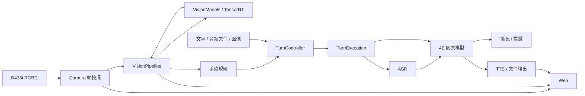

# 软件架构与运行逻辑

程序在 Orin NX 16GB 上提供本地陪伴交互。systemd 管理四个服务；模型运行复用 llama.cpp、OpenVoiceStream/VoxEdge、TensorRT 和 RealSense SDK。

| 服务 | 职责 | 本机端口 |
|---|---|---:|
| llama | Qwen3.5-4B 图文推理、流式文本与工具调用 | 8088 |
| asr | llama.cpp 承载 Qwen3-ASR-0.6B | 8089 |
| speech | 语音 HTTP API、ASR 适配、Matcha/Vocos 合成 | 8621 |
| app | RGBD、十模型视觉、手势、轮次、笔记/提醒、Web 与实时状态 | 8090 |

## 数据流



相机发布带 `source_epoch`、`frame_id` 和主机接收时间的 RGBD 快照。深度由 RealSense SDK 对齐到 RGB；无效深度不作为有效距离。视觉线程只取最新帧，各模型输出携带同一帧标识；过期和相机重连前的结果不再发布。

检测/分割先提供人体、物体、mask 和距离。满足距离与质量条件的目标进入姿态、ReID、物体特征及人脸属性处理。模型在应用内顺序调用，Norfair 负责轨迹关联。人脸图库是可选匹配能力，不是语音指令的授权关卡。

挥手触发问候；静止张掌取消当前整轮。取消传播到生成、播报和未执行工具；已提交的笔记或提醒保留。轮次控制负责接纳和状态，单轮执行对象负责输入准备、模型调用、工具提交与清理；释放未确认时拒绝接纳下一轮。

## 代码目录与阅读顺序

`app` 根目录只放组装入口、命令入口和配置；子目录按运行职责划分。

```text
01_src/app/
├── application.py          # 组装资源与管理应用生命周期
├── cli.py                  # 命令入口
├── config.py               # 配置加载与校验
├── vision/                 # 视觉采集、同帧管线与交互感知
│   ├── camera.py
│   ├── realsense_source.py
│   ├── frame_worker.py
│   ├── pipeline.py
│   ├── tracking.py
│   ├── face_state.py
│   ├── identity_gallery.py
│   ├── gestures.py
│   ├── geometry.py
│   ├── roi.py
│   └── models/             # 各视觉模型的预后处理与模型集合
│       ├── manager.py
│       ├── segmentation.py
│       ├── wholebody_pose2d.py
│       ├── face_trt.py
│       ├── face_tasks.py
│       ├── head_gaze.py
│       └── appearance.py
├── conversation/           # LLM 接口、轮次接纳/取消与单轮执行
├── speech/                 # 语音格式、采集、VAD、ASR、TTS 与输出
├── inference/              # TensorRT、工件校验与可取消 HTTP 基础
├── web/                    # HTTP/WebSocket、传输限制与广播
├── monitoring/             # 板端状态与阶段计时
└── actions/                # 笔记、提醒、事务与调度
```

| 模块 | 核心文件与职责 |
|---|---|
| 应用入口 | `application.py` 负责资源组装、启动和释放顺序；`cli.py` 与 `config.py` 管理命令和配置 |
| 视觉采集 | `vision/camera.py`、`realsense_source.py` 管理唯一 RGBD 采集者、时间戳和有界缓存 |
| 视觉管线 | `vision/frame_worker.py`、`pipeline.py` 管理最新帧、目标预算和同帧结果 |
| 视觉模型 | `vision/models/manager.py` 管理模型所有权；其余适配器实现必要预后处理 |
| 视觉交互 | `vision/tracking.py`、`identity_gallery.py`、`gestures.py` 管理轨迹、图库和手势证据 |
| 对话 | `conversation/turn_control.py`、`turn_execution.py` 管理接纳、取消、工具边界和输出提交；`llm.py` 适配模型接口 |
| 语音 | `speech/stt.py`、`tts.py` 适配语音服务，其余文件负责格式、设备、分段和输出 |
| 推理基础 | `inference/tensorrt_runner.py` 管理引擎和缓冲区；`model_artifacts.py` 校验工件；`request_io.py` 处理 HTTP 时限和取消 |
| Web | `web/server.py`、`limits.py`、`broadcast.py` 管理接口、客户端队列及消息发布 |
| 监控 | `monitoring/diagnostics.py`、`monitor.py` 采集实时指标 |
| 动作 | `actions/` 保持数据库事务、幂等回执和提醒调度；持久调度回调路径保持稳定 |

建议先读 `application.py`，视觉路径依次看 `vision/camera.py` → `vision/pipeline.py` → `vision/models/manager.py`。学习检测推理时读 `vision/models/segmentation.py` 和 `inference/tensorrt_runner.py`；理解对话时读 `conversation/turn_control.py` → `turn_execution.py` → `speech/output.py`。

当前配置：采集目标 10 FPS、视觉处理上限 5 FPS、帧有效期 1.5 秒、距离范围 0.35–3 米；每帧最多 1 人姿态、2 张人脸、1 个物体特征、2 只手。这些是调度参数，不是识别准确率或实测吞吐保证。
