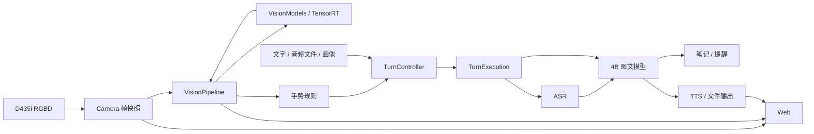

# 软件架构与运行逻辑

程序在 Orin NX 16GB 上提供本地陪伴交互。systemd 管理四个服务；模型运行复用 llama.cpp、OpenVoiceStream/VoxEdge、TensorRT 和 RealSense SDK。

| 服务 | 职责 | 本机端口 |
|---|---|---:|
| llama | Qwen3.5-4B 图文推理、流式文本与工具调用 | 8088 |
| asr | llama.cpp 承载 Qwen3-ASR-0.6B | 8089 |
| speech | 语音 HTTP API、ASR 适配、Matcha/Vocos 合成 | 8621 |
| app | RGBD、十模型视觉、手势、轮次、笔记/提醒、Web 与实时状态 | 8090 |

## 数据流

相机发布带 `source_epoch`、`frame_id` 和主机接收时间的 RGBD 快照。深度由 RealSense SDK 对齐到 RGB；无效深度不作为有效距离。视觉线程只取最新帧，各模型输出携带同一帧标识；过期和相机重连前的结果不再发布。

检测/分割先提供人体、物体、mask 和距离。满足距离与质量条件的目标进入姿态、ReID、物体特征及人脸属性处理。模型在应用内顺序调用，Norfair 负责轨迹关联。人脸图库是可选匹配能力，不是语音指令的授权关卡。

挥手触发问候；静止张掌取消当前整轮。取消传播到生成、播报和未执行工具；已提交的笔记或提醒保留。轮次控制负责接纳和状态，单轮执行对象负责输入准备、模型调用、工具提交与清理；释放未确认时拒绝接纳下一轮。

## 模块职责

| 文件或目录 | 职责 |
|---|---|
| `main.py`、`app/cli.py` | 命令入口与配置 |
| `app/application.py` | 组件组装、生命周期和释放顺序 |
| `app/camera.py`、`realsense_source.py` | RGBD 采集、对齐、时间戳和有界帧历史 |
| `app/frame_worker.py`、`vision_pipeline.py` | 最新帧调度、目标预算、同帧结果关联 |
| `app/vision_models.py` 和各模型适配器 | 引擎加载、契约校验、预后处理与调用指标 |
| `app/turn_control.py`、`turn_execution.py` | 请求状态、单轮执行、取消与工具边界 |
| `app/speech/` | 设备、采集、VAD、语音输出和事件 |
| `app/actions/` | SQLite 事务、幂等回执和提醒调度 |
| `app/web.py`、`broadcast.py` | HTTP/WebSocket、预览和有界客户端队列 |
| `app/diagnostics.py`、`monitor.py` | 当前模型耗时与板端状态 |
| `deploy/` | 服务归属、原生进程、文件校验与语音后端适配 |

当前配置：采集目标 10 FPS、视觉处理上限 5 FPS、帧有效期 1.5 秒、距离范围 0.35–3 米；每帧最多 1 人姿态、2 张人脸、1 个物体特征、2 只手。这些是调度参数，不是识别准确率或实测吞吐保证。
